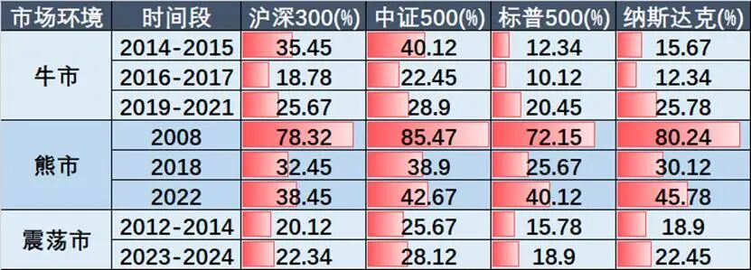
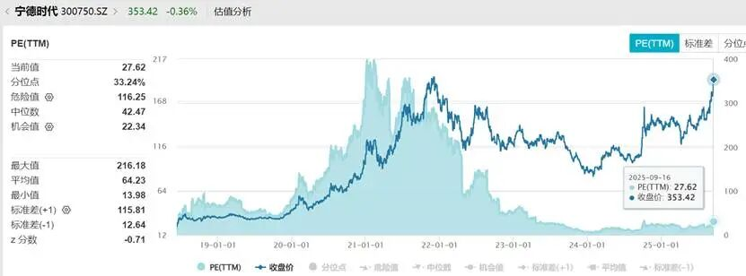
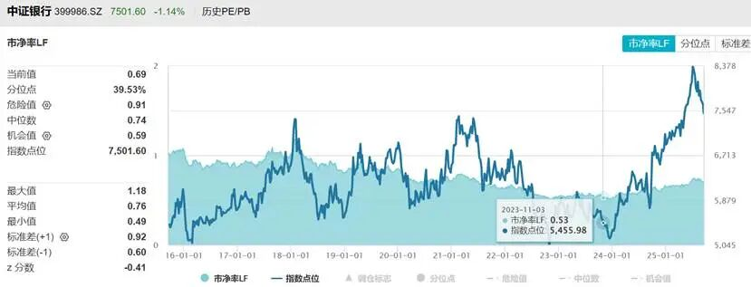
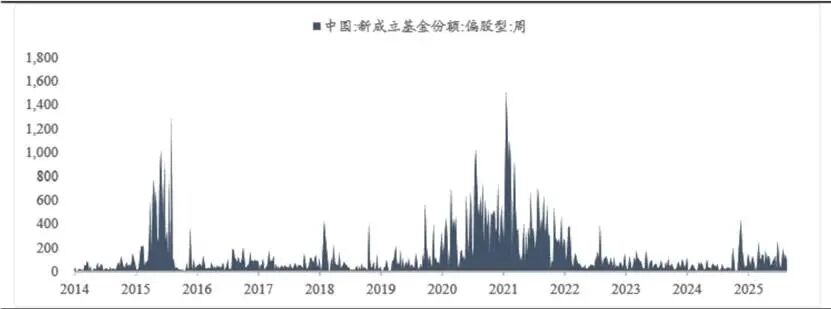
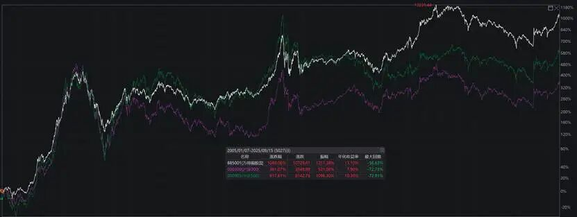
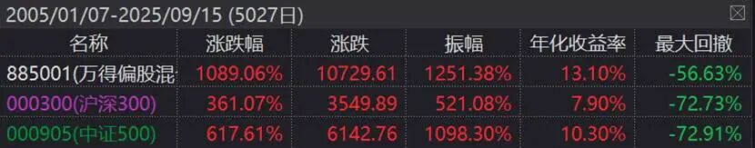

因为众所周知的原因，我们开辟了第二战场 《16号内参》，很多在公众号不方便写的业内八卦、独家观点、市场判断，我们会写在内参中，供大家参考。

具体的加入方式、更详细的介绍，以及福利，请点击文末链接。

去年底以来随着A股的快速修复，以及债券产品的收益大幅度下滑，A股的人气明显强了不少。

但和不少咨询我的客人，以及公众号的留言来看，大家对A股一关键特征，并不了解，以至于在投资上出现巨大的偏差。

**这就是波动率。**

**01**

我第一次关注到波动率，也是十几年前，一业内前辈聊天时，对方提了一嘴：

**A股波动率太大了，是美股的2-3倍，所以持有体验太差了。**

后续就研究了下，发现如果忽略波动率因素，的确无论是买股票、还是买基金，都会犯非常大的错误。

先说说波动率的概念。

**波动率是金融资产价格的波动程度，是对资产收益率不确定性的衡量，用于反映金融资产的风险水平。**

**波动率越高，金融资产价格的波动越剧烈，资产收益率的不确定性就越强；波动率越低，金融资产价格的波动越平缓，资产收益率的确定性就越强。**

如直接拿中美波动率来比较：

沪深 300 指数年化波动率长期维持在20%-25% 区间，创业板指常达 30% 以上。

美股标普500 指数年化波动率稳定在 15%-18%，纳斯达克指数约为20%。

如果再细分点，分成牛市、熊市、震荡市：

数据来源：wind

你会发现A股牛市的波动率，相对美股显著高很多。

熊市时候，中美波动率都飚起来，但A股还是高于美股。

震荡市整体而言，也高于美股。

**02**

也许上面的数据，让大家觉得有点专业，有点费解，我举些例子。

如07年那波牛市，老南才工作3年，万亿市值的中石油上市，发行价16.7，上市首日开盘飚到48.6元。

如21年，宁德时代，公司是好公司，估值能飙到200倍。当时我在直播时提了句这个股票未来股价腰斩一点都不奇怪，很多人还不服气，后来就腰斩了。

数据来源：wind

插一句，最近宁德股价又涨回当年高点了，但如今估值也就20多倍，这就是合理的。

**总结就是一句话，牛市来了，全员市梦率，涨的吓人，但就是还能涨，突破你的想象。**

而到了熊市，就是另一个极端，如银行。

23年最低的时候，中证银行的市净率，能跌到0.53，也就是净资产的一半，这也太夸张了。

数据来源：wind

那波银行下跌，搞死了不少人，我记得雪球有个大V的私募全仓搞银行，不断下跌不断补，最后融资补，然后搞爆仓了。

因此最近一年多银行的上涨，你会发现银行的业绩其实挺差的，本质涨的是估值修复的钱。

所以A股有个段子，股票跌到地板价，结果下面还有地下室，地下室下还有有地狱。地狱还有十八层。

**总结就是，A股到熊市，能全员破净，跌的都要破产一样，不断刷新你的认知。**

这就是波动率太大的可怕之处。

**03**

为何A股波动率会显著高于美股？

本身新兴市场和成熟市场，企业治理、业绩稳定性就有差异，但真正导致波动率如此大差异的原因，还是投资者结构的差异。

**美股还是机构投资者为主，对上市公司的定价非常精准，即使是T+0，ETF和量化，全面压低了市场波动率。**

**国内则恰恰相反，缺乏长期机构投资者，游资和散户（公募的持仓也是散户为主），过度的追涨杀跌，导致A股虽然中长期定价精准，但中短期情绪化非常极致。**

比如这个图，感受下，历史上2次最疯狂的基金销售高点，15年下半年、21年年初，大家回忆下，是不是都妥妥的牛市最高点附近。

数据来源：wind

**高波动下，牛市的时候全员市梦率，熊市的时候全员跌破净资产，导致长期持股难度极大，且一旦择时错误买在高点，解套是一件极其痛苦的事。**

**正常人，在这种高波动率下，股票看多了，精神都绷不住的。**

**但高波动率本身是双刃剑，即如果你交易能力或基本面定价能力强，在A股是能获得长期超额，跑赢指数；但如果反过来，纯韭菜的，就会在这个市场，亏得很惨。**

即如果你在美股，长期想跑赢指数是很难的，巴菲特这几年都没跑赢。

而在A股，我们看到股票型公募的均值、中位数长期显著跑赢指数。但基民收益又长期严重跑输基金净值收益。

数据来源：wind

这里举个例子，我前阵子在“16号内参”提醒过，桥水在美股发行了个全天候ETF，让大家千万别去买。因为桥水在美国这几年做的很差，很难做出超额收益，所以规模都快腰斩了。原因就是太卷了，做相同策略的太多了。

反而桥水在中国做的非常好，额度还要靠抢，策略实际还是美股总部在做。说白了，就是这类偏量化投资的产品，在A股相对美股太容易挣钱了。

所以老南前几年就写了《[投资百亿基金，就输在了起跑线上](投资百亿基金，就输在了起跑线上.md)》、《[聊聊ETF的缺点](聊聊ETF的缺点.md)》、《[长期持有，反而成了亏损之源？](https://mp.weixin.qq.com/s?__biz=MzAwNTc1NzQ5NA==&mid=2649733770&idx=1&sn=afed228d56d17b49a5ae2bfdf079a92c&scene=21#wechat_redirect)》、《[股票基金，为何要关注超额收益](https://mp.weixin.qq.com/s?__biz=MzAwNTc1NzQ5NA==&mid=2649733787&idx=1&sn=a6a11c5ac49dc1f8170271f19c974e2a&scene=21#wechat_redirect)》。

如果把这些文章真正看明白，相信这两年在A股是有明显超额收益的。

**此外，特别特别注意要避免的，是千万别在市场特别火的时候追高。**

如果不理解，问问20年底21年初，还有15年下半年，还有07年下半年，买基金的，之后的感受。

**结**

**如果在A股没有超额，这种高波动市场，真不建议参与，包括ETF。**

**巨大的波动下，正常人都拿不住的，而且最后的收益相对巨大的回撤，性价比实在太低了。**