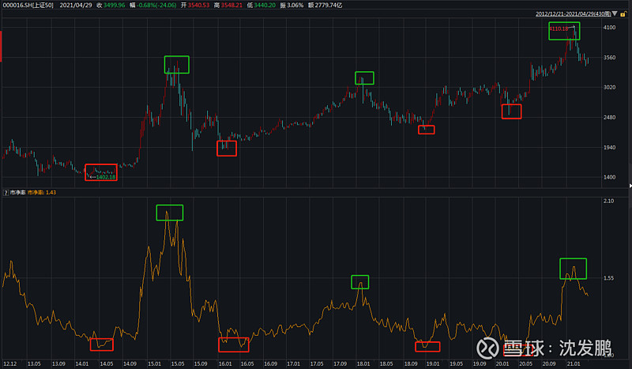
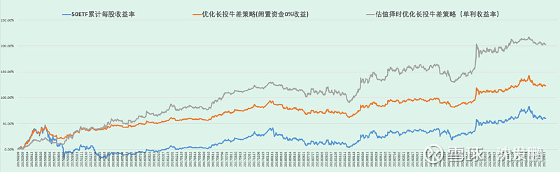
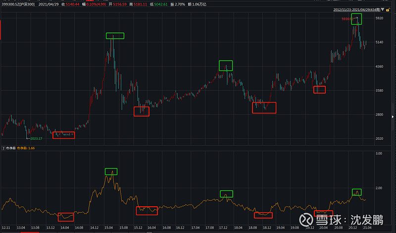

# M1与M2剪刀差

经过研究发现，M1与M2的剪刀差与大盘底部的形成具有很高的相关性。如图

当M1-M2不断减少到达一个阶段在极小值徘徊时，往往是大盘的底部。如2005年末，2009年初，2014年初，2018年末

当M1-M2出现拐点逐渐增大时，市场就会上涨，甚至带来大牛市。

当这个值到达很高时，市场就会盛极而衰，再次步入熊市。

在理论上，这不难解释。

简单说，可以把M1看作活期，M2看作定期。当M1增速的增幅（一阶导）大于M2增速的增幅时，代表着定期转活期加剧，可能出现“存款搬家”的现象，市场便进入活跃期甚至是大牛市。

而当M1增速的增幅（一阶导）小于M2增速的增幅时，代表着活期转定期，那么市场就可能盛极而衰。

而当M1与M2之差长期徘徊在低位，代表着投资意愿不强，在长期徘徊中形成了底部。

目前的状态，就是徘徊了半年以上。在经历了去年11月、12月（-8.1%）的低值后，目前M1-M2有一定抬升，为-5.9%，**因此，可以说2900点以下的底部区域是比较明确的。**

# PB值

为了更贴合实战，本文再进行一个升级，即根据历史上最近的几轮牛熊市转换下的指数估值进行一个长期指数多头仓位上的择时。如果下图是上证50指数2014年以来价格与PB走势对照图。

红框对应牛市起点，PB也在低点约1.1倍附近；绿框对应熊市起点，PB在2015中、2018初、2021初的高点分别约2.0倍、1.5倍、1.63倍。如果认可多轮牛熊转换下指数估值反复充分包含经济周期与人性规律，后续的指数当可以基于此做仓位上低估时超配、高估时低配的安排。

参照上述估值周期，50指数PB低点约束大致在1.1倍，彼时市场再担忧只要对国家有信心都应该大仓位上多，反过来越临近PB高点1.7倍（3个高点大致取均值），投资者则需要减仓指数多头仓位。

基于此我再度对优化长投牛差策略做样本内数据的升级，规则如下：

a.当指数PB低于1.2倍，策略采取2倍杠杆进行，即原本期权合约数量加倍；

b.当指数PB走高到1.35倍以上，策略恢复为1倍杠杆的原始头寸数量；

c.当指数PB走高到1.5倍以上，策略采取0.5倍杠杆进行，原本期权合约数量减半。

 在正式说分享规则前，先说两点。第一点是上边的回测是基于50ETF的，但考虑到沪深300指数可以稍广泛的代表中国经济核心企业，后边的分享基于510300ETF来做，核心头寸是510300ETF期权。对比50指数的历史PB估值，粗略定300指数的几个关键PB估值点位是：1.4倍、1.65倍、1.85倍。

第2点是随着新经济的发展，这类蓝筹指数会面临纳入高估值新公司、剔除低估值老公司的情况（下图是去年上证50的2次纳入和剔除成分股记录）。这会造成指数整体估值区间的抬升，即纳入高估股票且市场给予充分的稳定性认可后，估值的低点和高点都得上移。我们当知晓，未来某刻有可能需要调整

  
