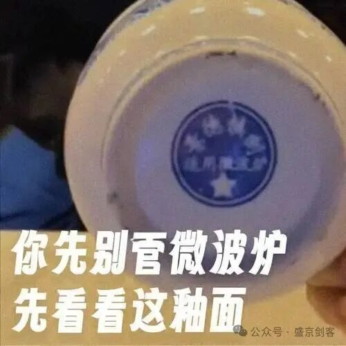
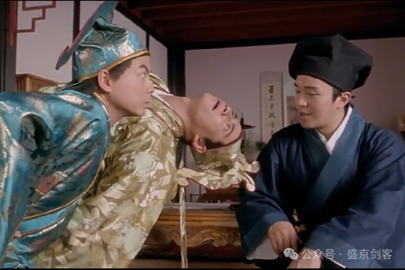

自从我披露多年前使用的狂赚系统以来（[首次披露2006~2007年我狂赚22倍的交易系统细节及心路历程](https://mp.weixin.qq.com/s?__biz=MzU1NjUwNjM4Ng==&mid=2247486562&idx=1&sn=8bdce61ea7ff853f98793728ab17489f&scene=21#wechat_redirect)），就不时的收到“鉴股CUP”的私信。大体上是想让我鉴定下某股是否为CUP形态，好坚定其买股的信心。

由于在股市这个名利场长期的浸淫和对人性的了解，更知道散户与“国宝帮”本是同根生的好兄弟，我便对这类“鉴股”提问始终保持沉默。否则必然收获散户之于国宝帮“微波炉专用”巨婴般的强词夺理了。

说来也是有趣，凡是发来“鉴股CUP”的私信的，至今就没有一个图是合格的CUP形态（只是看起来像CUP，就如适用微波炉的碗确实是瓷器，但不是古董）。

时常感叹天赋这种东西是先天的，教不会的。也常常感叹上天真是有好生之德，允许大量低能儿有吃有喝的活着。若人人似老剑这般精明，又不似老剑这般少私寡欲，还有这些低能儿的活路吗？

当然了，写这篇文章的目的也不是想一定教会识别CUP，教也教不会嘛。只是我单方面想把对于CUP的心得体会没有讲仔细的讲一讲，吸收多少则是你们自己的事情了。

今天从北京回来前，说是给我饯行。这帮逼弄了个大的红酒醒酒器，把几瓶茅台五粮液二锅头都倒里了，人均喝了一斤多。

写这狗屁文章，我开始时强压着不装逼，不装逼，不装逼，要儒雅、儒雅、儒雅，夜深了便也儒雅不起来了。要基巴现原形了，妈了个比的，不活了，艹了，只要高兴，不传之秘都基巴说了，能咋地啊？！

不废屁了，上干货。

1.只看周线，在周线中找

2.CUP形态可以分解成圆弧底+旗形整理两部分

3.不传之秘：旗形整理必须要第一个上升下飘旗形为标准。上升尖旗形不行，因为洗盘不够狠，不构成“杯柄”。很多私信要求鉴定的，都是犯这个毛病。

4.不传之秘：圆弧底越浅越好。虽说叫CUP杯子形态，但最好是像一个盘子。当年我狂赚22倍的广船国际，就是一个浅浅的盘子形。

不要找那种调整很深后涨起来的，调整幅度不要超过50%！

看看你们给我发的都是些什么？简直是水桶！暴跌70%80%之后涨起来的水桶形。还问我：“剑叔叔，你给看看是不是CUP呀？”让我说什么好呢？看你丫大爷的。所以说，天分这个东西......估计给狗两个大饼子，狗都能学会，但低能儿很难......

5.不传之秘：要找“天池”不要找“天坑”。

艹了。这是打死都不能说的秘密嘞。仅仅知道了这一点，有些人会赚很多很多钱，很多很多，很多......

你们他妈的感谢茅台吧，感谢五粮液吧，感谢红星他八辈祖宗吧......

什么是天池呢？就是涨了或反弹了一段之后形成的CUP，即天池。

就是图中这种喽

你们看看黄金是不是一路天池、天池、天池的涨上去的？！（当然不是每次调整都是标准的CUP，但都是盘子型天池嘞！）知道这一点，真的可以赚很多很多马内，马年就要赚马内！（当然，没有让你们追黄金的意思，低能儿们别理解错了）

而天坑就是没有经过上涨和反弹形成的CUP，仍趴在底部的假CUP。

这种形态失败率很高，常用来忽悠散户抄底。嘿嘿。我收到的很多鉴定私信都是这种天坑CUP，你不亏钱谁亏钱？！

你不亏钱还有天理吗？

艹嘞！