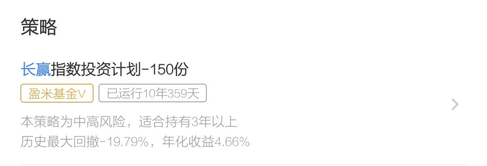
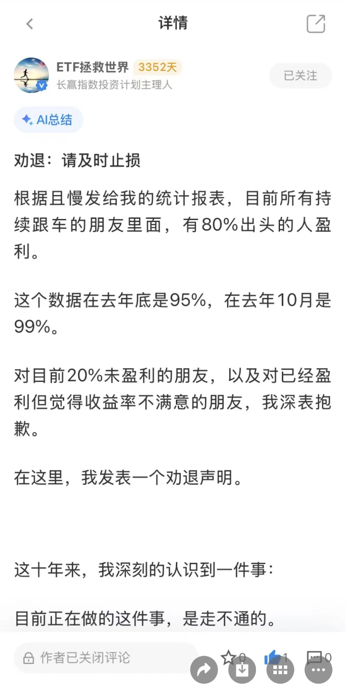
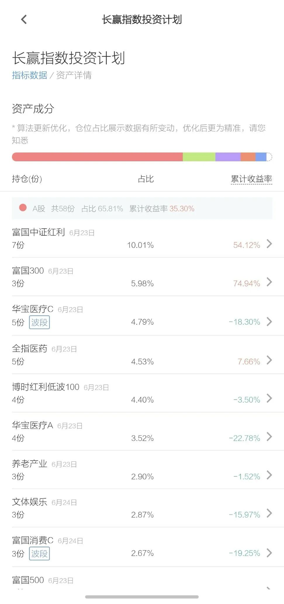
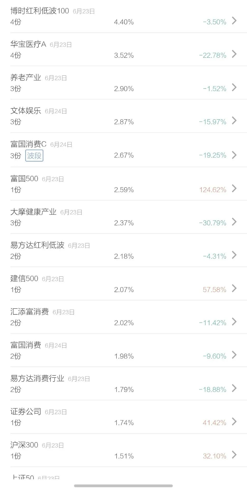
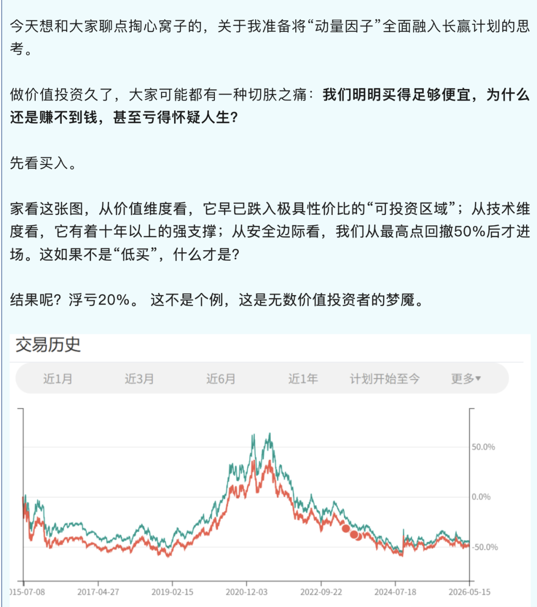
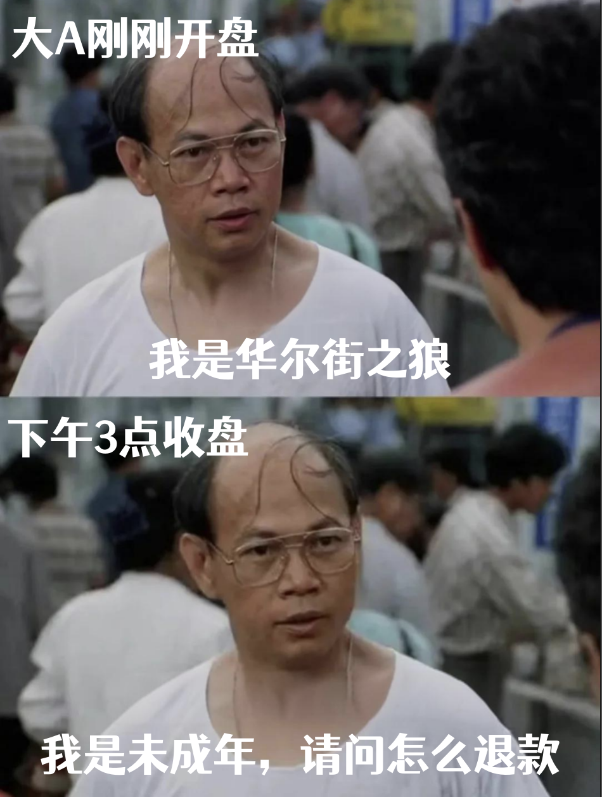

大家好，我是NP教授。

熟悉我的朋友都知道，我很少写其他财经博主的故事，主要是怕得罪别人。

前些年因为长期追踪P2P，我得罪了不少人。

不过之前得罪过的，多数是搞非法集资的，得罪也就得罪了。

有些后来进去了，有些至今还在外面蹦哒着。

直到今天，我还有点心理阴影。

所以这些年，我很少再去评价具体的人。

但关于E大劝退声明的事情，我还是想聊几句。

不是为了评价他，而是因为他的经历，某种程度上也是过去20年A股价值投资发展的缩影之一。

E大是我的前辈，无论是过去还是现在，我始终很尊重他。

（一）

E大劝退

E大，全名叫“ETF拯救世界”。

算是博客时代的第一批财经博主，当年的博客，差不多就相当于今天的公众号。

很多后来耳熟能详的投资大V，都是从博客时代走出来的，E大也是。

他是从2003年开始在网上分享自己的投资记录，经历博客、微博、雪球，再到公众号和且慢。

放在财经自媒体圈里，绝对算得上老前辈。

早些年，他靠着“12年10倍”的经历圈粉无数 ，跟银行螺丝钉的“10年10倍”基本如出一辙。

就是这些口号，给他们的实盘带来了极大的关注度，后来也带来了极大的争议。

早年间，E大的实盘更多是公开记录。

后来随着移动互联网发展，跟投工具越来越成熟。越来越多人开始直接照着买，慢慢变成了组合跟投，再到基金投顾产品——长赢投资计划。

随着「长赢投资计划」组合运行超过10年，真实业绩开始慢慢出来了。

截止目前，E大的长赢指数投资运行10年多，年化收益大约4.66%左右，最大回撤19.79%。

这跟大家希望的理想结果，显然差距很大。

这里再说明一下，因为E大的体系里，一直保留着较高比例现金。

如果把现金部分剔除，那么实际收益率会更高一些，大约在6%左右，其实并不算差。

但距离理想目标还是差得有点远。

如果只是一个免费的公开组合，大家可能还会宽容一些。

毕竟投资有赚有赔，没人能保证永远正确。

但后来开始收取投顾费用，每年0.5%，收费之后，预期自然也变了。

如果业绩跑不赢主流指数，投资者的耐心就会下降，开始骂人。

因为长投重仓红利、医疗等等板块，今年以来的收益不佳，有些人也在持续亏损的状态。

于是到了6月初，E大发了一篇劝退声明，关闭评论区。

他说组合盈利用户占比，从最高时候接近99%，下降到了80%出头。

然后劝一些实在无法接受策略的人离开，去寻找更适合自己的投资方式。

在小某书上面，甚至有人造谣说E大玉玉了。。

看到这里，其实我有点唏嘘不已。

（二）

其实是市场变了...

其实E大的投资体系，简单来说就是——

不预测市场，只比较谁更便宜，低估就买，越跌越买，高估就卖，永远留现金，永远不梭哈。

然后再配合一套固定规则：跌一档，买一格。涨一档，卖一格。

本质上，就是估值体系下的网格交易，属于左侧投资。

赚的是估值回归+市场波动的钱。

说实话，长期来看，这其实是一套绝对正确的交易策略，赚钱的概率很大。

问题是，市场变了。

这套策略如果放在2019年之前，还是非常奏效的。

事实上，E大也是严格按照自己的思路和投资体系来执行，没有太大的风格漂移。

但问题是——

最近这两轮牛市，跟之前不太一样。

最大的不同就是——

A股牛市越来越像「结构性牛市」。

以前的牛市，往往是“全面牛”，在一轮牛市里面，各个行业不断轮动上涨。

但现在逐渐变成结构性牛市，只有部分行业持续上涨，部分行业长期横盘甚至下跌。

根本原因，我认为就是上市公司越来越多，资金量和退市速度却没有同步跟上，导致很多辣鸡公司也占据较多的成交量。

结果就是——

在结构性牛市的行情里面，强者恒强，而弱者还出现了结构性熊市。

因为强势板块把弱势板块的资金吸走了。

最赚钱的资产，越来越强；最便宜的资产，可能还会更便宜。

于是价值投资者经常陷入一个困境：

强的买得不够多，弱的越买越多，亏得越来越多。

最后变成了「汰强留弱」的状态。

有长赢的跟投用户评价得很直接：

强势资产买得少，还提前卖掉；

亏损资产必须等回本才卖。

投资有时候不能太有洁癖。

这句话未必完全正确。

但确实说出了很多跟投者的真实感受。

按照E大的策略，他这两年就在买入医疗、消费、红利。

说实话，我认为现在买入这些指数基金，长期来看，大概率赚钱，是没问题的。

最大问题是时间，是机会成本。

我也是价值投资者，也习惯左侧投资，也有公开实盘组合，所以非常理解E大的困境。

我一直有关注E大的【长赢指数计划】，这么多年以来E大的每笔买入和卖出都记录在且慢上面，以及主理人的持仓盈亏情况。

可以看到，其实长赢的宽基指数基金都是盈利的，但持仓里的很多行业指数基金都处于亏损的状态。

这跟我以前实盘遇到过的问题，几乎一模一样——

宽基赚钱，但行业指数基金却在亏钱，而且还亏得特别久。

后来我复盘很多次。

我想明白了，在结构性牛市的行情之下——

宽基的牛熊周期与很多行业指数基金的牛熊周期并不完全同步了。

因为没有全面牛，在结构性牛市里面，甚至部分行业指数还出现结构性熊市。

很多宽基还可以跟上这种结构性牛市，但有些行业指数就跟不上，反而越跌越多。

如果按照价值投资的理念，确实要考虑买入那些越跌越多的行业指数基金。

结果就是——

结构性牛市来了，组合里面的宽基指数涨幅还不错，但行业指数却在持续亏损。

理论上，那些在低估阶段买入的行业指数基金，只要基本面没有根本性逆转，最终大概率还是赚钱的。

但面临的问题就是：结构性牛市里，那些低估的行业指数基金会拖累组的合整体收益，而且还是长期拖累。

因为行业指数的牛熊周期，会比宽基的牛熊周期更漫长。

不仅熊市更长，而且熊市的跌幅更大。

宽基指数跌入低估之后，再跌个20%-25%，就算调整得比较充分。

但行业指数的波动会更大，跌入低估区间之后，再跌个40%、50%，都非常常见。

问题是，普通投资者未必能接受。

不要把普通投资者的风险承受能力想得太高，其实多数人都是扛不住的。

很多人嘴上说自己能长期投资。

真正回撤10%时开始焦虑；回撤20%时开始怀疑人生；回撤30%时基本已经睡不着觉。

当时我的实盘组合也是踩了这个坑。

实盘组合里面的宽基，熊市买入，牛市来了，收益都不错。

唯独是中概互联、券商保险等等行业指数基金，牛市来了，不仅没涨还在加速下跌，把组合的收益都拖累了。

当我意识到这个问题之后，后续的组合，再也没买过行业指数基金。

因为我发现不是策略错了，而是参与的人，撑不到策略兑现那一天，体验也不好。

所以在这轮牛市周期，我的组合收益还不错，关键是跟投者的体验也不错。

所以我觉得E大这几年遇到的问题，跟我几年前是差不多的——

1、结构性牛市里面，单只行业指数的牛熊周期与大盘牛熊周期可能是错配的，一旦选错行业简直是地狱般的体感。

2、大多数普通投资者，其实是扛不住行业指数的波动风险。

所以这种低估买入的策略，如果只买宽基，对普通客户来说，体验会更好一些，更容易接受。

我后面也反思了一下。

对于普通投资者来说，宽基指数可能更适合左侧投资。

行业指数基金或许更适合右侧投资，在趋势确认之后再参与。

毕竟行业指数的调整周期和幅度太大，需要的资金、耐心和承受力，都远高于多数人的想象。

这不是对错的问题，这是适不适合的问题。

E大可能也意识到这个问题，所以在最新的内部信，也宣布要开始加入“动量因子”，说白了就是右侧投资。

虽然已经官宣，但还没实质性行动。

但我认为E大后续应该会把动量因子优先纳入那些行业指数基金，这是我的观点。

（三）

新股民没有真正感受过疯牛..

最后聊聊那个很多人争论的话题。

E大或者银行螺丝钉说的10年或12年10倍，到底是不是真的？

我个人坚定认为都是他们真实的经历，但其实也有时代红利。

现在很多新股民或者新基民，都没有真正感受过A股疯牛是怎么样。

我这么说吧，无论21年牛市或目前牛市，比起08年和15年那种疯牛，其实都差得远。

我曾经用中证全指做过回测。

假设你在2005年4月份全仓入市，

哪怕用最简单买卖策略：跌破60日均线卖出，涨破60日均线买入。

从2005年4月到2015年4月，累计涨幅是10倍；到2015年6月，累计涨幅是14倍。

从2005年到2015年经历了A股历史的两轮超级疯牛，还是全面牛市。

只要你有点策略躲开大跌，轻松翻几倍。

连我自己都没有完整经历过08年牛市是怎么样的，但2015年牛市我是完整经历过的。

那种疯狂程度，现在的A股牛市根本就没法比，体感上就跟今年的韩国股市差不多吧。

反正我个人是相信E大和螺丝钉的10倍故事，只是很多人忽略了一件事——

他们不仅抓住了方法，也抓住了时代红利。

E大从2003年开始分享自己的投资记录，一直到2015年底成为顶流，刚好就是12年。

这12年恰巧就是经历了A股的两轮全面牛。

所以我现在也想清楚，只有时代的投资者，没有投资者的时代。

后来我越来越认同这个观点——

投资里最重要的，可能不是找到一个永远正确的方法。

而是知道：

什么方法适合什么时代。

什么方法已经开始失效。

以及什么时候应该调整。

时代给过很多人红利——

楼市如此、互联网如此、A股也如此，但红利最大的特点，就是事后才看得特别清楚。

身在其中，往往很难识别，而且坑特别多。

所以在寻找下一次10倍机会前，给自己多留一点安全垫，不要ALL IN。

这样即便判断错了，也还有机会等到下一轮红利。

今晚的分享就酱。

*长久陪伴，偶尔启发，请关注↓*

NP教授，热爱低风险理财和养基的老师傅。

说过最毒的真话，得罪过很多人，只为救更多人。

如今年华渐老，采菊东篱下。只写我感兴趣的，只说你看得懂的。

长久陪伴，偶尔启发，慢慢变富也挺好。

[绕头，不得不冒点风险...](https://mp.weixin.qq.com/s?__biz=MzU0OTE4MTU4Mg==&mid=2247514934&idx=1&sn=1f66d174bd118c271b528d232bc461b3&scene=21#wechat_redirect)

[朋友接到税局电话了..](https://mp.weixin.qq.com/s?__biz=MzU0OTE4MTU4Mg==&mid=2247515009&idx=1&sn=a5a606fa384d0afb9c2ea175b69b83a0&scene=21#wechat_redirect)

[反转了吗？有一点点迹象...](https://mp.weixin.qq.com/s?__biz=MzU0OTE4MTU4Mg==&mid=2247515067&idx=1&sn=b6dc5e43052d8710eea924c2ea9ec2e6&scene=21#wechat_redirect)

[吓崩了...](https://mp.weixin.qq.com/s?__biz=MzU0OTE4MTU4Mg==&mid=2247515148&idx=1&sn=859d18e823935c7ce6630b98b645a013&scene=21#wechat_redirect)

觉得有帮助的

请在右下方点赞，表示鼓励

