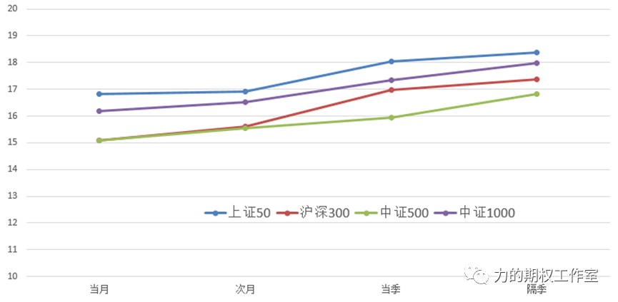
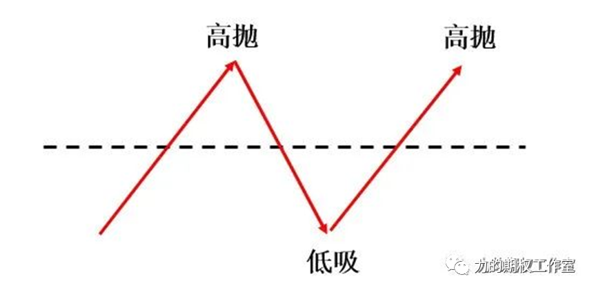

**2月份快过去一半了！中证1000/中证500两大指数已经上涨3.63%和1.51%，远远超过了沪深300/上证50的-0.32%和-1.43%，小盘与成长总体强势于大盘与价值，2月的日历效应也在兑现的途中。从历史上看，2月的第二和第三周是中小盘兑现日历效应的关键周……**

最近的一周，北向这股势力的减弱也是大盘价值风出现下跌的一大因素，尽管“北水”已经连续14周保持净流入，上周也净流入了29.32亿，但上周五天里四天净流出，净流入的密度和强度已经明显下降，而与之形成鲜明对比的是，两融杠杆资金净流入幅度还在继续加大，题材股仍然保持着活跃度，上周两市融资余额继续上升近150亿，“融资买入额/两市成交额”这个指标在7.5%-8%之间震荡，周均融资买入热度已创出7月中旬以来的新高，融资净买入额主要集中在制造业、信息传输、软件的行业，这个现象表明内资的风险偏好回升到了一定的程度，这对具有弹性的成长板块更有利。

**那么站在当下，各大指数期权的“波”发生什么变化了吗？**

一起来“描点连线”跟踪一下。截至今天的收盘，上证50四个月份的平值隐波分别为16.83、16.91、18.04、18.39，沪深300四个月份的平值隐波分别为15.09、15.61、16.96、17.38，中证500四个月份的平值隐波分别为15.10、15.55、15.93、16.81，而中证1000前四个月份的平值隐波分别为16.18、16.52、17.33和17.99（注：由于中证1000期权本周五到期，以3月替代当月）。

**图：当日收盘，上证50、沪深300、中证500、中证1000各月份期权隐波图**

**数据来源：Wind，力的期权工作室整理**

对比上周《[不知不觉，中证1000的“波”快追上上证50了！……](http://mp.weixin.qq.com/s?__biz=MzAwOTk3MDczNg==&mid=2247497202&idx=1&sn=d699327a1b029dfb7b0d1e25a4eaecec&chksm=9b55c0adac2249bbb82e3fb3f168d0ef53ce0ac14f812258e4877e7a96b686efc46418bc62c7&scene=21#wechat_redirect)》文中的那张图，我们至少可以产生这样的三个推断：

第一，若去观察四大期权的近端隐波，中证1000平值隐波已经与沪深300拉开了差距，甚至曾在上周一度超过了上证50，结合当前中证1000技术面处于多头排列的形态，它的相对加速度比中证500和沪深300更高；

第二，若去观察四大期权的远端隐波，当前为50>1000>300>500，这反映的是期权市场所定价的未来“爆发点”仍然不在集聚大量资源股的中证500，当前仍然更愿意把远端趋势定价在强宏观和非新能源的赛道股身上；

第三，各大指数期权的近端隐波都较上周一出现了明显下降，沪深300平值隐波甚至已经降到了15左右，**从历史上看，当沪深300平值隐波降到14-15这个区间后，后续发生变盘的概率往往会明显增大，所以如果近段时间里沪深300期权继续降波，则可以关注持续盘整后的突然变盘……**

不知不觉！近端期权的“波”又到了15左右。我们过去说过，“隐波”之于期权，正如“PE”之于股票，低波的格局有利于提高买的性价比，高波的格局有利于提高卖的性价比。在这种“低波”的行情里，想必大家很容易联想到期权策略库里一种组合——“双买”组合，也就是既买一些认购、又买一些认沽，指望标的能够大幅波动或是隐波能够快速上升来获得盈利。

那么，我问一个问题，在平时双买的过程中，你会觉得是开仓难，还是平仓难？我想大家存在更多的问题一定是它的平仓离场！过去有不少读者曾经问道：“双买组合构建完以后，我总是走不好，到底应该一起平仓，还是断腿平仓（先平掉一腿，再视情况平掉另一腿）呢？”

**这个问题非常实际！答案取决于什么？**取决于我们处在趋势里，还是箱体里。对于一波趋势持续行情（类似于2018.1的19连阳、2020.3的一波空头排列、2020.7的一波多头排列），这种环境往往是一起平仓更好！但是对于像最近几个月“来回打脸、反复折腾”的行情，分腿平仓的效果就会显得更好一些！所以这个问题的答案取决于行情演绎的过程。

然而有的时候，我们并不需要得出一个“孰优孰劣”、“非黑即白”的结论，而是可以去寻找一种介于两者之间的“柔和”模式，在市场的左右摇摆中一步一步地平完所有的双买头寸，**这种一步一步的调仓方式就是曾经提到过的“刮头皮”策略，又会被冠以了一个听上去高大上的名词，叫做“Gamma Scalping”。**

什么是Scalping？Scalping这个词在英文里的意思是“倒买倒卖”，这个动作并不陌生，我们都曾经在做股票、或者期货交易里进行过“低买高卖”，比如，我买了10w市值的一只股票，如果当天收盘前这只股票上涨了，导致它的市值超过了10w，那么我就卖出一些股票，让市值重新下降到10w，反过来，如果当天收盘前这只股票下跌了，导致它的市值不到了10w，那么我就补买一些股票，让市值重新回到10w的水平。这不就是一种“倒买倒卖”吗？永远再做低买高卖，只不多这种“倒买倒卖”是一种delta维度的scalping，可以称它为“delta scalping”。

**图：delta scalping示意图**

那么“Gamma Scalping”呢？赚Gamma的钱是指赚标的“位移”变大的钱，所以它就是在“位移”这个维度上做一些“低买高卖”的操作。比如，买入认购+买入认沽，哪一腿先出现盈利，我就先减仓兑现某一腿的期权，假如指数先出现了明显的跌幅，认沽期权率先浮盈了，那么就先减仓一部分认沽，如果后续市场又涨回去了，再考虑择机减仓一些认购。

在“刮头皮”策略的具体操作中，专业机构通常会基于每天delta中性来分批操作，这样的好处是“鱼鳞”刮的很精细，但对于个人而言，理解上可能会稍微有些困难。于是，当个人实施“刮头皮”策略的时候，我们还可以参考股票里的“低买高卖”，基于期权市值的变化来分批离场买购或买沽：

- **首先，控制好双买的总成本，买购+买沽，让两者的持仓市值相差不多。**比如，假设你在盘面上找到一份认购和认沽都是200元左右，那么在相同张数下，两者的持仓市值相差不多。

- **然后，就要视情况调整买购与买沽的市值。**这一步的操作就是把“刮头皮”的灵活性淋漓尽致地体现出来了，我们可以中午收盘前看一次盘，或者收盘前半小时看一次盘，假设我各买了100张认购和认沽，买购和买沽的成本价分别为200元，那就表示我在买购和买沽上的持仓市值各为2w元。

- 接下来，我们假设某一天认购的价格翻倍涨到了400元，同时认沽的价格跌到了100元，这个时候，认购的持仓市值就涨到了4w，而认沽的持仓市值跌到了1w，为了拉平市值，我就需要平仓75%仓位的认购，也就是兑现75张，先落地了1.5w的利润，于是手里的持仓就暂时变成“25张买购+100张买沽”了。

那么，当持仓变成了“25张认购+100张认沽”以后，下一步你可能会怎么做呢？在假设隐波并未大幅下降的前提下，如果标的指数进一步往上上攻，那么剩下的25张认购就还会继续浮盈，这个时候，我们可以取个合适的时机，比如整体浮盈已经达到心里预期时，平仓剩余的认购与认沽；反过来，如果标的指数掉头往下，比如上周五的情形，我们就可以考虑平仓一部分认沽，再次把认购与认沽的市值调平——这就是一种简化版的“刮头皮”。

**每个策略都有相对偏好的环境，每个策略都有需要记录的细节。在“低波+箱体”的格局里，这种“刮头皮”的方法确实也是期权人需要了解的一种技能……**

---

**【最近文章与资料回顾】**

- [不知不觉，中证1000的“波”快追上上证50了！……](http://mp.weixin.qq.com/s?__biz=MzAwOTk3MDczNg==&mid=2247497202&idx=1&sn=d699327a1b029dfb7b0d1e25a4eaecec&chksm=9b55c0adac2249bbb82e3fb3f168d0ef53ce0ac14f812258e4877e7a96b686efc46418bc62c7&scene=21#wechat_redirect)

- [八年了！50ETF期权！为什么期权客户需要持续式的服务？……](http://mp.weixin.qq.com/s?__biz=MzAwOTk3MDczNg==&mid=2247497212&idx=1&sn=514076e542cb9d5219d173aa84d09073&chksm=9b55c0a3ac2249b5d27593e5bb3338244f08729ee40af28ec8b8121f56722d42071b4db584d3&scene=21#wechat_redirect)

- [节后第一周！全面注册制，美联储加息，中证1000加速【本周一财视频与解读】](http://mp.weixin.qq.com/s?__biz=MzAwOTk3MDczNg==&mid=2247497184&idx=1&sn=ede85afac50d15f2edfa0a470d9d3b86&chksm=9b55c0bfac2249a99d69f09f969a996534797bafab8a1e1d737b5ce6f19c54a8ca527daa41fd&scene=21#wechat_redirect)

- [每年的二月份！你懂我要说什么？……](http://mp.weixin.qq.com/s?__biz=MzAwOTk3MDczNg==&mid=2247497167&idx=1&sn=0568f6a03a1815c873d04ca485e06b1a&chksm=9b55c090ac22498663527db3222b823f702bbf77119007776f3c0272b05f27504e30a80ac1ce&scene=21#wechat_redirect)

- [节后“超级到期日”，是会翻倍，还是归零？……](http://mp.weixin.qq.com/s?__biz=MzAwOTk3MDczNg==&mid=2247497165&idx=1&sn=ca119472a4c3a5d3d63e287fbe4be433&chksm=9b55c092ac224984fa73156356e30eda29b6f5578380991afa8a6737cbfab7c5e41453328fee&scene=21#wechat_redirect)

****

****

**（版权声明：原创作品，抄袭侵权必究，如需转载内容，请与作者联系。）**

**（免责声明：本公众号的一切内容仅代表个人观点，不代表任何机构或组织观点，亦不构成对投资者的任何投资建议。）**

**原创是一种心血，**

**欢迎三连（点赞、在看、分享），**

**给更多的朋友，感谢感谢！**
