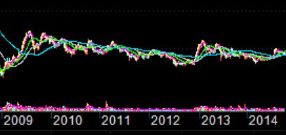
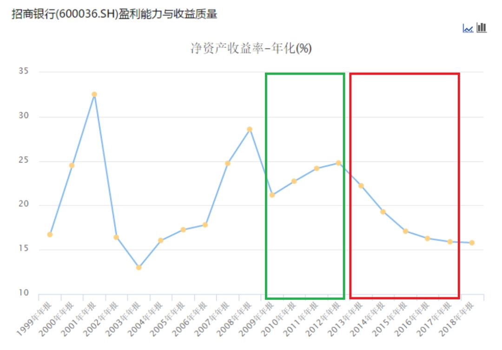
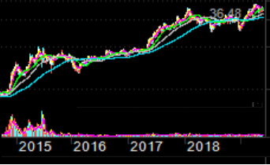
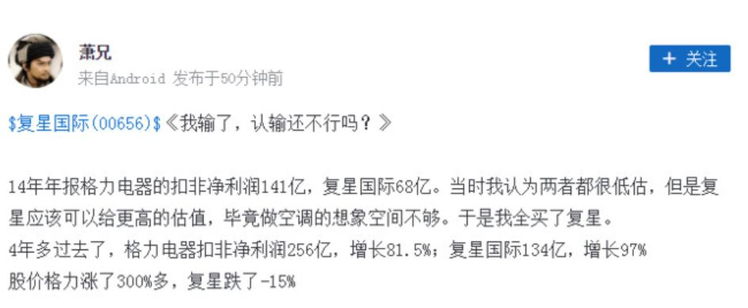

端午假期结束了，今天聊个有意思的话题。缘起前几天，我们一篇文章后面的网友留言：

很有意思的问题，也和这几年火热的“价值投资”理念，很是契合。今天聊聊。

今天 老南想说

照例开头说故事。我们A股，有个股票，叫招商银行，相信很多人都不陌生。  

招行在2009年到2014年年中，净利润从2009年的178亿，提升到2013年的513亿，复合增速30%。ROE（净资产回报率）稳定在20%以上。

**业绩牛的一塌糊涂。这段时间，股价如何呢。**

**一直在8到10元之间晃悠，就是不涨，整整5年。**

之后，2014年到2018年，这5年，招行的净利润复合增速，从30%跌到9.7%，平均ROE从23%下降到17%。

股价呢？

从10元最高到36.48。

**嗯，如果你是个坚定的价值投资者，且判断对了招行09年到13年，牛逼的业绩增长，结果，一毛钱没赚到。**

**然后在14年，判断对了招行业绩，未来5年增速下滑，卖出股票。结果，反而错过了5年近4倍的涨幅。**

**人生最大的痛苦莫过于此。10年啊，人生有几个10年？**

这几年，国人有钱了，不满足出国游山玩水了，每年巴菲特的股东大会，中国人的面孔越来越多。

如同“价值投资”朝拜大会一样，人人都都要去瞻仰下。连非法集资，躲在国外不敢回来的，都用割韭菜的3000多万，找巴菲特吃饭。

可又有几个人，能搞懂“价值投资”？

**绝大多数人心中的“价值投资”，基本就是“长期投资”；不是Buy and hold，而是Buy and hope。看似门槛很低，实际上，绝大多数股民，压根不具备“价值投资”的门槛能力。**

再看一个活生生的案例，在雪球上看到：

**所以，“价值投资”的门槛不适合绝大多数人，对财务分析能力，公司行业分析能力等，要求极高。**

很多人连公司季报、年报都没看过，就自称“价值投资”，基本就是找灭。

**其次，价值投资赚的不是交易的钱，也不是成长的钱，而是市场偏见，带来的预期差的钱。**

这就意味着，预期差的修复，不是几天，不是几个月，可能是几年。如上面说的招行，用5年犯错，再用5年纠错。有几个人，能挺得住10年？

尤其这几年，不少“股市大师”，动不动就价值投资

今天 老南想说

**今天聊这些，并非说“价值投资”是错误的，而是告诉你，真没你想象的那么简单，那么容易。**

**当你决定“价值投资”前，务必先掂量掂量自己，否则，输钱又输时间，是大概率时间。**