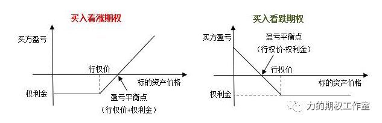
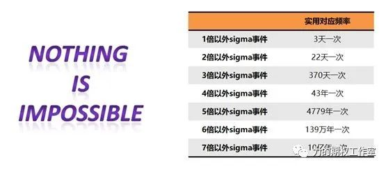

     **时间过的真快，一年的时光很快又要过去了！**今年年初，或许很少人会想到上证综指又会面临“2900点”的保卫战，也没有多少人想到大小盘会有如此极致的分化，没有人会事先想到硅谷银行这么快就被迫倒闭了，也没有人会猜到最后搞了半天，北交所的股票会创出年内最强的一波涨幅……

       **投资就是这样，左手预测，右手对策，预测与对策同在。**错误的预测+正确的对策，有时也能够减小损失，长存于市场，于是作为期权交易者，我们同样可以想一想这一年的“得”与“失”，你有没有在1月的时候顶着趋势卖购？你有没有在8月中旬破位后一路补仓？你有没有仍然在偏执地每月卖沽？你有没有毫无体系地买购，最终导致一次又一次的归零？

       **时值年末收官，为了让我们牢记交易原则，形成更好的“条件反射”，也为了让新手朋友们能在明年的操作中尽可能少犯错，在今年的最后一篇文章里，我就从过去的一些素材里，帮大家梳理一下期权新手最容易犯下的七大“错误”，但愿您能从中有所收获。**

**【误解了“损失有限，收益无限”】**

        这是初学者最容易犯下的错误。每一本期权教科书都会画出下方的这张盈亏图。这张盈亏图在实战中有多大的作用，我们姑且不谈，它会给您一种错觉，那就是期权的买方操作是一种损失有限，潜在收益无限的盈亏结构。

        不知您第一次看到书上这么写，您会产生什么样的感受。反正，当我在大学期间第一次看到“损失有限，收益无限”这八个字时，我第一反应是“这怎么可能呢？”怎么会有一种工具的买卖双方这么不公平却能够成交！后来，在一个月的实盘交易中，我明白了期权买卖双方真正的关系，那就是买方虽然损失有限、收益无限，但应该再加四个字“常常归零”，至少胜率很低，买方与卖方所交换的东西是盈亏的不对称性和胜率的不对称性，你要在盈亏上占到便宜，那么你就会在胜率上吃到亏。因此，初学者不能因为买方损失有限这句话，而拼命重仓最后归零。

        今年的买购，如果不是“扶墙走”，如果没有止盈止损体系，而是“无脑”操作，可能面临持续6个月以上的归零……

**【买入过于深度虚值的期权】**

        许多初学者喜欢买入深度虚值期权，也就是那些很便宜的期权。有个客户曾经和我说道“怎么今天标的涨了，我买的认购期权从来不涨”，后来一看他买的是什么期权？原来就是最虚值的那个认购期权。有一句俗语特别适合期权，那就是“便宜没好货，好货不便宜”，特别便宜的期权，往往delta和gamma非常小，当标的价格变动时，这些期权往往像老爷车一样涨不动，需要标的出现非常明显的持续涨幅后，价格才会明显变动。这样的期权胜率极低，常常归零，交易成本占权利金的比例高，扔进水里的概率大。尽管在历史上，你看到几百倍的涨幅浮于屏幕，但这就像巴西0:5落后德国一样，一生有几次能变成6:5！

**【害怕时间流失而赶快重仓】**

        另外有一类投资者，学完期权后，了解到了期权卖方的好处，做期权卖方胜率高，时间是你的朋友，能赚取时间价值，耗出theta的收益。于是，他们便分秒必争，生怕晚了一天时间价值就损耗完了，故而很早就卖出开仓，早早地在许多合约上重仓操作了。事实上，特别希望纠正的是“时间价值”这个概念，其实在国外有很多书把它称为外在价值，时间价值里不仅仅包含的是时间，还有波动率对期权价格的影响，通常而言，如果距离到期一个月卖出近月期权，前半段时间主要受到隐波的影响，后半段时间才逐步受到时间的影响，如果早早地重仓卖出期权，那么隐波一旦中途上升，一切就会陷入被动的困境。 
    

**【以为到期安全而孤注一掷】**

        卖期权就像开保险公司，这句话没有错，但只要是卖保险，就依然存在着风险。因此，我们并不能因为觉得卖出的期权处于深度虚值，就可以孤注一掷，满仓投入。2018年11月，J.Cordier的天然气期权爆仓事件还历历在目，在这个市场上，短到半年，长到10年，没有什么不可能，nothing is impossible！黑天鹅总会发生，尾部5倍以上sigma事件也不算奇怪！就算当时看卖出的期权有多安全，也最好不要孤注一掷，因为命运往往会在你满仓时与你开个玩笑。

        今年1月的卖购，不就是这样吗？如果你认为北向怎么可能一个月会净流入1000亿以上，然后重仓卖购，那会是什么结局？同样地，对于今年10月的卖沽，如果你认为这一次一定能够不会击穿3000点，然后重仓卖沽，那中途的持仓体验会是怎样的一种痛苦？……

**【喜欢像买股票一样追涨买期权】**

        有许多初学者在做期权时不自觉地会带入股票的思维，股票里有一种常用交易模式，说得好听叫做趋势追踪，说得投机点叫做追涨杀跌。实际上，由于期权是一种路径依赖的工具，不是位移依赖的工具。大盘同样从A涨到B，一下子一根大阳线和涨一涨，停一停的盈亏是完全不同的。

        当标的出现大阳线时，往往是市场情绪比较亢奋的时候，波动率会在短时间内快速上升，如果在日线的级别上趋势还没有确立之时像追涨股票那样追涨买入认购期权，那么一旦标的拉出了上影线或是一日游后，您的认购持仓就很有可能面临标的、波动率和时间的三杀了。在买期权前，一定要在日线趋势确立下才能考虑追涨，在左侧的盲目追涨将是危险的操作。

**【喜欢像买股票一样金字塔补仓】**

        熟悉指数定投的投资者，一定会知道金字塔补仓这个操作。所谓金字塔补仓就是一种摊薄成本的加仓操作，如果我真的长期看好一个指数，每跌一个台阶我就买入一点指数etf，只要每次仓位小，这样的做法是可以理解的，因为你这么做的信仰是基于指数总归会起来，然而，对于某些期权合约，情况就不是这样了，尤其是对于近月虚值期权，当标的下跌一个台阶时，原来的虚值期权就变的更虚值了，如果你还是在原来合约上补仓，那么就意味着你在一个delta很小的合约上仓位越来越重，最后可能归零的本金越来越大。 

**【过度沉迷于各种组合，忽视标的本质】**

        确实！期权被誉为衍生品皇冠上的明珠，它的一个让人着迷之处在于它的组合性。有许多书把几百个期权组合一个个列举出来，让你感到期权组合就像变魔术一样强大，但这样去学习了解期权往往会让自己慢慢地沉迷于各种组合的盈亏结构，而忽视对标的的判断。除了套利以外，可以说期权能做的长期稳健，一定是和标的深入研究分不开的，这就像和一个人处的好得先了解他的脾气性格一样。大道至简，投资不是越花哨越好，有了标的在大格局上的判断，所有的组合也就可以基于需求出发去理解了，而不必孤立地一个个像背诵一样的理解了。

        从去年到今年，国内金融期权的上市节奏明显提速，从中证1000指数期权，到中证500ETF期权、创业板ETF期权，再到科创50ETF期权，期权确实有着现货、期货所不能替代的功能，所以基于这种想法，我归纳了2020年以后的策略运用和实盘经验，于今年8月总结成了第二部新作《魅力期权》，在这本书里，我只希望脱离“本本主义”的思维，基于实盘的思考路径，让读者切实感受到一个衍生品投资经理是怎样运用期权看市场的，又是怎样运用期权来布局的，因为任何一个好的工具必须得到正确的使用才能尽显威力……