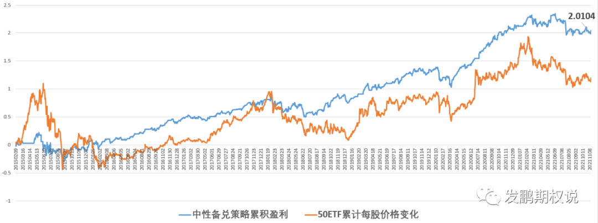
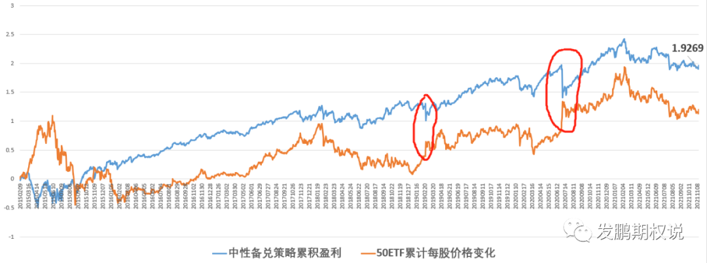

2021年最后一篇正式文章，不聊行情，分享一个不算完美的“好”策略——中性备兑策略给朋友们。这个策略是在长投牛差策略的基础上，通过多卖虚值认购将组合Delta基本调0的方式获取长期虚购偏贵的钱。

先放上策略的规则：

a.买入1倍名义市值的当月实值程度6%的认购期权一直持有，直到当月到期以交割日标的价格匹配最新的实值6%认购期权持有；

b.卖出4倍名义市值的当月虚值6%认购期权对冲买权Delta，知道当月到期以交割日标的价格匹配最新的虚值6%认购期权；

c.以上一个头寸建立日为基准，如果标的累积上涨超过6%，则以新的标的价格平仓原4倍卖出认购，匹配新的虚值6%认购卖出；

d.观测标的的10日涨跌幅，如果大于3%，则将所有持仓全部平仓等待，直到涨跌幅小于3%收盘时，将原有的组合拿回

e.期权交易手续费设置为3元/张。

在50ETF期权上市以来的数据回溯中，这个策略对比标的的累积盈利如下：

截止2021年12月24日，中性备兑组合赚了2.0102元/股，如果按照10000股的名义市值，初始ETF价格为2.331即23310元，赚得20102元，接近7年赚了85%左右，最大回撤在15%左右。

从曲线来看不“完美”，但是其实我这个回测是比较粗糙的，有兴趣的朋友可以深入优化。比如买1倍实值购和卖4倍虚值购在临近到期的区间，Delta因为虚值几乎归零的原因不会是中性。这里是可以考虑优化的，优化后理论上可以规避一些标的出现大跌时造成的Delta敞口损失。

另外的不完美可以从上边的2个过滤条件感受，因为超过市值权益卖了购，而且是没有底仓多头的。所以从防护厚尾的角度，设置了累积涨幅6%，和10日涨幅超3%两道砍规避意外加速上行造成的卖购爆亏。如果不增加10日涨幅超3%这个过滤条件，2020年7月这种小概率急涨会非常惨。

这个策略本质上是赚国内市场对认购超额定价的钱，承担的是急涨真来了的风险。如果行情不好，这个策略表现一般；如果行情稳健上涨，这个策略表现亮眼；如果行情急速上涨，这个策略感受最差，有种全民赚钱我独亏的感觉。

所以这个策略更深层次的不完美，在于长期暴露厚尾风险的同时，还站在了多数人的对手方。大部分时候都会对，类似于中性双卖，表现则稍好一点，但少数错的时候很要命，而且特别伤人心！各位朋友自己切身感受和优化吧，这个策略对个人投资者和机构投资者来说，适用性上是有差异的。

好了，期待下个交易日顺利！