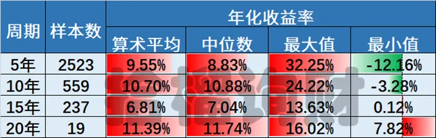
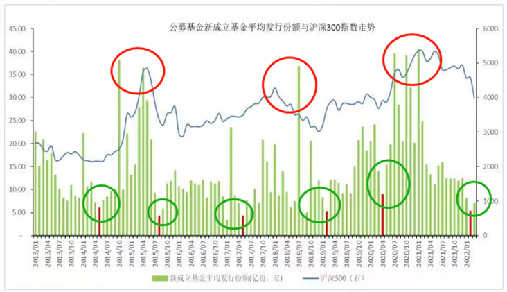
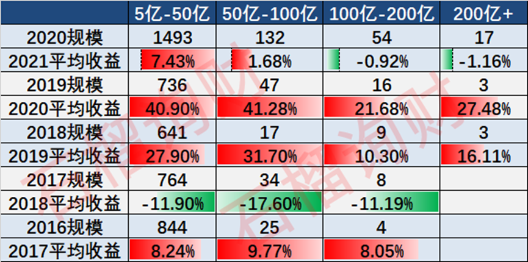
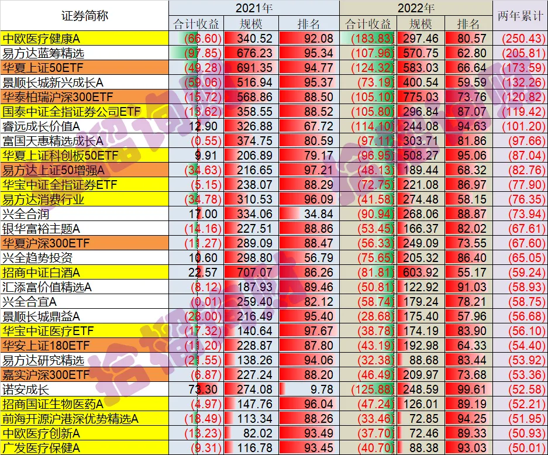

最近几天出差，写篇短文数据分析的，供大家娱乐。

今年以来，公募基金在网上被批得体无完肤，毕竟给投资人亏了不少。

但很遗憾，更多的是情绪输出，理性数据分析太少。今天继续聊聊，那些亏钱最多的基金，背后很有意思。

**1**

**老南长期以来一直的观点就是，公募基金是好东西，但是被卖坏了。**

前几天也写了《[我20年前买的第一支基金，如今怎样](我20年前买的第一支基金，如今怎样.md)》，给大家看了国内主动型公募的长期年化收益，从均值角度看，其实还是不错的。

但为啥大家总觉得亏钱？

**一方面是，是我们之前写过的，大家都在大涨的时候猛买基金，真正底部反而没人敢买，导致持仓成本太高。长期投资回报率，远低于基金均值。**

**另一方面，就是扎堆百亿基金。**

其实老南之前在《[投资百亿基金，就输在了起跑线上](投资百亿基金，就输在了起跑线上.md)》一文中，也通过相关数据揭示过这个问题。

**02**

  

今天，换个角度，老南把21、22两年，给投资者造成亏损最大的基金给筛选出来，看看有啥特征。

**方法论是把公募21、22年年报的利润表，其中的“股票投资收益”和“股票投资公允价值收益”加总。投资收益是已实现的，公允价值变动是浮盈浮亏。**

这是过去两年，合计超过50亿亏损的，拉仇恨对象，一共31支。估计看老南这篇文章的，大部分人都踩过这些。

细看这个表，有几个特征：

**1、百亿规模。**

21年就1支低于百亿，22年就4支低于百亿。

当然，你也许会说，规模大自然亏的多，但你再细看下排名百分比，21年基本都在后85%，22年稍微分散点，但基本都在后75%。

**2、有明显的行业、风格暴露**

其中11支行业基金，主要集中在证券、医药、中概、消费、白酒、科创。

其中6支宽指，集中在50、180、300，而这些都是典型的蓝筹风格，完美包括上述行业；500其实也跌，但没有上述的夸张，因为500的行业暴露和300不一样。

剩余12支，基本都是蓝筹风格暴露的主动型管理人。

**3、业绩都是前两年的王者，也是各家重点猛推的。**

比如亏钱冠军葛兰的中欧医疗健康，这两年亏了250亿。

2020年6月被调入某某宝金选基金， 2023年4月被调出金选基金。