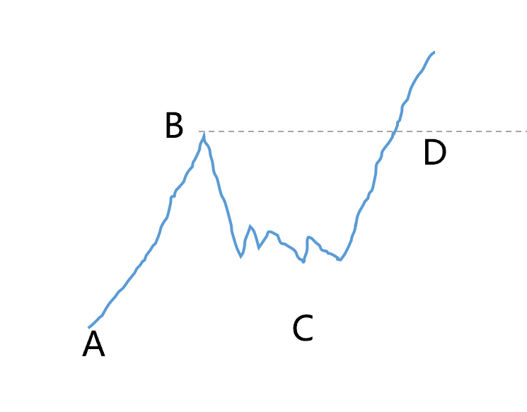
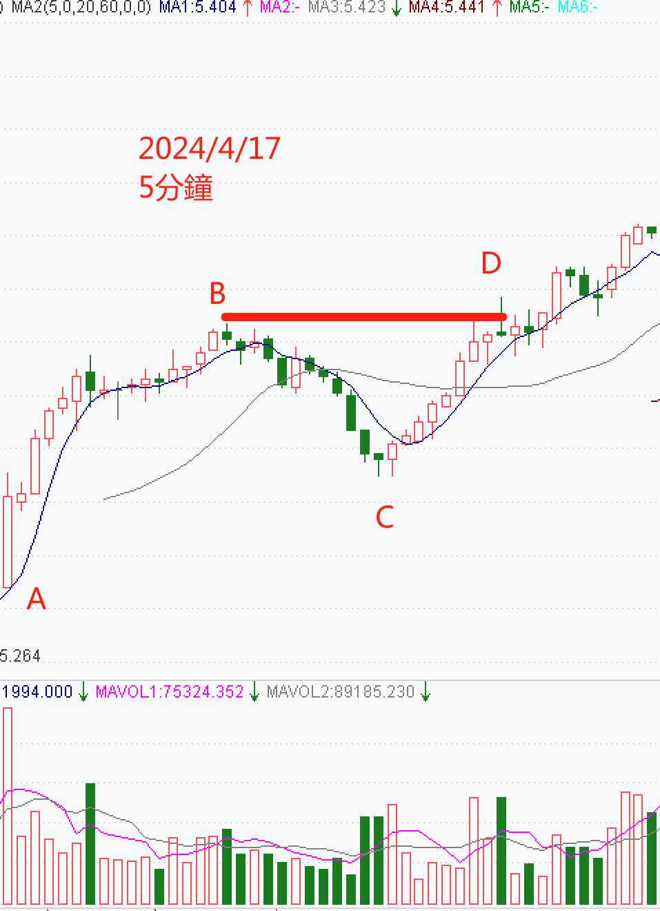
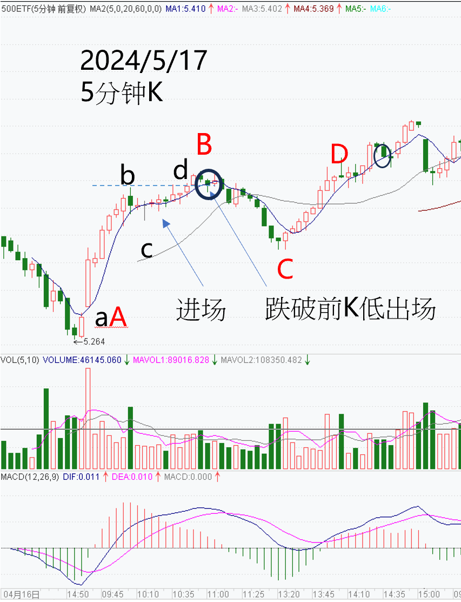

如何运用短线来交易期权,将传统的拉回买入或反弹卖出的技术成为标准化流程,可以让交易判断更容易…

今天讲一个最基础的策略叫ABCD形态策略,是安德鲁.阿齐兹博士在< How to Day Trade for a Living >一书中推荐使用,虽然名称不同,但相信看过之后应该会觉得似曾相似。这交易方式尤其在多头市场中寻找回调买入的机会时尤为重要,同样的道理也适用于下跌市场中的反弹放空。这种策略与我们常说的"N"字型或"反N"字型走势不谋而合，是投资者在波动市场中寻找机会的利器。

尽管ABCD形态结构简单，但它却是一个历经时间考验的经典交易形态。多年来，它一直是许多交易者所青睐的工具，也是短线交易中最基本的判断方式之一。它基于道氏理论的趋势判断法，提醒我们趋势可能是我们在市场中唯一可以信赖的朋友。

如下图一,ABCD形态的起点是一段强劲的涨势。在A点，买家积极进场，推动价格升至当日新高B点。然而，聪明的交易者不会在此追高，因为B点往往代表着价格的过度延伸。此时进场，下方缺乏合适的止损位，风险与回报的比例将不再吸引人。因此，保持冷静，不被市场情绪左右至关重要。

当行情发展至B点，一些早期进场的投资者开始获利了结，故价格随之回调。在这个阶段，耐心是关键，因为我们无法预知回调的深度和持续时间。然而，一旦发现价格在C点获得支撑，且C点位于A点和B点之间，这通常意味着市场已经找到了一个潜在的支撑点。此时，我们可以开始制定交易计划，设定止损和获利目标。

图一:ABCD型态图

如下图二,以2024年4月17日的中证500ETF为例，当天早上9:30，股价从5.288元的A点上涨至B点的5.387元。由于涨势凶猛，许多交易者都在等待股价涨至B点后，然后等待回调。当股价在某个价位获得支撑，即C点时，我们确认买家不会让价格跌破这一水平。此时，我们可以开始买入，止损设在C点下方。

当价格再次接近B点时，会吸引更多买家进场，因为B点是当天的主要压力区。如果价格开始突破，成交量会激增，这意味着更多交易者开始进场，D点因此形成。这就是经典的ABCD策略。

这笔交易的获利目标设定在价格跌破前一根5分钟K线的低点，这通常被视为短线动能丧失，买盘不再追高，是盘势转弱的信号。因此，在使用ABCD策略并在D点完成后，我们可以持续持有，直到行情呈现弱势，也就是我们获利了结的时机。

图二:2024年4月17日中证500ETF5分钟走势图

当然，ABCD形态并不总是那么容易判断，尤其是确定C点最为困难。C点的确定关系到我们的止损设置，以及是否真的可以形成ABCD形态。以2024年5月17日的中证500ETF 5分钟走势为例，虽然这种简单形态的交易没有亏损，但盘中的判断与盘后的分析往往大相径庭，说明这种简单形态实际上并不那么简单。

当我们观察到行情开始回调时，我们会确认B点，并开始等待C点的出现。但实际上，在当下我们看到的只是b，而非盘后看到的最优B点。因此，当行情止跌并获得支撑，找到的C点，自然也非当日回调后的最佳进场点。因此，我们的ABCD形态交易可能只是abcd交易，其利润和获利空间都不相同。但这个问题并不大，因为当我们寻找ABCD形态交易时，我们通常会忽略较小的回调abcd，但有时当天根本不存在ABCD形态，也会错失一些赚小钱的机会。

图三:2024年5月17日中证500ETF5分钟走势图

基本的ABCD形态有6个要点，大家需要牢记：

1.当某只ETF的价格从A点涨至当天的新高价B点时，我们要观察是否会从这里拉回整理，并在回调时出现价位高于A点的支撑。我们就此进入寻找C点的过程，但此时我们不会立即进场建立仓位。

2.我们观察行情在假设的C点进行整理。这时要开始规划仓位的规模、止损以及出场策略。

3.当确定C点支撑时，我们会在C点的上方买入（因为跌破时C点就不是我们认定的C点了），并期待价格上涨至D点或更高点。

4.多头仓位的止损设在C点的下方。如果价格跌破C点，我们将立刻止损出场。因此，为了减少可能的损失，买入的价位应尽可能接近C点。但矛盾的是，越接近C点的买入点其确认性越差，因此有些交易者会等到D点才买入，即等待价格突破前一波高点的B点，并确认ABCD形态完成。这种做法类似于传统的突破交易方式，也是一般认为的海龟交易法，这种方法会降低获利潜能，风险也会比较高。因此，确认C点的技巧非常重要，通常会参考局部的放量和更细致的形态。

5.如果价格继续走高，涨势一旦突破D点，我们通常会先卖出半数的仓位，并把剩余的仓位止损调整到进场点，以确保本次交易是确定获利的。

6.一旦价格达到获利目标或认为价格丧失动能，我们就会退出仓位。一般来说，如果价格跌破前一根5分钟的低点，就意味着多方的力度即将放尽，行情可能进入另一阶段博弈。

最后我将文章输入AI,请求帮忙找到C点的方法,想看看看与我目前的方式是否有差异,AI回答如下:

实际操作中，准确识别ABCD形态中的C点是关键，因为C点不仅关系到交易的入场时机，还决定了止损的位置和潜在的盈利空间。以下是一些帮助交易者更准确地识别C点的方法：

**1.价格行为**：观察价格在回调过程中是否显示出明显的支撑迹象。C点通常是价格在回调后停止下跌并开始反弹的水平。

**2.成交量分析**：在C点附近，成交量的变化可以提供重要线索。如果价格在达到某一水平时成交量放大，这可能表明市场在该水平上有较强的买盘兴趣。

**3.技术指标**：使用如随机振荡器（Stochastic Oscillator）、相对强弱指数（RSI）或其他动量指标来判断超买或超卖条件，这些条件可能预示着价格回调的结束。

**4.趋势线和支撑/阻力水平**：绘制趋势线或识别历史支撑/阻力水平，价格在接近这些水平时可能会找到支撑。

**5.价格模式**：识别如双底、头肩底或其他反转模式，这些模式的完成点往往与C点相吻合。

**6.市场情绪**：评估市场情绪和交易者心理，市场恐慌或贪婪的极端点往往与C点的形成有关。

**7.蜡烛图形态**：在C点附近寻找如锤子线、吞没形态等蜡烛图反转信号。

**8.时间周期**：C点的形成可能需要一定的时间周期，观察价格在特定时间周期内的表现，以确认支撑的有效性。

**9.波浪理论**：如果交易者熟悉艾略特波浪理论，可以通过波浪的结构来预测C点的可能位置。

**10.风险管理**：即使C点被识别出来，也需要通过适当的风险管理来确认交易是否值得进行，包括设置合理的止损和评估潜在的风险/回报比。

**11.经验判断**：最终，交易者的经验在识别C点时至关重要。随着经验的积累，交易者会逐渐发展出一种直觉，能够更好地识别市场中的C点。

请记住，没有任何方法可以保证100%的准确性，因此，交易者应该结合多种工具和方法，并始终保持谨慎和纪律，以管理交易风险。

这些找寻C点的答案可以供各位参考