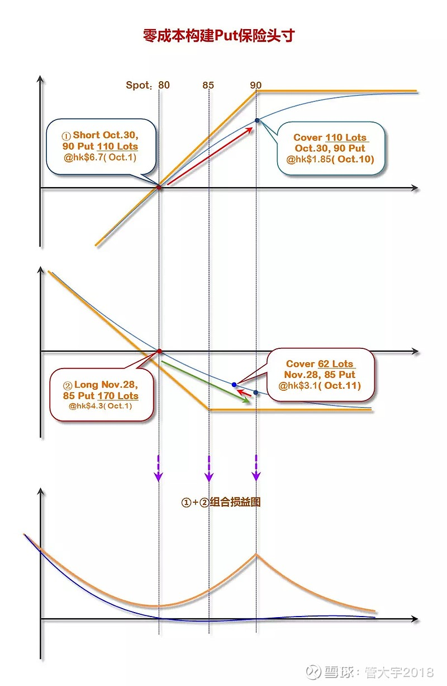

用单腿风控实践了大约2－3个月，组合整体的稳定性大幅提高，主要原因就是通过单腿期权事前风控，锁住了最大风险之后，正股能够拿得住了，不会因为反向波动而被动减仓。现在我也逐渐理解为何过去一年自己的收益比较差，其实就是事后被动风控追涨杀跌导致的损失。

但是事前风控的损耗也是巨大无比的。如果60％的仓位用单腿平值期权锁定风险，单个仓位月度成本大约是3％，组合平均一个月要损耗1.8％（60％＊3％），年化22％。这意味着，如果股价横在那里不动，一年下来组合要亏损22％；或者需要正向盈利22％才能刚刚承担风控的成本。这个成本太高，长期是根本无法承担的。所以，单腿风控，只有在特殊时点（短期盈利太大，或者预计有意外大概率会发生）才能实行，这不是个常年能够执行的普适方案。

是否有普适的方案呢？

我先尝试了用Put熊差（多仓风控）和Call牛差（空仓风控）。

Put熊差的Long 腿用于抵御下跌风险，Short腿意味着这个点需要加仓。比如[阿里巴巴](https://xueqiu.com/S/BABA?from=status_stock_match)([baba](https://xueqiu.com/S/BABA?from=status_stock_match))现价185，用12月20日Long 180 Put (成本3.8)/Short 170 Put (成本1.45)熊市价差来抵御下跌风险。这个熊市价差最大盈利每股7.65，最大损失每股2.35，盈亏比3.26:1。如果股价在一个月内单边下跌，熊市价差最大盈利7.65，相当于每股少亏4％；如果股价稳定不动或者上涨，熊市价差亏损2.35，相当于每股损失1.3％。虽然熊市价差无法抵御极端单边下跌风险，但最大损耗已经从单腿风控的月度3％损耗，下降到1.3％。

那现在的问题有两个：

极端单边下跌的风险概率有多大？

是否愿意在Short 腿的行权价增加多仓？(Short Put意味着买入)

如果认为单边下跌的风险不大，或者概率不高；同时愿意Short 腿处加仓，这个方案就是比较理想的。如果以上两个问题答案自己无法明确回答，那就意味按照自己的认知，持有这个多仓风险很大，不如不做风控，直接减掉这个股票头寸。

用熊差／牛差做风控，如果遇到波动市场，是最有利的。还是上面那个[阿里巴巴](https://xueqiu.com/S/BABA?from=status_stock_match)的例子，如果股价从185跌倒170，可以选择先卖掉Long 180 Put，获利了结，然后等着到行权日在170价位自动买入股票（Short 170 Put行权）。如果股价在行权日之前反弹，这个熊差的收益超过之前预算的7.65，很可能在10－15元（Long 180 Put卖掉利润，估计大于10元，再加上Short 170 Put期权金1.45）。因此只要股价反弹到175以上，熊差的收益就足以抵消所有股价下调损失，并且还略有盈利。

用熊差做指数期权我实践下来也是一个比较好的方案。当指数的风险溢价在历史平均值1倍标准差以上的时候，这意味着指数处于历史偏高估区域，用指数的熊差对冲组合个股多仓风险暴露的风险效率性价比相对比较高，因为指数的IV普遍比较低，尤其是在持续上涨阶段IV非常低，熊差的盈亏比基本可以做到３-４倍。

双腿风控

对角价差

用两条腿的熊差/牛差做风控一个月左右，组合的收益变得比以前平稳了，损耗也比用单腿强行风控要低得多，进展很明显。但是遇到一个新问题是，两条腿时间一致，一旦过期就要再做一组进行对冲，是否有更加优化的办法呢？

对于Short Put/Long Put熊差来说，Short Put意味着加仓，Long Put意味着对冲下跌风险。是否可以把Short腿从虚值变为实值，Long腿移到三个月以后，并且Long腿的股数超过Short腿的股数呢？这样的话，如果股价短期下跌，Short腿行权为股票，远期的Long腿自动成为下跌的保护。

按照这个思路，我开始在[美团](https://xueqiu.com/S/03690?from=status_stock_match)(3690.hk)这个股票上进行了实践：

2019年10月1日，组合持30,000 股[美团](https://xueqiu.com/S/03690?from=status_stock_match)股票。我设计了用Short oct.30 90 Put/Long nov.28 85 Put这个对角价差作为对冲工具。具体方案如下：

Short Oct.30 90 Put 110 Lots (相当于55000 shrs)[@hk](https://xueqiu.com/n/hk)$6.7；

Long Nov.28 85 Put 170 Lots (相当于85000 shrs)[@hk](https://xueqiu.com/n/hk)$4.3；

Delta为0.

2019年10月10日股价涨到91以上：

Cover 110 Lots Oct.30 90 Put[@hk](https://xueqiu.com/n/hk)$1.85, 获利hk$266,750=( (6.7-1.85)*55000)；

剩余的Nov.28 85 Put成本变为hk$1.16 (=（85000*4.3-266,750)/85000)，总成本hk$98,600；

当天85 Put市场价格hk$1.7-1.8，这相当于用1.16元买入了现价1.7元的Put，节省了买Put对冲风险的资金.

10月11日：

股价下跌到88；

85 Put 价格上涨到hk$3.1 (Vs.成本1.16）；

卖掉大约62 Lots (大约31,000股），收回hk$96k，就拿回了所有Put成本；

剩余108 Lots （相当于54000 shrs) 85 Put，成本是0.

经过这样两日的操作，股价为88元，组合里剩下54000股的11月85 Put来抵御30000股股票的下跌风险，而这54000股Put的成本是0。应该说，用对角价差Delta Neutral的组合顺利的在波动市场中赚取了免费Put来抵御多仓下跌的风险

  
  
作者：管大宇2018  
链接：https://xueqiu.com/1484679899/136294887  
来源：雪球  
著作权归作者所有。商业转载请联系作者获得授权，非商业转载请注明出处。  
风险提示：本文所提到的观点仅代表个人的意见，所涉及标的不作推荐，据此买卖，风险自负。