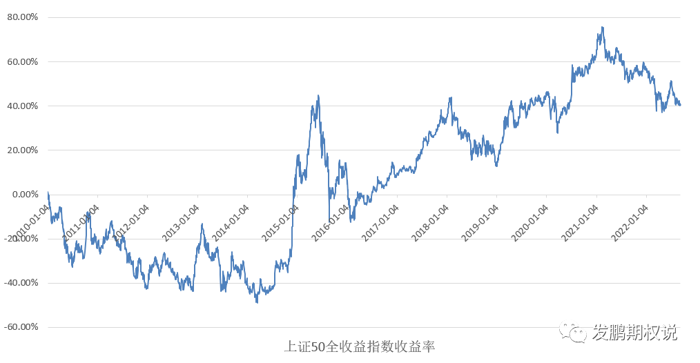
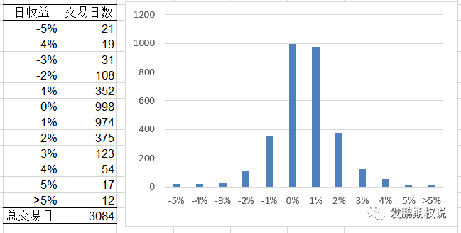
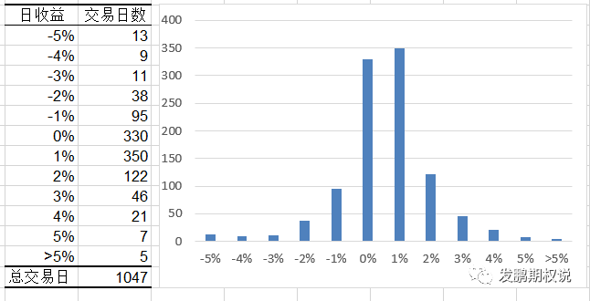

先说一下，这一周是很关键的数据与政策周。市场既然迟迟不出恐慌，那么就可能有动力在这里做一轮基于政策预期的新行情。和出现恐慌信号、政策超预期信号不同，这种拐点通常很难具象到某个具体的点，实践中非短线情绪拿捏能手或者中长期格局玩家不好把握。作为有基础多头持仓的长期玩家，我表示只要能往上，就值得期待！

今年的指数波动率极低，期权隐含波动率也在多年低位持续纠结，这样的背景让很多人忘了我们身处的社会、市场其实随时面临不确定性。今天索性再分享去年写的一篇有关指数投资和黑天鹅波动关系的文章，欢迎新朋友慢品，老朋友回味。

为了让更多的朋友对投资路上的黑天鹅有个比较清醒的认识，我尝试用一组简单的历史统计与大家分享“反脆弱”思路的重要性。因为后边尝试和此前“简单反脆弱期权策略”部分呼应，同时50ETF期权也是上市时间最久的国内期权，所以后续的指数收益统计用上证50全收益指数。先看2010年1月1日至2022年9月8日，上证50全收益指数累积收益率图：

大家记住几个数据，累积收益率40.50%，3084个交易日。进一步对这3084天的指数日收益率做单独统计，数据如下：

数据显示，3084个交易日中，指数日涨幅大于5%的只有12次，比例为0.39%。日跌幅大于-5%的有21次，比例为0.68%。显然，两种情况的概率都极低，发生即可定义为黑天鹅式波动。

我们继续统计，12年的时间里，12次大于5%的日上涨，平均每年有1次，累积的收益率为73.08%。如果你不巧绝大部分时间都在做50指数的多头，但刚好错过了这12个交易日，你的收益率即为-32.58%（上边50指数累计收益的40.5%-73.08%）。

另一个方向，12年的时间里，21次大于5%的日下跌，平均每年1.5次，累积产生的收益为-138.35%。如果你在做50指数多头的同时，每年能够规避1.5天，即错过这21个交易日的大跌，你的收益率即为178.85%（同理）。

上述收益率的简单加减未必符合资金收益率实际的情况，但可以作为极简方法参考。这组统计告诉我们的事实是，极小概率出现的黑天鹅事件对长期投资带来的影响力十分的巨大，甚至可以颠倒投资结果。

逻辑上可以确定的是，未来的投资世界一定还有黑天鹅，而且不止一次。顺势而出的结论就是，在未来的投资世界当中，我们一定要有可以抵御或者利用黑天鹅事件的投资方法加入到整体投资框架当中，即前文所述的“反脆弱”思想。

因为期权交易是我自己的擅长，下边我用50ETF期权上市以后的数据尝试为大家展示一下，用衍生品预防与捕捉黑天鹅的“反脆弱”思想结合到50指数长期多头后的情况。先做2015年2月9日期权上市后，截止2022年9月8日的指数日收益统计情况。

一共1047个交易日，上证50全收益指数区间收益率35.60%。日跌幅大于5%的有13次，日涨幅大于5%的有7次，比例分别为1.24%、0.48%，依然是极小概率。其中13次大跌日的收益率为-100.52%，5次大涨日的收益率为39.87%。

我在“[极简期权反脆弱策略](http://mp.weixin.qq.com/s?__biz=MzU5NDc0MTkyNw==&mid=2247491692&idx=1&sn=f15dcda8a31d93480038f17d31d1759b&chksm=fe7e3fa4c909b6b2114a3892b146a145cb20374c538cd709bf78f2dcecab9f0c8cb51281a600&scene=21#wechat_redirect)”一文中有分享过一个简单的反脆弱组合，有兴趣的朋友不妨回看老文具体策略规则。一般投资者可以很简单的利用远月双买策略作为防范远端厚尾的方案，再稍辅助以隐波高低、指数估值过滤策略持有与否即可形成长期有效的反脆弱构架。专业投资者，则可以运用相对更复合的期权曲面优化机制进一步进阶这个方案。

本文我用老文所述的极简反脆弱策略思路作为基准，在1倍名义市值的反脆弱策略布局下，上述上证50指数黑天鹅式大跌的13个交易日当中，反脆弱策略带来的收益补偿为67.66%，覆盖了多数损失。因为分享的反脆弱策略是上下黑天鹅双防双捕捉的思路，在上述5个极限大涨交易日中，反脆弱策略带来的收益补充为37.37%。两项加总，反脆弱策略让组合在原收益的基础上增加了100%+。

当然，稍懂期权的朋友这里定然有的疑问，即反脆弱策略在大波动来时有收益是肯定的，但对于长期坚守这个策略者来说，常规波动时期的损耗能否小于这个收益才是长期正期望的关键。

事实上这个想法是可以极大概率做到的，比如示例这个极简反脆弱策略，见老文可知常规时期的损耗明显小于黑天鹅时期的收益。对于更专业的投资团队来说，常规时期通过全市场立体工具的综合运用和机会把握，可以更好的控制损耗期回撤深度的。

但是这里我想提的一点是，“既要又要”是一种病态心理。**既然想获得反脆弱策略体系在极少数时间的大收益优点，就要接受反脆弱体系在大多数时间有回撤波动的缺点。**就像2022年底至2023年中这一轮，由全社会资金“躺平”式吹捧类债的雪球类投资工具，导致指数波动与期权波动率溢价极低，进而影响反脆弱策略体系的绩效。**我们要接受这个结果，不要妄想控制全部的回撤，更不应该轻易风格漂移。**

最后总结一下，我认为在任意一轮指数牛熊更迭的周期轮回中，极大概率会碰到不止一次黑天鹅式极限波动。指数投资者，除了对指数代表中国经济长期成长的信仰外，请增加一个黑天鹅必然发生的信仰。前者对应的资产是权益的多头，后者对应的资产是波动率的多头，把这两个资产有机结合在一起，即是一套完整的长期指数投资框架。这即是我自己近年一直坚守的核心认知，当下阶段虽然难熬，但我知道终点定然光明！

好了，期待下一个交易日顺利！
