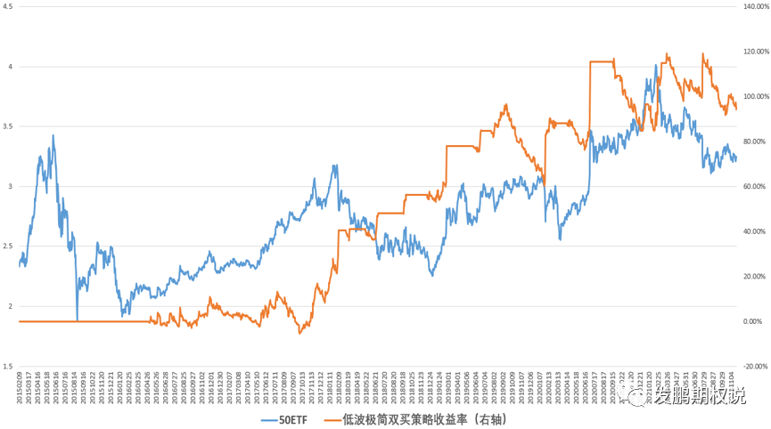

行情没啥可说的，观点我都快说得嘴巴起老茧了。都又乒乓球外交了，政策慢转向迹象已经存在，美联储应没胆过分提前加息预期，追求DCF贴现框架的投机资金总有要找安全港的时候，50指数多头继续老实等风来。

延续昨天倒腾数据的节奏，今天分享一个具备“反脆弱”特质的极简期权策略。反脆弱特征是什么？较真的朋友不妨百度、知乎一下，简单说就是能抗意外、亲黑天鹅。在期权隐波久低难高的区域，这个策略虽然简单，但值得细品。

策略规则也极度简单，在50期权日频数据上的测试规则具体如下：

a.如果50ETF期权当月平值隐波大于20%，空仓；

b.未有持仓的情况下，如果50ETF期权当月平值隐波下穿20%，基于50ETF价格选择到期时间距离当日大于30日的剩余时间最短月份的平值认购和认沽期权，对等数量做双买，组数匹配账户市值的2倍（比如50ETF上市日价格2.331，如果刚好是23310元的账户，则默认2组）。

c.有持仓的情况下，如果50ETF价格较开仓日变动超过0.15元/股，则按照最新的标的价格重新匹配新的跨式期权买入，同时平仓原跨式期权组合。

d.有持仓的情况下，如果50ETF期权当月平值隐波大于25%，清仓跨式期权组合。

e.每张期权交易费用为3元/张，初始资金假设23310元。

50期权上市截至2021年11月22日，策略累计获得了94.36%收益，最大回撤不小，35%的回撤出现在2019年底。回撤的核心原因是低波区继续降波，远月双买的Theta消耗很次要。获得长期正收益的原因是抓住了大部分上or下的价格暴动或者隐波的上行暴动，即“黑天鹅”。

策略虽简单，但道理不含糊。这结果说明塔勒布大神的“反脆弱”思路在国内市场可能反而因为投资者结构更散户化具备更高的参考价值。情绪淡定区特别要重视这类机会，待到情绪发泄后的狂暴区收割该策略后，再想想卖权收割情绪收敛的事情。

总之，一个成熟的投资框架要具备可持续、反脆弱的基础特质。同时对部分资管行业参与者来说，能大规模也是投资框架的必要能力。

好了，期待下个交易日顺利！

