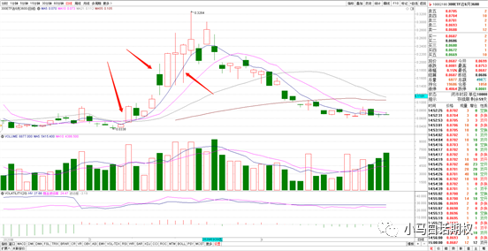
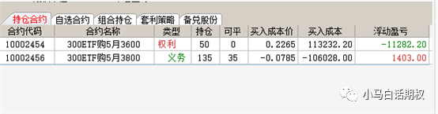
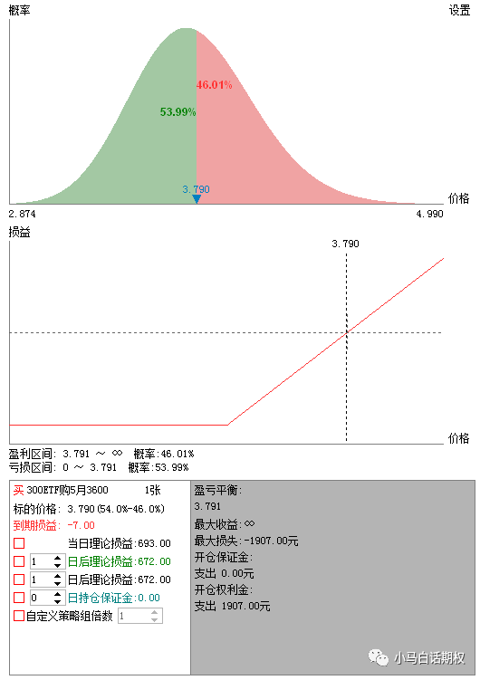
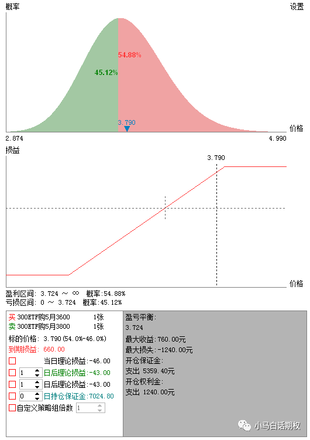
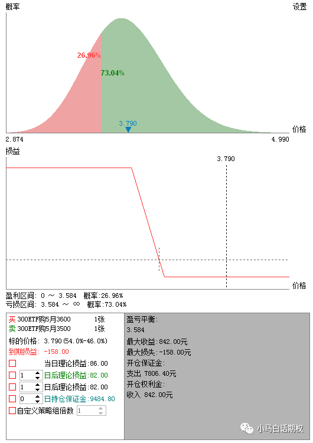
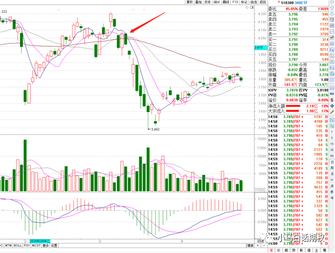

买方被套后的处理，如何运用策略，低成本降低盈亏平衡点。

在我们的期权操作中，经常会出现“买太早”或者“跑太晚”的现象，可能是对标的的看法正确，但是波动率处于下降途中，也可能是对标的的看法暂时不正确，但是过几天后就正确了，主动买套左侧入场，或者是因为对对标的的看法左右摇摆，提前买入， 结果小亏10-20个点，或者是仓位过大，买了稍微风吹草动就吓得不得了，跑了后马上大涨，这都是期权买方拿不住，或者归零的原因。

比如上图中的认沽期权，上涨的那波利润是很丰厚，但是中间的过山车非常厉害，简直和特斯拉MODEL 3 performance的百公里加速3.4秒有的一拼，能把你彻底震吐，在前面过早买入的，也会心里发毛会被吓跑，除非是绝对坚定的空头。

对于这些情况，我想解决的方法有这么多。

**一、控制仓位**

仓位的控制是最容易也是最难的，容易的是你少投入总是非常量化的，投入一万块亏的起，五万块也不算多，十万块还好还好，超过20万甚至更多，那是有些人感觉坐不住的，用你输得起的钱来投入权利仓，或者是义务仓赚的利润的一部分（20-50%）来投入，那自然是可以拿得住，亏了也不会那么的心疼。等到这笔单子赚钱了，再顺势加码，或者移仓，就会心理上舒服很多。

**二、先卖后买**

当你想做一个方向时，与其重仓买入，除非马上大涨（以认购为例）快速脱离成本区，那就无所谓波动了，不然的话，可以先用卖方来表达，先卖个沽，卖沽赚钱了，说明你的方向没有大错，或者波动率帮了忙，有了利润之后再投入买方。甚至最后会出现，卖方一直赚钱，买方不温不火没赚没亏。比如2020年4月，标的反弹了10%，认沽期权天天下跌不反弹，但认购温水青蛙，成本线附近晃荡。如果你卖出一个虚值沽都是亏损，那买平值、虚值购大概率不会赚钱。

**三、做成价差**

比如买了认购被套，如果不愿意止损，我们可以做成认购牛市价差、认购熊市价差、比率价差来降低盈亏平衡点，获取一个卖方的收益。

比如上述买入认购3600被套，发现标的并没有如期上涨，也没有大跌，只是时间价值一直在衰减，波动率再下降，这时候盯盘你会紧张，我们可以卖出等张数的3800构成牛市价差，或者卖出多份3800构成牛市价差，到期损益图变化如下：

买入3600购，盈利平衡点为3.791元

使用3600-3800牛市价差，盈亏平衡点降为3.724

如果买入期权后，不愿意割肉，但是标的走势和这方向大幅相反，我们可以卖出更加实值的期权来构建认购熊市价差：

买入3600购 变为 买入3600购+卖出3500购

3500是实值，在下跌时一般下跌的金额比3600要大，这个持仓立马从多头变成了有限的空头，先保持这样再说。在看标的的变化来拆腿。到期损益图变化如下：

变成了下跌赚钱的熊市价差

**四、买入反向合约**

前提还是当前的持仓不愿意割肉，当标的出现快速下行时，前面被套的权利仓可以不用管，反过来买入认沽期权就好， 比如2018年2月，2020年3月，如果“不幸”做多买购被套，套就套吧，反过来用原来投入成本的20-50%资金买入认沽，不仅可以把前面的亏损扳回，反而可以小赚一笔，比装死归零要好的多，况且，已经亏成那样子了，也应该不会在乎多亏20%的资金了吧？

当然，以上种种，最后都依赖于标的的最后走向。

免责申明：以上仅为个人见解，如据此操作，收益自享，亏损自负

还可以，移仓实值，换到下月，策略对冲（后天晚上会讲）。

