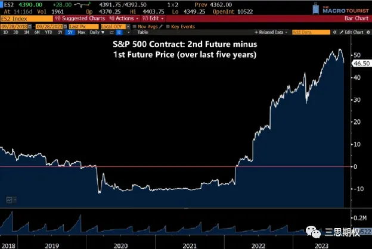
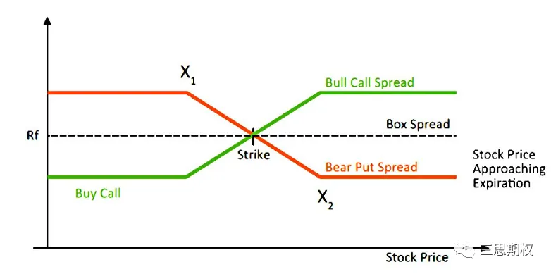
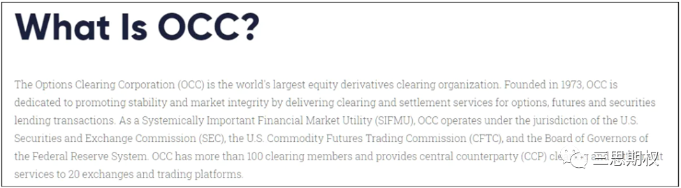
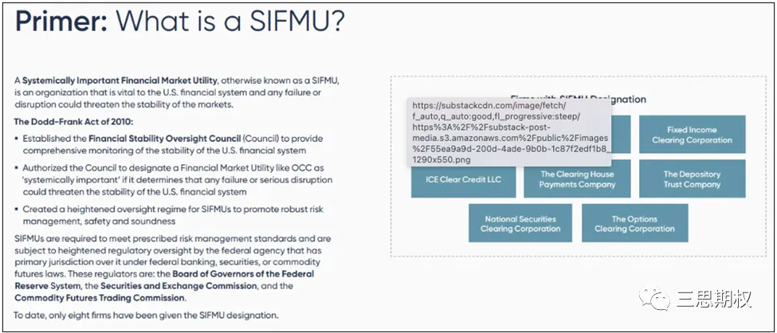
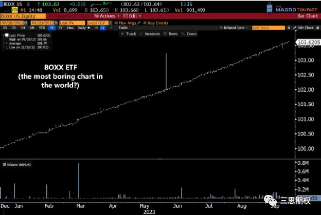
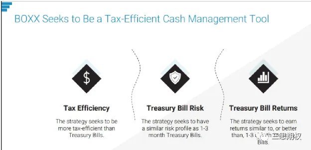
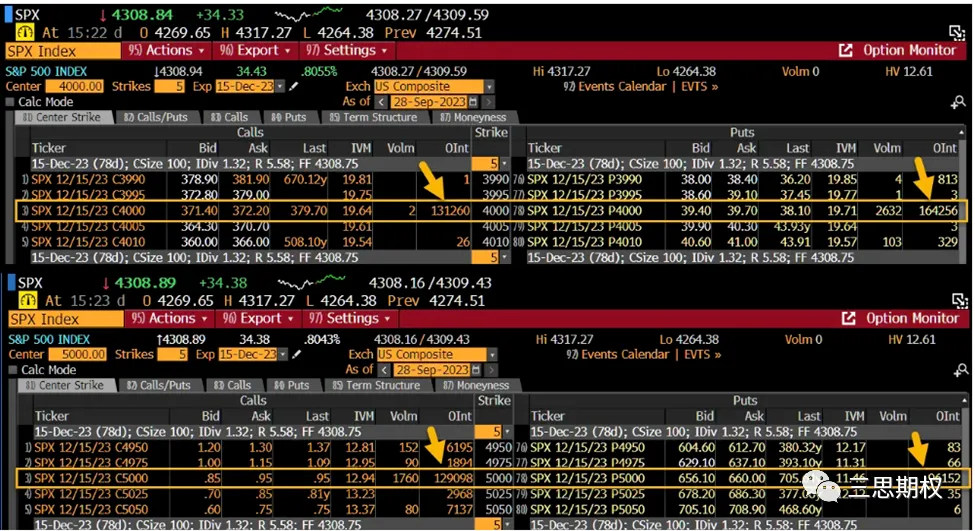

**期货套利**

几天前，有位海外财经名嘴表示，「如果买入S&P500期货合约，而不是ETF，多余的保证金可以用来赚利息。」

但其实，如果真能这么操作，那对冲基金们都会挤破头去把ETF换成ES期货。

为什么这么做行不通呢？下面是S&P500即将到期的两个期货合约，ES1和ES2在过去5年的价差。

不难看出，随着利率上升，两个合约的价差也在走阔。

换句话说，利率上升后，远期期货价格要高于近期。所以，买入期货而非现货ETF，虽然是能多赚部分利息，但却得支付更高的价格。

除非，保证金这块的利息收入，能够完全覆盖期货这块的价差。

这篇文章的重点在于，「持有标普500期货而非ETF」并非免费的午餐，期货价格里面已经计入了利率成本因素。不能因为利率很久没有大幅变动，就认为市场套利者们已经忘记该如何给远期产品定价了。

但有的时候，市场可以提供一个双赢的机会，同时降低借贷双方的成本。

**盒式期权套利（box spreads）策略**

什么是盒式套利策略？下面我们就用一个实例来解释。

首先要明确的是，盒式期权策略要用欧式期权（不能提前行权）来构建。

现在S&P500在4300左右。

根据期权理论，如果买入12月到期、行权价4000的看涨期权，然后在卖出同样参数的看跌期权，这就相当于构建了个标普500的多头头寸。

比如买入看涨期权要支付367美元，而卖出看跌期权能收取40美元。也就是说，这个策略就相当于在4327（4000 + 367 - 40）的位置买入标普指数，这和12月到期的标普期货价格差不多。

在这个基础上，我们接着买入12月到期、行权价5000的看跌期权（662美元），卖出同参数的看涨期权（1美元），这就相当于在4339点位做空标普。

这样一多一空，对标普的敞口就抵消了。  

假设标普价格不变，到期后那整个策略的总收益为12元（4339-4327）。

从资金成本的角度来看，构建策略时，4个期权合约净花费988元，到期时一共获得1000元。3个月时间，它的年化收益率相当于5.68%。

上面的数据均参考了真实市场的数据，能大致够反映盒式期权策略的收益情况。

对交易员来说，了解市场上套利机会的运行逻辑非常重要。如果我们不能解释它为何会出现，自然也没法理解它背后的风险。在这个例子里，融资需求是盒式期权策略存在的原因。

除券商外，市场上其实还有其他投资者愿意用稍低于券商利率（隔夜利率+利差）的价格，借出资金。对他们来说，与其将资金放在券商账户里赚（隔夜利率-利差），还不如用盒式期权策略来争取更高的收益率。

重点是，盒式期权策略的信用风险还非常低。期权统一由期权清算中心（Option Clearing Corporation，OCC）结算，而OCC被认为是系统性重要金融机构（Systemically Important Financial Market Utility，SIFMU），所以可认为它的信用风险接近于零。

下面截图是OCC以及SIFMU的定义。

当然，并不是说OCC不会破产。假设OCC真的破产了，需要担心的也不会是盒式套利这类小问题了。就本文讨论的范围来看，可以认为OCC和美债的信用相当。

这个策略的准入门槛很低，并不需要有建模定价能力，也不需要有强大的算法交易执行系统。但是如果你还是不会操作，但又想增厚现金收益怎么办？

**BOXX ETF**

BOXX ETF就是解决办法之一， 特别是对那些有融资需求或者手里有闲置资金的投资者来说。

BOXX ETF是款由Wesley Gray的公司Alpha Architech开发的ETF产品，负责追踪S&P500期权的盒式期权套利策略。

接下来看看BOXX ETF的市场表现。该ETF利用到期日在1-3月内的期权，构建盒式期权策略。其收益率基本上是一条直线向上，和美债一样没有什么想象空间……

由于市场有融资需求，所以它的回报率要稍微高一些。而且，由于合约双方是和期权清算中心（OCC）直接清算，可以基本认为其信用风险接近于零。此外，对于某些投资者来说，它还能提供部分税收优惠。

对于有闲置资金，希望获得高于国债收益率的投资者来说，可以考虑一下BOXX ETF。如果读者有优化融资成本的需求，可以探索一下这方面的机会。如果券商提供的融资利率不那么理想的话，那盒式策略还是值得深入挖掘的。

**盒式策略补充**

看期权市场分析的都知道，不少期权策略师都会通过观察未平仓合约的分布来推测市场上的gamma效应，从而推测技术上的支撑或者突破。  

【注：关于伽马（Gamma）敞口，理解起来有困难的朋友可以回顾下我们前几年的科普文章：<[软银是怎样用Gamma把市场玩坏的](http://mp.weixin.qq.com/s?__biz=MzIyMzkwMjc4MA==&mid=2247484057&idx=1&sn=a0456906051ee443e12d430e6a0755eb&chksm=e8166fcadf61e6dca842dadb57b5e1ffe5020d9541ec2a339689b0d5557d698ba7522341c5f4&scene=21#wechat_redirect)>和<[散户如何用期权拉爆百亿美元对冲基金](http://mp.weixin.qq.com/s?__biz=MzIyMzkwMjc4MA==&mid=2247484264&idx=1&sn=a5614508986a300e9a06c50b47567744&chksm=e8166e3bdf61e72dafe3d6a40360952e88aedd6587d44e5bdba95b0c05503c164a21a9808e17&scene=21#wechat_redirect)>。】  

比如两周前不少人根据行权价4000的SPX期权有很多未平仓合约，推测4000点有着很大的伽马敞口。  

下图是12月到期、行权价4000/5000的SPX期权未平仓合约。

其中行权价4000的看涨期权中，有13.1万手未平仓合约；而行权价4000的看跌期权中，则是有16.4万手。

根据上面提到的盒式套利策略逻辑，其中9.6万手肯定都来自盒式策略。因为除了盒式策略外，但凡有点理性的投资者，肯定不会去在这时去交易行权价5000的看跌期权。

所以，对于「期权市场在整数行权位置有着巨大的伽马敞口」这类结论，应该要保持警惕。其中可能有大量的盒式套利需求存在，这夸大了它的伽马效应。