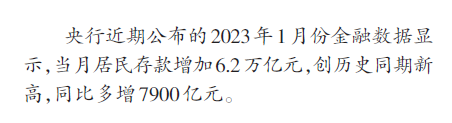
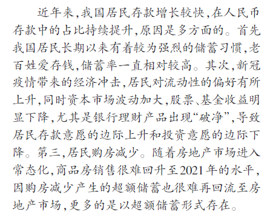
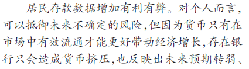
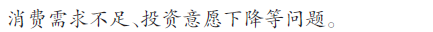
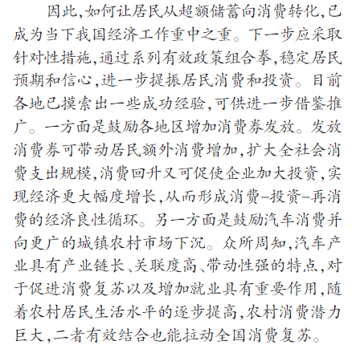
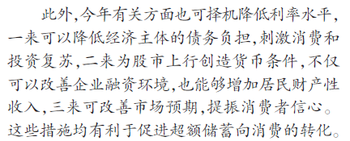
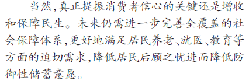
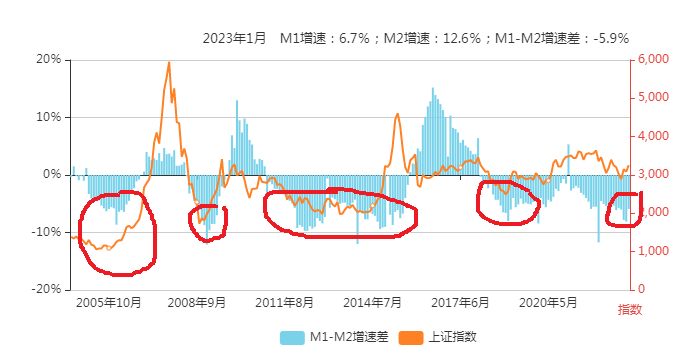

近期，老剑高度关注一月份经济数据。因为这份数据非常特殊。

虽然我有自己的看法，也在心中写出了草稿，但迟迟没有写下自己最后的答案。因为我也在蹲“标准答案”。也相信必然会有标准答案。

今天证券时报的头版文章《多管齐下引导居民从超额储蓄向消费转化》可谓是给出了标准答案。虽然我的答案可以得高分，但我们依然不妨怀着崇敬的心情做一下真题解析。

文章上来就写：

没有谈增速高达12.6%的M2，也没有谈人民币贷款增加4.9万亿，而是上来就谈居民存款增加6.2万亿，创出历史新高，同比多增7900亿元的情况。这是开宗明义，上来就点题了。

点什么题？点的是“超额储蓄”的题。也就是说，作者（极可能代表权威人士）认为6.2万亿就是超额储蓄了，还敢多增0.79万亿，真是BIG胆！既然是超额，那么必须不能超额。由此，再次点题，即“多管齐下引导”。

按形象的说法，现在的局面是形成了“储蓄堰塞湖”，必须采用一些手段炸开堰塞湖。

接下来，开始解析“储蓄堰塞湖”形成的原因

一共有三点：

1.老百姓的储蓄习惯

2.疫情、资本市场波动加大、理财产品暴雷导致风险偏好降低，储蓄意愿上升

3.居民购房减少

老百姓为什么爱储蓄？教育医疗住房都提高福利，没有后顾之忧了，你看谁还愿意储蓄？

比如万恶的美帝国主义，每人6000刀发个几次，你看他还储蓄不？当然，美帝国主义这种做法是极端错误的，造成了全球的通胀，养了大量不劳而获的懒人，而且家庭还极端负债，都刷信用卡，月光族遍地。现在后悔了吧，只好搞激进加息，搞得灰头土脸、乌烟瘴气的。

还是老胡说的对：“都发钱等于没发钱”

这段第一句值得玩味。还有利有弊？对谁利，对谁弊呢？

紧接着就解释。

对个人而言抵御未来不确定的风险是有利的。

但，注意“但”字，但后面就是不利的呗。对什么不利？

对经济增长不利、对银行不利、对消费不利、对投资不利。

是的，是的。

我们同学不能因为对自己有利，就忘了大格局大方向。那些提前还房贷的就是没有大格局啊。房贷高些又有什么关系呢？银行赚了钱不也是全体人民赚了钱吗？最后还不是一样给你享受各种福利吗？没有央企赚钱，你能享受这么好的高铁、机场、公路和地铁吗？你去美国就知道了，公路坑坑洼洼的，地铁垃圾成堆，真是天上地下。所以排队还贷干嘛？还排几个月？真是令人想不通啊。

哎呦，话说的开始重了。

“如何让居民从超额储蓄向消费转化，已成为当下我国经济工作重中之重。”

注意什么是“重中之重”？

这考试要考的哦。划重点！画个五角星~~

我换个问法：想投资股票必须投什么股？

什么？新能源股。

谁说的？

哦，奔波霸同学，是你说的啊。你给我滚出去！

消费股~~

对，消费股。鲸鱼同学答对了。

因为，因为什么？全班一起答！

因为“让~居~民~从~超~额~储~蓄~向~消~费~转~化，已~成~为~当~下~我~国~经~济~工~作~重~中~之~重。”

再往下看，“针对性措施”、“组合拳”、“提振消费和投资”划重点。

有两招：

- 发消费券

- 鼓励汽车消费

我们前面讲了，不能发钱，都发等于都没发，还容易像万恶的美帝国主义造成通胀。因此，必须坚持发劵，应发尽发，让大家养成抢券的习惯，谁抢到算谁的。那种美帝国主义邪恶的人人发钱的做法，大家都不去抢，说明这个国家没救了，太懒了。

汽车呢，产业链长，一带就带一串产业。其次，文中重点提到要向农村市场下沉。为什么要向农村下沉？哪个同学回答下。

吕同学你回答。

“老师，因为农村人爱面子。这次春节回去，村里都是三十万以上的车，但这几个同学都是干保安的”

回答正确。老师奖励你，一会儿你调个座位，换到和鲸鱼同学同桌。

咳咳~~接着往下看

注意，除了上面两招，大招要出来了。什么招？

降低利率。

同学们在后面加上“或降低存款准备金率”几个字。

文中给出三条好处。

1.降低债务负担

2.拉抬股市

3.改善预期

看1，降低经济主体的债务负担。注意用词，是经济主体，而没有用市场主体。以前讲过，用市场主体是指企业。用经济主体指谁？对，指政府。

政府有什么？一起答。

有~地~方~债

对，所以，降息首先对地方债有利，降低压力。

看2，什么是为股市上行创造货币条件？简单理解，就是利息低了，你还在银行放着不？不放了，那就变成什么？对，M2变成M1，定期变活期，活期再流入股市。这就是货币条件。

有了更多的钱流入股市，首先满足谁？先满足企业发行股票。其次，才是推动股市上涨。

股市涨了，居民财产性收入就多了，多了就更愿意投资股市了，也更愿意消费了。所以，这些爱跟风的叫什么？全班答。

韭~菜~

对~

看3，什么叫改善市场预期？就是利息低了，不能再放在银行了，要的就是这种预期。

看最后一段。“当然”和“真正提振~的关键还是”说明什么？说明作者什么都懂。但对这段话的实现表示不抱信心。该说的话还是放上来，以免读者认为作者是草包。

最后总结一下：

三招

- 发消费券

- 鼓励汽车消费

- 降低利息或准备金率

好，这篇真题解析就到这里。

接下来看关于投资的扩展部分。

---

经过研究发现，M1与M2的剪刀差与大盘底部的形成具有很高的相关性。如图

当M1-M2不断减少到达一个阶段在极小值徘徊时，往往是大盘的底部。如2005年末，2009年初，2014年初，2018年末

当M1-M2出现拐点逐渐增大时，市场就会上涨，甚至带来大牛市。

当这个值到达很高时，市场就会盛极而衰，再次步入熊市。

在理论上，这不难解释。

简单说，可以把M1看作活期，M2看作定期。当M1增速的增幅（一阶导）大于M2增速的增幅时，代表着定期转活期加剧，可能出现“存款搬家”的现象，市场便进入活跃期甚至是大牛市。

而当M1增速的增幅（一阶导）小于M2增速的增幅时，代表着活期转定期，那么市场就可能盛极而衰。

而当M1与M2之差长期徘徊在低位，代表着投资意愿不强，在长期徘徊中形成了底部。

目前的状态，就是徘徊了半年以上。在经历了去年11月、12月（-8.1%）的低值后，目前M1-M2有一定抬升，为-5.9%，**因此，可以说2900点以下的底部区域是比较明确的。**

再加上一月份数据出台，M2增速是七年来最高达到12.6%，这代表堰塞湖的水位非常可观。M1增速达6.7%，较上月高出3%，说明堰塞湖中的“定期冷水”在变成“活期热水”进程也在加速。

虽然出现文章《多管齐下引导居民从超额储蓄向消费转化》中超额储蓄的担忧，但可以确定，上述的鼓励消费等措施会有一定成效，炸开“储蓄堰塞湖”成功率较高，毕竟是“重中之重”的地位了。

因此，M1-M2的增大有政策支撑，存款搬家值得观察，由此推动的股市繁荣也是值得期待的。

但最后要提到的是，我们应该不仅仅从指数的角度来考察股市，毕竟注册制的落地使得指数可能更加失真。我们很可能看到这样一种景象，大盘只上涨了5%，而有些人手中的个股却上涨了50%，因此有的人说股市没怎么涨，真是癌股，真垃圾啊。

而懂的人，只需微微一笑。

全文完

下课~~

同学们再见

老师再见~~
