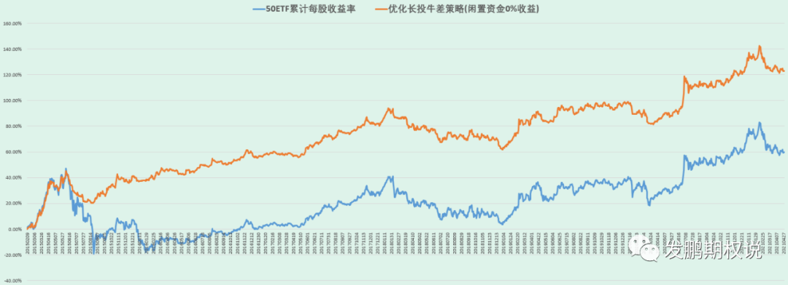
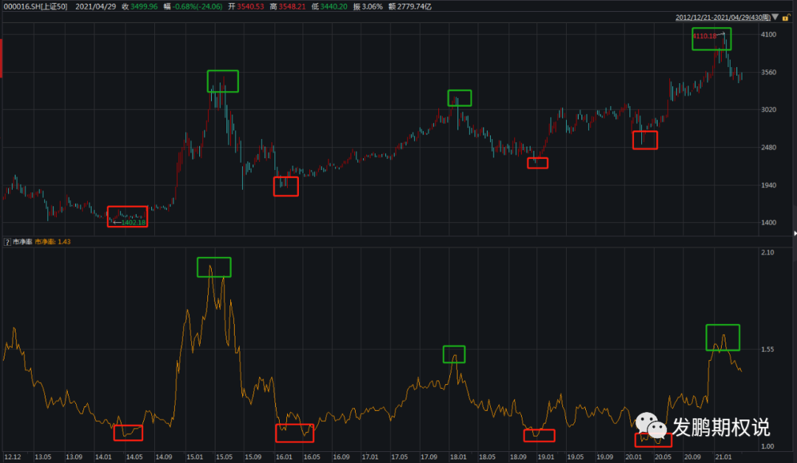
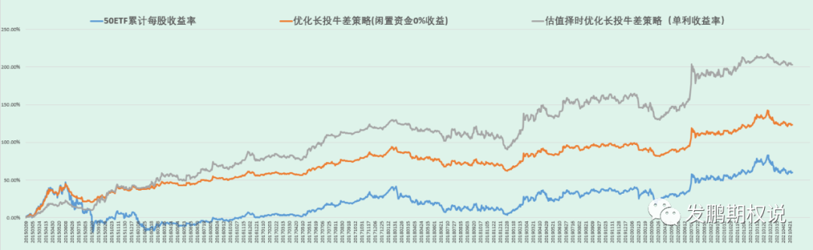
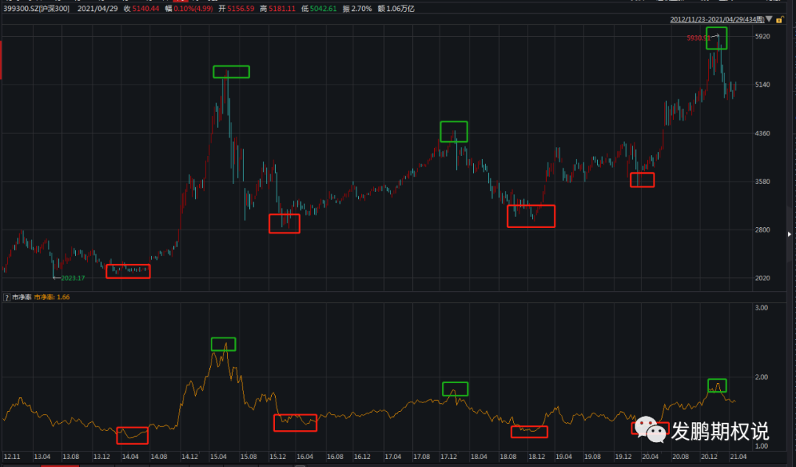
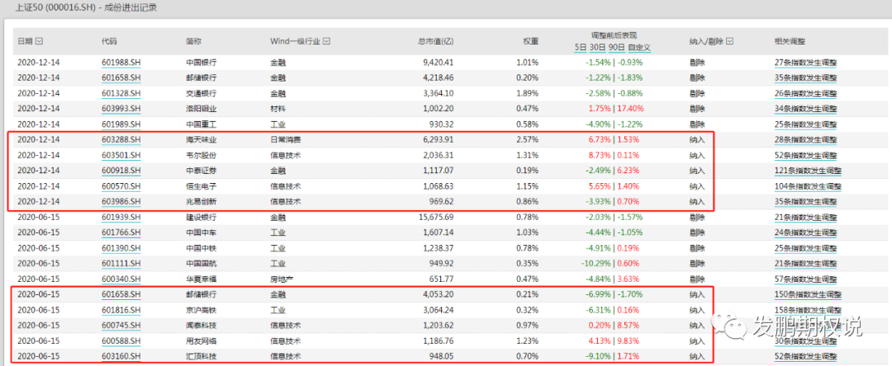
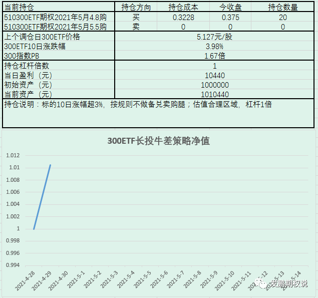

行情还算不错，还是觉得本轮回调底部就这差不多了，多头思路耗着的思路最近也聊了不少，这里就不说了，今天开始干个不一样的事情。今天文章又有点长，老铁们留心一下。

自2018年底开始写公众号以来，通过分享自己在期权交易中围绕波动率进行的一些策略思考、策略技巧、策略回测，得到了不少朋友的赏光关注，在此再谢过各位老友。过程中不乏有些相对主观和对普通投资者来说比较晦涩难懂的部分，经常都有朋友后台留言我聊的过于专业或学术，希望能有更普适一些的东西。

回想我写过的内容，每天闲聊的观点和波动率看法难免主观和“貌似专业”，也聊了不少策略，其中真正符合投资大道的无非是高隐波时的卖权策略与长期多头的长投牛差策略两个。而基于指数长期多头思想下，用期权做执行层优化的“长投牛差策略”是我认为最为普适的值得长期分享策略。所以今天也正好趁期权合约换月，我打算按日分享长投牛差策略的持仓与收益。以后公众号内容会有2个固定的部分，1是如往常一样的基于市场行情的闲聊与偶尔想到的策略思考，2是常态化的长投牛差策略持仓与收益。

既然算是常态化分享长投牛差策略收益的开篇，再回顾一下这个策略的原理很有必要。长投牛差策略——在长期投资指数ETF基金的认识下，结合期权的保证金优势、收益增强与黑天鹅保险策略优势，可以获得额外的年化收益增强，就是在应当持有ETF基金的时段，用牛市差价期权组合替代。

结合之前已经分享过的优化版50ETF长投牛差策略的回测，说明具体的执行步骤：

a.匹配拟买入持有的标的规模(具体股数or市值)，当月期权交割日当天收盘，买入下月实值程度最接近6%的认购期权合约，并一直持有直至下一个当月期权交割日收盘卖出，同时按相同规则买入新期权合约；

b.对等买入期权的数量，当月期权交割日当天收盘，备兑卖出当月虚值程度最接近6%认购期权合约，并在标的价格偏离前卖出期权日收盘价超过一定阀值日收盘时刻（比如下述测评中，50ETF价格偏离阀值取6%偏离），按照最新收盘价匹配卖出新的虚值程度最接近6%期权合约并平仓原卖出期权合约，若未再触及阀值则持仓直至下一个当月期权交割日收盘平仓，同时按相同规则卖出新期权合约；

c.为了避免疯涨时卖虚值认购合约影响主力多头头寸的表现，设置10日50ETF累计上涨3%为观察值，当超过时提前了结备兑卖购部位直到这个涨幅缩小到3%以内按原策略对应的合约重新加入卖购

d.构建期权组合后剩余的资金约有80%以上暂做闲置处理。

上述优化长投牛差策略在50ETF期权上市6年来对比持有50ETF不动的绩效如下：

上市截止2021年4月28日，50ETF长期多头的累计收益率为59.63%，优化长投牛差策略的累计收益率为123.07%。6年时间超额了60%+，平均年超额达10%+。看走势对比容易发现，最主要的1次超额收益是2015年的大跌减亏，其他时候超额不过。大熊市有超额，牛市跟得上，这个策略作为长期多头的替代策略毋庸置疑是好的。

为了更贴合实战，本文再进行一个升级，即根据历史上最近的几轮牛熊市转换下的指数估值进行一个长期指数多头仓位上的择时。如下图是上证50指数2014年以来价格与PB走势对照图。

红框对应牛市起点，PB也在低点约1.1倍附近；绿框对应熊市起点，PB在2015中、2018初、2021初的高点分别约2.0倍、1.5倍、1.63倍。如果认可多轮牛熊转换下指数估值反复充分包含经济周期与人性规律，后续的指数当可以基于此做仓位上低估时超配、高估时低配的安排。

参照上述估值周期，50指数PB低点约束大致在1.1倍，彼时市场再担忧只要对国家有信心都应该大仓位上多，反过来越临近PB高点1.7倍（3个高点大致取均值），投资者则需要减仓指数多头仓位。

基于此我再度对优化长投牛差策略做样本内数据的升级，规则如下：

a.当指数PB低于1.2倍，策略采取2倍杠杆进行，即原本期权合约数量加倍；

b.当指数PB走高到1.35倍以上，策略恢复为1倍杠杆的原始头寸数量；

c.当指数PB走高到1.5倍以上，策略采取0.5倍杠杆进行，原本期权合约数量减半。

虽然波动加大，可以发现因为低估是加倍了指数多头，高估是减仓了指数多头，截止2021年4月28日，简单估值择时后的优化50ETF长投牛差策略收益率达到203.42%，比原策略的收益率翻了一倍，年化更是达到30%+。

如此优秀的占了底层绝对逻辑优势的长期策略，只要是长期稳定可控的资金，坚持干即可。别想每年翻倍的事，也别想回撤尽量小的事，长期做下去即可以享受复利的红利，即便后边这个策略因为备兑基金的介入超额越来越少，也大概率能保持一定超额。正因为此，我才觉得值得将该策略长期分享下去，希望在这“阿尔法”衰减前，关注本号的朋友可以多“享受”。

在正式说分享规则前，先说两点。第一点是上边的回测是基于50ETF的，但考虑到沪深300指数可以稍广泛的代表中国经济核心企业，后边的分享基于510300ETF来做，核心头寸是510300ETF期权。对比50指数的历史PB估值，粗略定300指数的几个关键PB估值点位是：1.4倍、1.65倍、1.85倍。

第2点是随着新经济的发展，这类蓝筹指数会面临纳入高估值新公司、剔除低估值老公司的情况（下图是去年上证50的2次纳入和剔除成分股记录）。这会造成指数整体估值区间的抬升，即纳入高估股票且市场给予充分的稳定性认可后，估值的低点和高点都得上移。我们当知晓，未来某刻有可能需要调整。

下边部分是按日都会留在公众号上的内容，300ETF长投牛差策略的执行与分享规则：

*a.初始资金100w，ETF期权交易成本3元/张；*

*b.前当月期权合约到期日尾盘，按照当日300ETF价格选定实值程度6%附近的认购期权买入持有，直到该合约到期按同样规则切换到新当月合约；*

*c.前当月期权合约到期日尾盘，按照当日300ETF价格选定虚值程度6%附近的认购期权卖出持有，当300ETF价格上/下行击穿卖购/买购行权价时，平仓该合约，并以当日300ETF价格重新选虚值程度6%附近的认购期权卖出持有，合约到期同理买购腿移仓；*

*d.300ETF10日累计涨幅超过3%时，不管c规则持仓的是哪一档卖出认购，先平仓了结，等到10日累计涨幅缩减到3%以内时按照规则拿回卖认购持仓；*

*e.如果300指数PB估值低于1.4倍，账户采取2倍杠杆，超量部分在PB重新高于1.65倍减仓到1倍杠杆，高于1.85倍采取0.5倍杠杆；*

*f.初始时刻，1倍杠杆对应的300ETF期权张数为20张；*

*g.因为不可能做到收盘价交易，选择每日14:55分为观测点，只要彼时价格or日期符合了某规则条件，即开始做头寸处理，本策略分享的头寸实际交易价格取最后5min中间价（14:55分价+15:00价）/2。*

当前300ETF长投牛差策略的持仓头寸、数量、成本、绩效、绩效曲线如下：

好了，期待下个交易日顺利！

