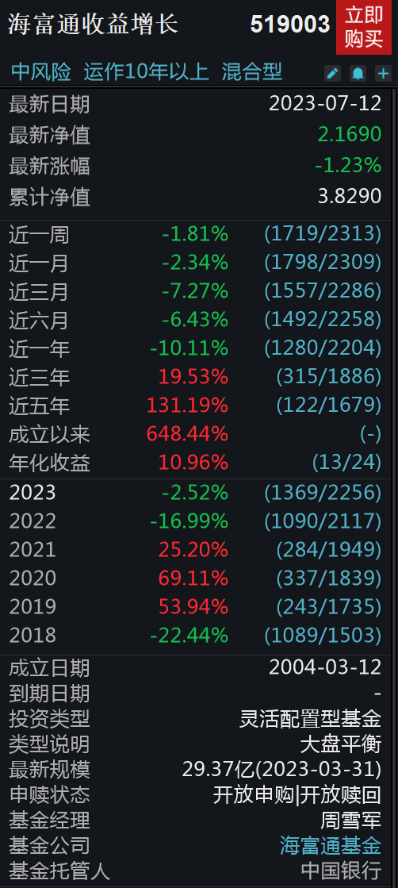
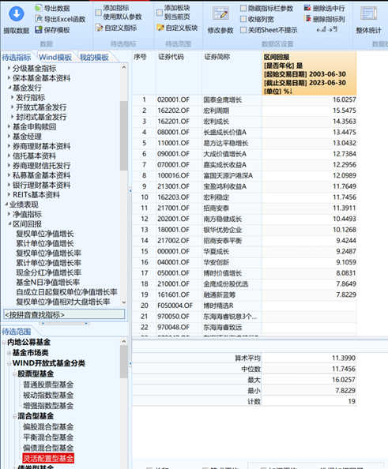
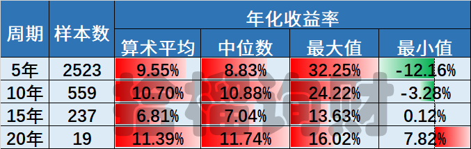
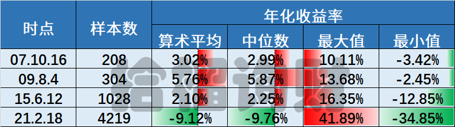
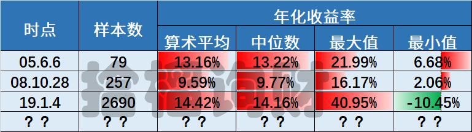
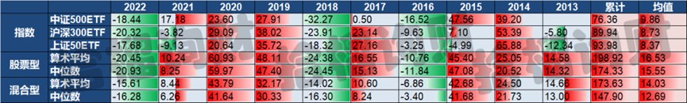
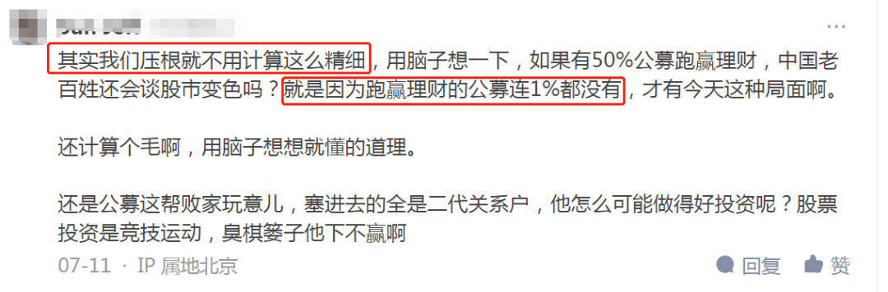
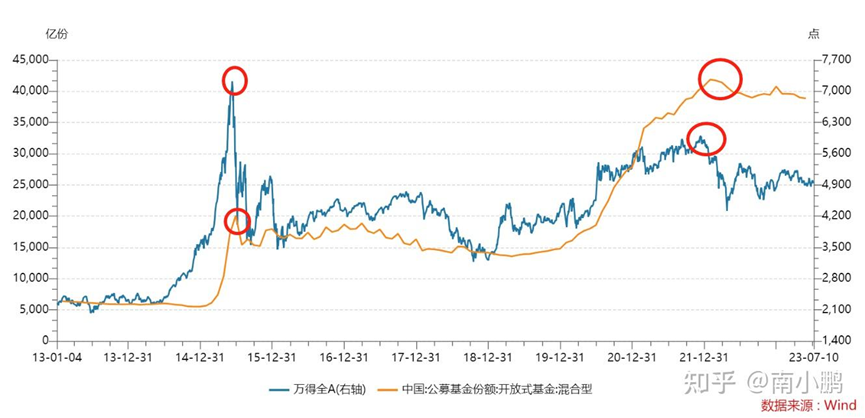
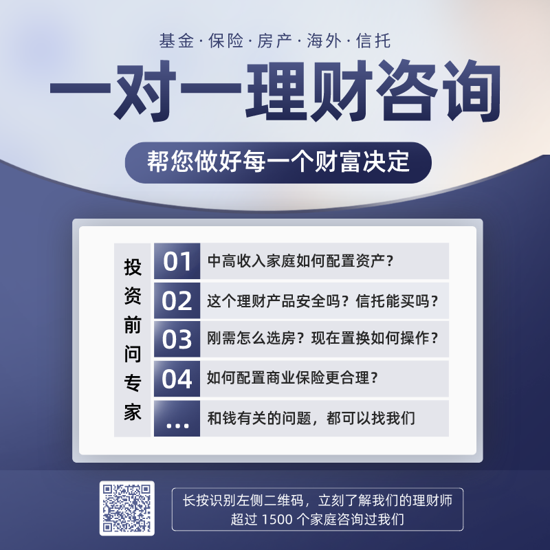
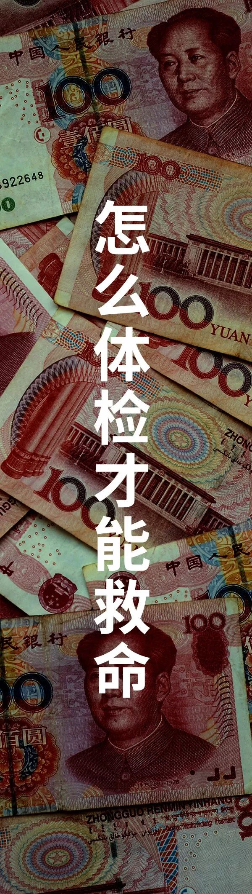

**因为过去2年，公募基金整体业绩不佳，网上各种骂，对基金公司、基金经理各种讨伐。**

**上周，多家公募基金官宣下调管理费。**

**但是，很遗憾，在老南看来，管理费降费只是治标不治本，如果大家没找到根本原因，一年少千分之几的手续费，大部分人依然长期不赚钱。**

**01**

**前阵子，一老南20年前的同事，现在是某券商的省公司一把手，请老南去讲课。**

**去之前，想起当年刚工作时，买的一只基金，虽然后来赚钱卖掉了，但想想也差不多20年了，就顺便去查了下。**

**这里特别备注：并非基金推荐！并非基金推荐！并非基金推荐！**

**这个基金叫海富通收益，2004年3月12日发行，这个基金，如果老南没记错，是国内第一只百亿基金，当时还是小白中的小白的老南，买了。**

**毕竟老南当时在海通证券工作，这个基金公司是海通控股的，而且海富通前一支新基金业绩不错，所以这只基金卖的特别热闹。然后老南买进去就跌，套了一年多。**

**时至今日，这个基金换了9任基金经理，规模还剩30亿，19.4年总回报6.48倍，年化收益10.96%，在同期24只可比的基金中排13，也就中游水平。**

**这个中游的收益率，貌似还说的过去啊，毕竟同期沪深300只有1.8倍，差远了去了。**

**02**

**老南顺手从wind里，统计了下主动管理型基金过去20年来的阶段收益，样本包括：普通股票型、偏股混合型、平衡混合型、灵活配置型，发现结果还挺有意思。**

**先看第一张图，分别统计5年、10年、15年、20年4个周期，有业绩的主动型基金，均值收益是多少。可以看到，除了15年，因为当时是08年，市场从07年高位还在下跌中途。**

‍‍**其余长周期下来，主动型公募的均值，均在年化收益10%左右。无论是算数平均数还是中位数。**‍‍

**再看第二张图，如果你买在过去20年，4轮牛市行情的高点，会如何？**

**你会发现，除了21年初的本轮行情，毕竟这会还在熊市。**

**之前3轮大牛市，买在最高点到现在，均值都是赚钱的，但收益率的确低的感人。**

**但如果换个角度，在每轮熊市低点买入，会如何？**

**答案是年化收益会高一点，别看高的不多，这可是年化，10年下来不得了。**

**03**

**写到这里，你发现问题没？**

**长期看，国内的公募基金的收益并不差，包括老南在《[首选指数？巴菲特这话在A股并不对](首选指数？巴菲特这话在A股并不对.md)》中也给大家计算过，主动管理型产品在国内，长期是碾压指数的。**

**但实际上，大部分基民的肉身感觉，是自己买基金，远远没这么赚钱。**

**上周，老南在知乎上回了基金降费的一个问题，然后有人和老南抬杠。**

**说基金长期收益跑不过银行理财，老南提供了真实统计数据后，对方怼了老南一句：**

**抛开事实不谈，这事就真没法谈了。**

**其实，中国长期以来，一直是基金赚钱基民不赚钱，为啥呢？这张图说明了一切：**

**因为在市场差的时候，没人买基金，都在情绪化输出；而到了牛市中后期，都是砸锅卖铁追高基金。**

**这种错配，自然而然导致大家都买在了高点。所以这个锅，在老南看来不是基金经理的问题，虽然他们被骂得最多。**

**实际问题出现销售上，毕竟业绩好的时候好卖，业绩差的时候难卖，都是人性，也都是KPI。**

**在上一轮高点，21年初，老南就写过《》，提示风险。当时文章后的一些批判老南的留言，现在回头看也是讽刺de得很。[新基金超卖两千亿背后 你被联合收割了](http://mp.weixin.qq.com/s?__biz=MzAwNTc1NzQ5NA==&mid=2649719170&idx=1&sn=04384eae24fba9152f0accac9361544b&chksm=830ceedbb47b67cdb06212c03cfda697a65c5a6001882f7e5d8eebb7e5936d1d59ade26e1ae6&scene=21#wechat_redirect)**

**所以，如今的降费，在老南看来是治标不治本，不改变销售环境，早晚还是这样。**

**这也是为何老南经常建议一些客人，选择那些长期能做到市场均值附近的股票型公募FOF，别买在大牛市高位，就能解决上述90%的问题。**

**今天，老南翻朋友圈，看到一同业跳槽去了某基金公司做FOF去了，看来不少公募已经意识到问题所在，就看是否认真解决了。**

**结**

**抛开事实不谈的情绪，永远是投资的天敌，牛市的时候让你追高，熊市的时候让你避之不及。**

**只有冰冷的统计数据，理性的思考，才能让你获得不错的收益，虽然有点反人性。**

**加入，就可以和我们再近一点👇**

**-END-**

作者：南小鹏，拾榴询财创始人，江苏省理财师协会秘书长，畅销书《识破迷局》作者。金融从业 19 年，曾就职海通证券、国资紫金所。

**推荐阅读**

**点“阅读全文” ，一对一咨询**
