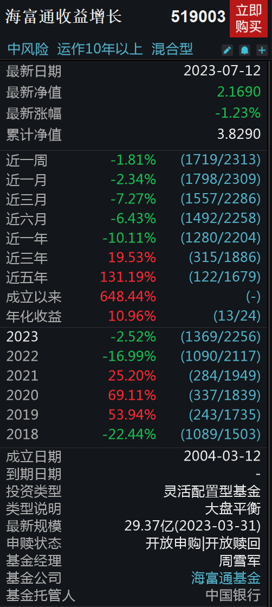

因为过去2年，公募基金整体业绩不佳，网上各种骂，对基金公司、基金经理各种讨伐。******

上周，多家公募基金官宣下调管理费。******

**但是，很遗憾，在老南看来，管理费降费只是治标不治本，如果大家没找到根本原因，一年少千分之几的手续费，大部分人依然长期不赚钱。**

**01**

前阵子，一老南20年前的同事，现在是某券商的省公司一把手，请老南去讲课。******

去之前，想起当年刚工作时，买的一只基金，虽然后来赚钱卖掉了，但想想也差不多20年了，就顺便去查了下。******

这里特别备注：并非基金推荐！并非基金推荐！并非基金推荐！******

这个基金叫海富通收益，2004年3月12日发行，这个基金，如果老南没记错，是国内第一只百亿基金，当时还是小白中的小白的老南，买了。******

毕竟老南当时在海通证券工作，这个基金公司是海通控股的，而且海富通前一支新基金业绩不错，所以这只基金卖的特别热闹。然后老南买进去就跌，套了一年多。******

**时至今日，这个基金换了9任基金经理，规模还剩30亿，19.4年总回报6.48倍，年化收益10.96%，在同期24只可比的基金中排13，也就中游水平。**

**这个中游的收益率，貌似还说的过去啊，毕竟同期沪深300只有1.8倍，差远了去了。**

