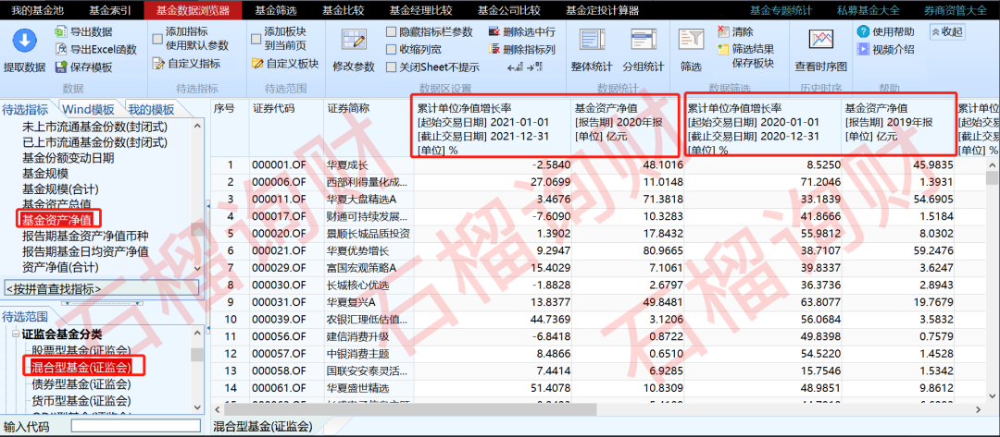
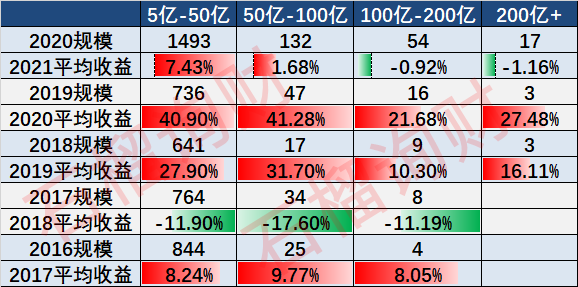
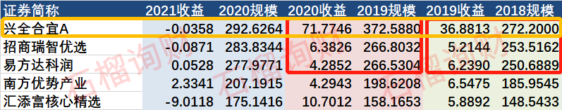

这真不是标题党，而是老南根据过去5年的数据，分析出的结果。  

  

**1**

  

考虑到这篇的确有点砸人饭碗，本来仅发布在《[2022 年如何理财](http://mp.weixin.qq.com/s?__biz=MzAwNTc1NzQ5NA==&mid=2649723029&idx=1&sn=43a1655cb10deccc44d82eddbde90f38&chksm=830cffccb47b76da8da39e37ba2589e7be9eb8f860f709e7eb126396f1c29bc444c80a1ef3cc&scene=21#wechat_redirect)》里的，想想还是公开发表出来吧。  

为避免业内引战，先自保几句：

1、分析数据均来自WIND基金数据库，并非山寨网站，准确性请放心；

**2、老南并非对百亿+规模的基金经理有意见，但规模对业绩的副作用，还是挺触目惊心的；**

**3、过度迷信明星基金经理，抱团百亿基金，是基金投资者，投资收益显著低于基金平均收益的重要因素之一；**

4、如您对结论有异议，欢迎提供您认为正确的算法，老南可以去拉数据算下。

  

**2**

  

  

先简单说下分析逻辑：  

1、分析当年不同规模区间的基金，次年整体收益情况。

如2019年100亿-200亿规模的所有基金，2020年业绩如何。主要是基金规模变动比较剧烈，所以通过组别形式看来年业绩。

2、选择“证券会基金分类”中的“混合型基金”。

混合基金规模相对较大，参与人数较多。

图片来源：石榴询财

然后，得出这个数据：

图片来源：石榴询财

如，2020年，200亿规模以上的17只基金，2021年收益均值为-1.16%；5亿-50亿规模基金，平均收益为7.43%。

那通过这个数据，我们得出结论：

**除了2018年的大熊市，其余4年，百亿以上的基金，收益均不如百亿以下，而且这个差距在扩大。**

这里特别提下，200亿+的组别，看上去19年、20年业绩不错，但实际上，完全靠其中的一只，谢治宇的兴全合宜力挽狂澜，否则均值只有5%，会非常难看。

但21年完全撑不住了，谢治宇的业绩也并不好。

图片来源：石榴询财

  

**3**

  

所以，这个表格，希望你多看几遍，其实就会得出，选择基金时，在规模上要考虑的重要原则：

**1、尽量避开百亿规模的基金，不是基金经理无能，而是规模越大，管理难度指数级上升，获得超额收益是HARD级。**

**2、可以在20亿-60亿规模去选基，一般到这个规模，脱离了几亿规模的“**新手村**”，业绩有所表现，规模才上的来。**

3、以上思路，不仅适用于公募，私募也适用。

  

**结**

  

**对了，最近基金又开始难卖了，不少新募的基金都失败了。**

**一般这种时候，买买基金，定投下，长期看都能获得均值以上的收益。**