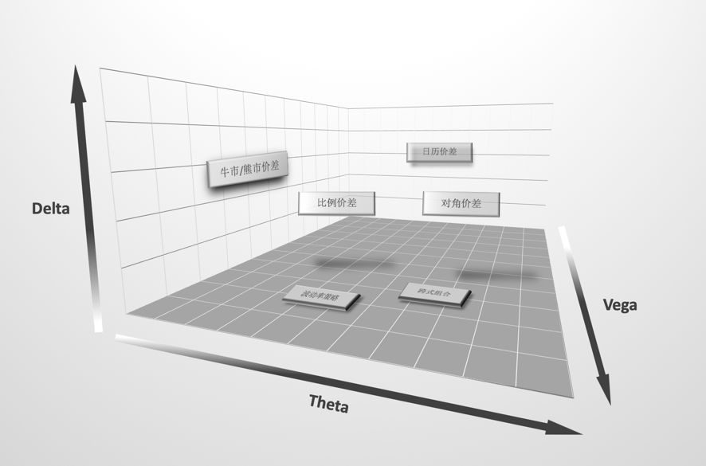
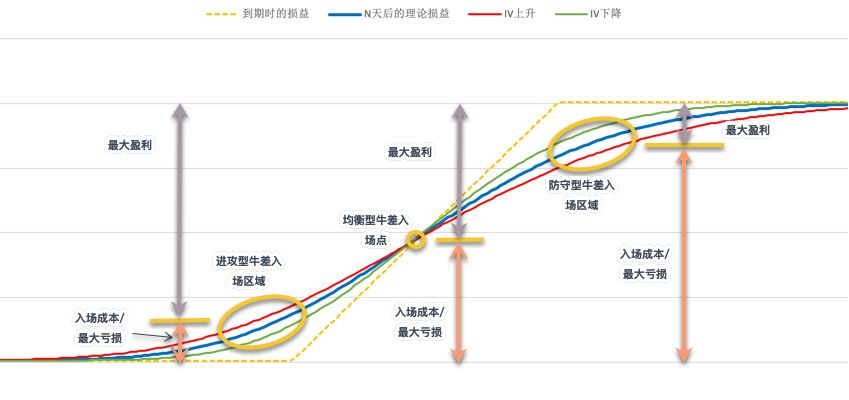
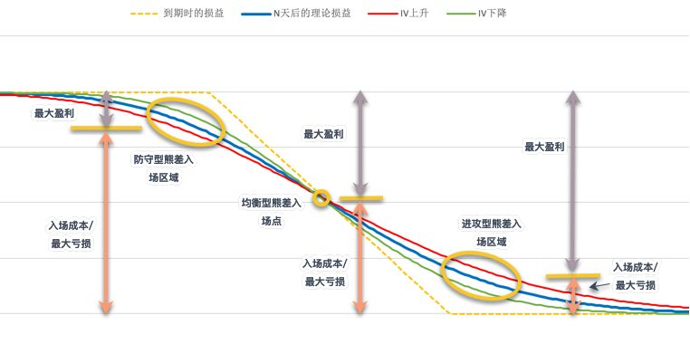
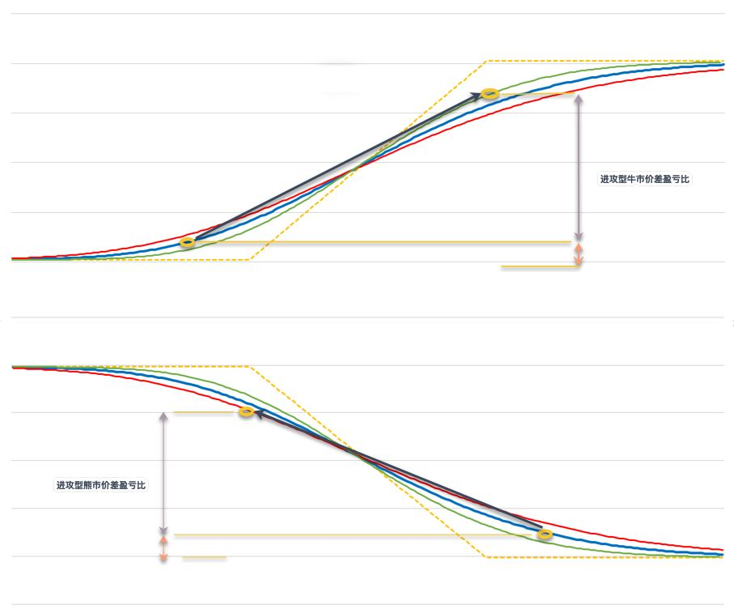
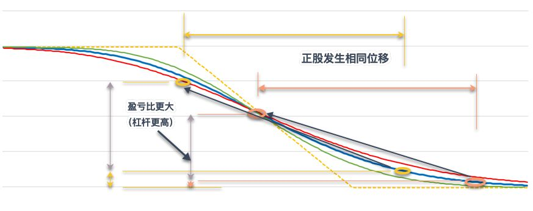
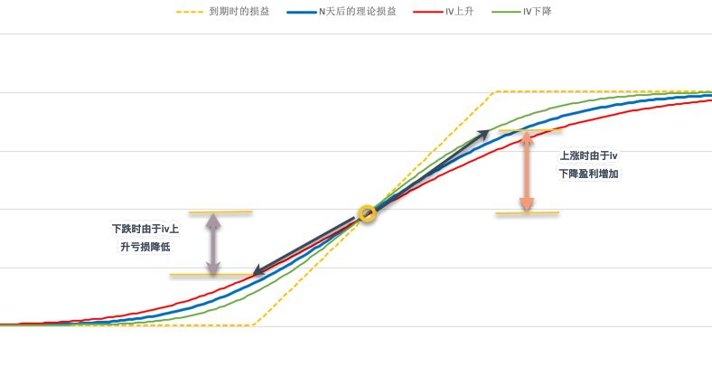
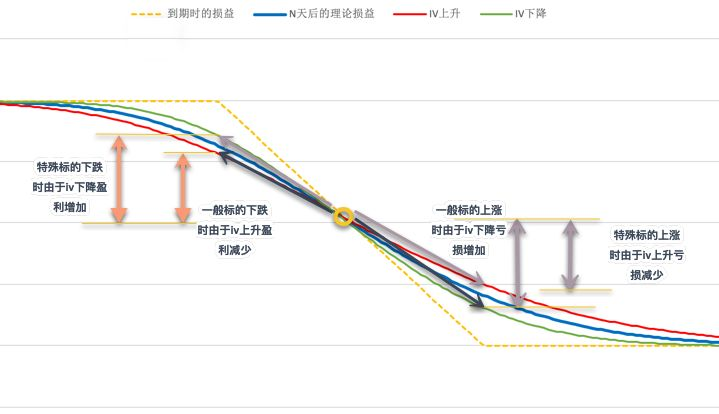
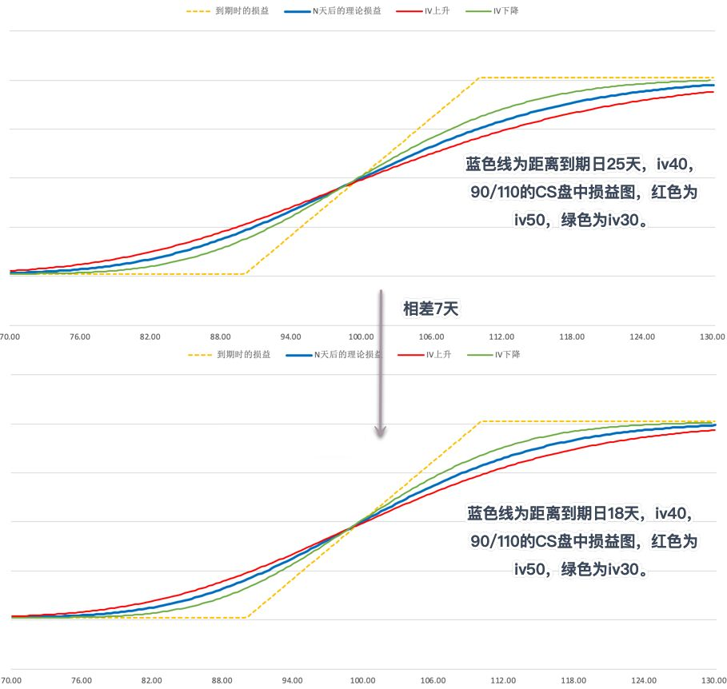
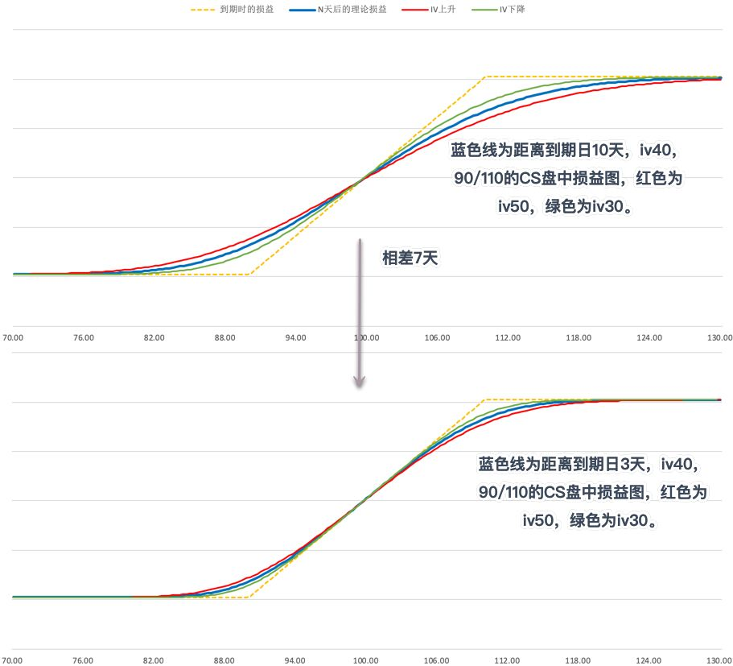

**点击蓝字**

**关注我们**

未来金融研究院

带你进入期权立体世界

之前的文章中(见文末)作者结合实际的交易操作谈了一些观点和策略的建立过程，本文准备系统性地谈一下个人对牛市/熊市价差组合策略的一些理解。

**总述**

牛市价差/熊市价差，英文是Bull Spread / Bear Spread，一般语境下我们也将其等同于Call Spread(CS)和Put Spread(PS)（实际上两者有区别，并且可以形成四种组合，后文会提及）。

其构建的方式很简单，针对某个标的，选择两个同样的到期日，不同行权价的Call或者Put，Short其中一个Call或Put，同时Long另外一个Call或Put即可。

如果将无风险利率视作定值，期权的价格主要由三个因素影响：正股价格位移(Delta)，隐含波动率(Vega)和时间(Theta)。可以将三个因素构建成三维坐标系，衡量不同策略受到三个因素的影响程度，如下图：

图1:不同期权组合策略受Delta、Vega与Theta的影响

牛市/熊市价差组合由于受到Theta的影响相对较小（尤其在到期日较远的时候），距离左侧的平面较近；同样的道理，日历价差组合（特别在没有事件影响时）的位置靠近后方的平面，而跨式组合以及波动率策略靠近底面。对角价差，比例价差及普通的Call/Put单腿策略受到三个维度的影响比较综合。

深入思考还能从图中发掘更多有趣的事情，比如

a. 组合策略中，为什么牛市/熊市价差能够提供最大的杠杆？

因为最大程度地降低了Theta的影响。三个维度中，Theta提供的利润/波动最低，利润/波动更多来自于Delta和Vega，牛差和熊差由于将Theta方向的损耗进行了相当程度的对冲，留下了波动最大的两个因素，所以进攻型策略可以做到单位成本中所含的时间价值最少，故可以做到最大的杠杆。

b. 为什么牛市/熊市价差是组合策略中相对最容易理解的？

因为其最大程度地降低了Theta的影响。时间维度是个抽象概念，难以与一些直观标的（如位置，位移，速度等）组成的二维空间建立联系。分析单一标的在时间上的表现相对容易，但分析处于不同时间点的两个标的组合之后随时间变化产生的不同变化相对较难，因为我们的大脑更习惯从空间的角度去思考问题。信号处理将不同信号在时域上的表现转换到频域进行分析也有异曲同工之处。

扯得有点远，我们重回正题。

**基础篇**

牛熊价差有几个比较直观的事实

a. Long一个价差组合的最低价格为0（一般会略高于0，到期时有可能归零），最高价格为两个行权价之差的绝对值（后文简称为价差）。

b. 到期损益图表中，如果横纵轴比例尺相同，那么两个行权价之间的线段斜率为1或-1。

c. Long一个价差组合的最大损失为入场成本，最大收益为价差-入场成本。

d. Short一个价差组合（稍后会提到，牛差/熊差可以通过Short CS/PS的方式构建）的最大损失为价差+入场成本（此时入场成本为负值），最大收益为入场成本绝对值。

继续扩展的话：

e． Long一个价差组合的盈亏比=（价差-入场成本）/ 入场成本；

f． Short一个价差组合的盈亏比= 入场成本绝对值 /（价差-入场成本绝对值）；

g． 当正股价格处于两个行权价中点时，理论上价差组合的成本为行权价之差的一半（忽略无风险利率），不受到期日与IV的影响。

做进一步的深入讨论之前，我们先预设三个前提

a. 第一个是在没有事件的影响时，股票价格上涨时IV会下降，股票价格下跌时IV会上升（此假设对于绝大多数情况成立，例外的是在标的股票短期内发生连续暴涨，这种情况下即使上涨IV也会上升。鉴于此类情况不多，本文不进行深入讨论）。

b. 第二是对于均衡型价差，忽略无风险利率的影响（否则理论价格会有少许偏离）。

c. 第三，为了方便讨论和定性分析，图2至图7忽略了时间（Theta）的影响，认为Delta位移在短时间内发生（否则盘中损益曲线会发生少许变化）。

**进阶篇**

1. 现价和行权价的关系

根据标的目前价格与行权价位置的不同，可以将牛差/熊差分为：进攻型，均衡型，防守型。对于牛差来说，三种组合分别对应标的价格在两行权价中点的左侧，中点和右侧。

比如，标的现价100时，Long Call 110 / Short Call 120的组合即为进攻型牛差，LC 95 / SC 105的组合为均衡型牛差，LC 80 / SC 90的组合为防守型牛差。

熊市价差也同理，标的价格在100时，可以构建三种类型的组合：进攻型如LP 90 / SP 80，均衡型如LP 105 / SP 95，防守型如LP 120 / SP 110。

进攻型组合的盈亏比大于1，均衡型组合盈亏比等于1，防守型组合盈亏比小于1。

图2：进攻型、均衡型、防守型牛市价差的入场区域及盈亏比

图3：进攻型、均衡型、防守型熊市价差的入场区域及盈亏比

2. 行权价的选择

如果正股目前正股价格在100，对于进攻型牛差来说，是选择105 / 110的行权价还是110 / 120？对于均衡型，是选择90 / 110还是95 / 105？对于防守型应该选择90 / 95还是80 / 90？

总的来说，行权价的选择与对于该标的的观点有非常密切的关系，具体选择什么价位并无最佳答案。不过需要注意两点：

a. 进攻型组合，现价离两行权价中点越远，理论胜率越低，盈亏比越高；防守型组合，现价离两行权价中点越远，理论胜率越高，盈亏比越低。总的来说是盈亏比和胜率的一种权衡，进攻型组合，行权价越远则盈亏比补偿胜率；防守型组合，行权价越远即胜率补偿盈亏比。

b.两行权价之间的距离尽量不要太小，否则点差所占成本比例过高。例如，在正股价格100时，如果选择105 / 106的牛差，最大价格为1，理论价格为0.3的组合可能会由于点差因素实际花费0.34-0.35甚至更高，这时盈亏比就会受到很大影响。

3. 情绪（Vega）的影响

在价差中间点的下方区域（对于牛差来说是该点左侧区域，对于熊差来说该点右侧区域），组合+Vega，-Theta；在价差中间点的上方区域（牛差的右侧区域，熊差的左侧区域），组合-Vega，+Theta。

这意味着什么？

a. 对于进攻型价差组合，高IV是需要克服的成本，一旦入了场，高IV是短暂的保护，但一旦观点正确，正股移动超过了中点，IV下降便成了利润来源。高IV对于进攻型组合盈亏比的影响很大，因为其既影响盈亏比公式中的分子，又影响分母。例如，标的价格100时，对于LC 105 / SC 110的组合，如果组合价格是1，那么盈亏比是4；组合价格是1.5的话，盈亏比为2.33；如果组合价格是2的话，盈亏比就骤降到了1.5。

b.对于进攻型价差组合，在观点正确时，牛市价差盘中损益的杠杆/盈亏比大于熊市价差。

图4:进攻型牛市价差与熊市价差的盈亏比比较

c. 继而，对于进攻型价差组合的行权价选择，如果考虑IV的影响，牛市价差可以将目标价放的离远端行权价近一些（直接放在远端行权价上或中点和远端行权价之间），例如，标的价格100时，如果认为在一定时间内会涨至112，可以考虑105 / 112，105 / 115，或者108 / 112的CS等。

d. 而对于进攻型熊市价差来说，如果想获得更大的盈亏比，可以考虑将目标价放的离近端行权价近一些（如放在近端行权价和中点之间，或者在中点上），这在到期日较远的时候可能会有不错的效果。例如，标的价格100时，如果认为在一定时间内会跌至85，可以考虑90 / 80，或者88 / 80，甚至85 / 80等（短时间到期的熊差组合在入场时，由于组合损益受正股位移影响更大，则不太适用）。从图5中可以看出，在标的发生同样位移的情况下，这种行权价的选择方式可以获得更高的盈亏比，即更大的盘中盈利杠杆。

图5:进攻型熊市价差的行权价选择

e. 对于均衡型牛市价差来说，入场时IV与Theta中性，虽然盈亏比为1，但上涨与下跌具备非对称性，同样的涨幅或跌幅，上涨时由于IV下降将获得更多盈利，而下跌时IV上升则会减少一些损失。如下图，在标的位移距离相同的情况下，上涨时盘中损益由蓝线变为绿线，盈利增加；下跌时蓝线变为红色线，亏损降低。

图6:均衡型牛市价盈利与亏损的非对称性

f. 对于均衡型熊市价差来说，由于其特点与牛市价差对称（标的下跌赚得慢，标的上涨赔的快），所以适用范围不像均衡型牛差那样广泛。但是，对于一些上涨时IV上升，下跌时IV下降的特殊标的来说，均衡型熊差也是不错的选择。比如VIX期货，做空ETF（如SQQQ）等。

图7:均衡型熊市价差盈利与亏损的非对称性

g. 对于防守型组合策略，高IV是利润来源，即使标的在一定时间内不怎么发生位移，也会随着时间流逝和IV下降获得收益（参考图2），因此适合在IV相对较高时入场。

h. 选择不同类型的价差组合，背后对应着不同的观点：进攻型策略背后观点是赌标的向着目标方向在规定时间内进行移动，对方向，距离，时间都有很大的信心；均衡型策略背后观点是认为目标会向目标方向移动，但不太确定移动幅度和移动的时间点，即对方向有信心，但对距离，时间的观点不明确；防守型策略背后观点是在规定时间内不会发生反向的大幅波动，即在方向上排除一种极端情况有信心，对于距离，时间的观点不明确。

4. 时间（Theta）的影响

在文首已经提到，价差组合由于两期权到期日相同，故受到Theta的影响较小。影响较小但并非没有影响，总体来说价差组合受到时间的影响和Long Call和Long Put类似：即距离到期日较远时，Theta损耗较慢，在接近到期日时，损耗不断加速。

图8与图9显示了，同样是相差7天，在距离到期日较远和距离到期日较近的情况下，盘中损益的变化会有比较大的区别。

图8：距离到期日较远时，Theta对盘中损益的影响

图9：距离到期日较近时，Theta对盘中损益的影响

5. 牛市价差/熊市价差与CS/PS

根据期权的平价公式可以推导出，所有的Long CS可以等价为一个行权价相同的Short PS，如Long Call 90 / Short Call 110 (LC 90 / SC 110) 与Long Put 90 / Short Put 110（LP 90 / SP110） 具有完全相同的到期损益与盘中损益。那么意味着：

a.进攻型牛差可以用Long虚值CS或Short实值PS进行构建；防守型牛差可以用Long实值CS或Short虚值PS进行构建。熊差也可以类似推导。

b.无论使用Long CS或Short PS构建牛市价差，入场成本，最大收益和盈亏比完全相同（参考基础篇事实3和事实4）。入场成本均为图2中下半部分，最大收益均为图2中上半部分。

c.无论使用Long CS或Short PS构建牛市价差，保证金没有变化。Long CS使用图2中下半部分作为保证金支付CS费用，Short PS暂时得到图2中上半部分的权利金，但要减去价差作为卖方保证金，最终二者剩余保证金相同。（此处属于理论推导，具体交易时的保证金收取最终要看交易所及券商的规定）

d.使用Long CS和Short PS的最大区别在于对于正股变化路径的处理不同，即在盘中根据正股价格波动将两条单腿期权分开平仓时遇到的情况不同，以及在Short实值期权时面临被提前行权情况的不同。由于情况类别较多本文在此不进行展开。

e. 上述两个维度可以组合成四种组合：Bull Call Spread，Bear Put Spread，Bull Put Spread和Bear Call Spread。其中前两者属于Debit Spread，对应正的组合报价。后两者属于Credit Spread，对应负的组合报价。由于前两者的应用较为普遍，所以在一般的语境里，可以把牛市价差等同于CS，熊市价差等同于PS。

**结尾**

看似简单的牛市价差组合，随着多个参数的变化，可以构建出千万种组合，期权具有无限的魅力。跟买卖股票相比，除了交易标的本身的价格移动这一维度，期权还可以结合其他两个维度，在三维的空间中进行立体交易，从而在不确定的世界中找到多一点的确定性。怎么样，是不是有点小兴奋？

本文作者更多精彩文章

[学员交易笔记|防友尽，做期权最好别讨论这个](http://mp.weixin.qq.com/s?__biz=MzU3MzY1MTY5OA==&mid=2247485204&idx=1&sn=b97f9447e6da791feef523c1a17e95c4&chksm=fd3f2889ca48a19fcb49dd2219e9c8b10e9013e53da502ccd7995cd16914441d437aebf3cab4&scene=21#wechat_redirect)

[学员交易笔记|交易腾讯巨大失误导致仅赚70%](http://mp.weixin.qq.com/s?__biz=MzU3MzY1MTY5OA==&mid=2247484909&idx=1&sn=6fa14d74d1a9d3cf27f0404230c37c95&chksm=fd3f2a70ca48a36636c366cb5f7e7487889bc1e00dd7efcf351b91ad25dfeebaeaf691ac2df2&scene=21#wechat_redirect)

[学习期权一个月，如何把收益做到一倍半](http://mp.weixin.qq.com/s?__biz=MzU3MzY1MTY5OA==&mid=2247484492&idx=1&sn=1ab739dd4d9b6b65ea04819176b769b7&chksm=fd3f2bd1ca48a2c714b480a7c6d5caeae6804a95a7de8ea2e25b91e175bce19bcd369c22d7c3&scene=21#wechat_redirect)

[学员交易笔记|分段接力助力账户新高](http://mp.weixin.qq.com/s?__biz=MzU3MzY1MTY5OA==&mid=2247485062&idx=1&sn=82e37c725b48ae8abd3d489fd7c5033d&chksm=fd3f291bca48a00d62fcf5f70fafa7b6068e8fdd522aa23db2396d5e715227edc9ec4cdeeea5&scene=21#wechat_redirect)

**本文（本公众号）所有内容仅限于投资者教育，所有内容不构成任何交易指引性建议，投资者需独立承担自己投资决策的结果。**

End

快，点击这张图片，一起涨姿势～

