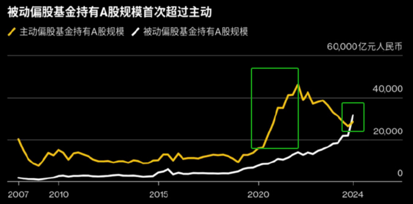
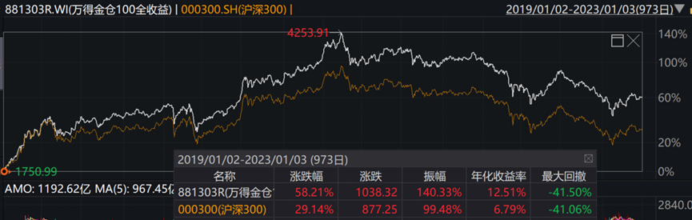
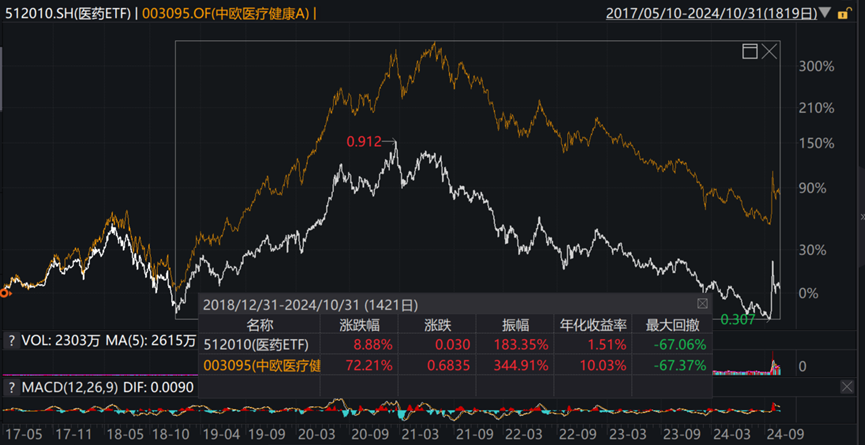
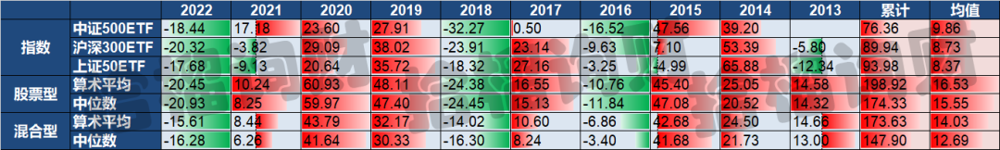
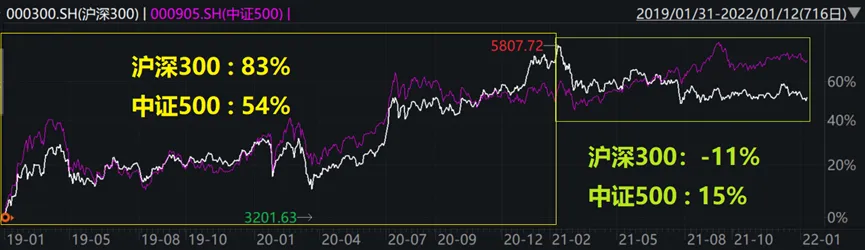
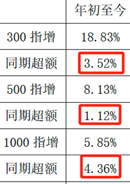

这两周老南出差比较多，忙得转不开。

今天把内参前阵子的一篇文章修改下，供大家参考，即聊聊ETF的缺点。

这个时候写ETF的缺点，很容易招骂，就和我们20年底提醒公募基金，尤其百亿基金的风险，以及今年一直建议要标配A股一样，评论区不少都在骂，毕竟和当下主流观点很不一样。  

  

**01**

  

随着19-21年期间，尤其21年规模暴增的主动偏股公募基金，在22、23年的回撤中，大量40%、甚至50%的回撤，让投资者失去信任。

逻辑可参考我当年写的《[投资百亿基金，就输在了起跑线上](投资百亿基金，就输在了起跑线上.md)》

去年以来，以ETF为代表的被动型基金，受到青睐，截止到今年3季度，历史上首次规模超过了主动基金。

这两天，距9.23，A500指数推出一个多月，跟踪A500的指数基金规模达1035亿，创下境内指数基金最快突破千亿的纪录。

**这几天和一些业内交流这事，大家都不约而同的认为，按照历史看，但凡散户一窝蜂冲的投资品，大概率最后一地鸡毛。ETF这波也难避免。**

ETF的优点这里就不多说了，本质就是根据对应指数，复制一篮子股票，能拿到均值回报。这里主要说说这个工具的缺点。

  

**02**

  

**首先，长期收益跑不过主动管理人，风险却一样。**

我们在wind里构建一个对比，一个是沪深300（黄线），一个是万得基金重仓股100（白线），就是基金重仓的票。

图片来源：wind

你会发现两个指数的波动形状高度一致，从19年行情开始，到23年初，金仓还跑赢了指数一倍，但两者的回撤是一致的，都在41%。

**这也是过去多年我自己实践下来发现的ETF的最大的缺陷，就是长期牛市过程中，跑不赢主动型产品，但下跌的时候，和主动型产品一致，一点都不少跌。**

就是收益跑不过，风险还一样，那优势在哪里？

再举个行业ETF的案例，被全网骂成翔的兰兰的中欧医疗健康，从19年初行情开始到现在，和医药ETF的对比。

这会医药ETF还剩8%的涨幅，而兰兰的中欧医疗还有72%的回报，但两者的最大回撤，恰好一模一样，67%。

图片来源：wind

是不是？主动型行业指数，只要别选的太差，相对行业ETF还是比较容易做出超额收益的，但真行业开跌的时候，ETF跌的一点不少。典型的赚的少，跌起来一点都不少。

有兴趣的，还可以看我们去年写的这篇——《[首选指数？巴菲特这话在A股并不对](首选指数？巴菲特这话在A股并不对.md)》，里面列举了大量的数据。

数据来源：wind  拾榴询财

  

**03**

  

**其次，但凡是指数，都存在行业或风格的暴露，这就存在择时的问题，这是需要专业驾驭的。**

举个例子，上一轮19、20套的最狠的一批基民，很多是重仓什么坤坤、兰兰之类这批百亿网红基金的。

这批基金的风格非常明显，就是重仓蓝筹，重仓价值，重仓行业龙头。实际上，这个风格和沪深300是高度相关的。

然后到了21年，蓝筹开始大跌，光伏、新能源为代表的成长股开始涨。这个风格又开始和中证500高度相关。

这个图就很清楚了，19年初到20年底，300跑赢500近30%，而21年，500又跑赢300近26%。

要知道，300和500可是最重要的两大宽指，但风格的差异还是很明显的，这个差异是由指数构成的个股、行业差异导致的。

那更别说行业指数，对择时的要求更高，如这波埋人最多的医药、医疗，21年高位没跑掉，回撤67%。

  

**04**

  

**再次，ETF本身是存在套利制度的。**

**很多人没意识到，ETF是各类量化基金，尤其是套利量化重点跟踪的品种。**

通过各种对冲、场内场外，能玩出花来。散户在猛冲ETF的过程中，产生的任何秒级的价差，都会被套利基金吃掉，也就是不断的小刀割韭菜。

这个话题有点复杂，但是必然会存在的。所以我绝对相信，各家套利都会盯着各ETF，在散户猛冲的过程中，寻找套利机会。

**所以，我自己的投资组合里，唯一和指数相关的，就是私募量化指增，还是通过FOF的形式参与，虽然今年量化超额很难做，但超额还是有的。**

各位感受下，这是某大券商统计的，私募量化指增产品，今年的均值超额数据，更别说优秀的产品了：

  

**结**

  

**所以，不是说ETF不好，在美国这样的高度机构化的成熟市场，市场定价精准，主动管理产品和各对冲基金，想长期超越指数，还是挺难的。**

**但在A股，韭菜如此茂盛的市场，且波动率是美股的3倍，长期超越指数，并不难，千万别迷信指数。**

因此，从配置角度而言：

**最优选还是去挑选一些有长期超额能力的主动型管理人，或者优质的私募量化指增产品。不过，这个是有难度的，只适合有专业选择能力的投资者。**

**其次选，就是去选择一些优质的FOF，无论是公募FOF，还是私募FOF，还是能创造出显著的超额回报。**

**如果再其次，那ETF是最无奈的保底选择。**

关键如果选择ETF，这种持续100%满仓的产品，在牛熊转换时的择时止盈还是很重要的，不然在A股这种超高波动的市场，牛市期间没超额垫底，一转熊，盈利部分能跌光。