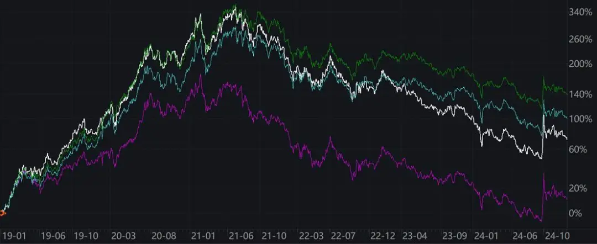

上周老南写了《[长期持有，反而成了亏损之源？](长期持有，反而成了亏损之源？.md)》，评论区也比较热闹。

今天顺着那篇文章，聊下A股至关重要的超额收益。

**1**

**正是因为A股波动率过高，导致对于有优秀交易能力，或者基本面分析水平的管理人而言，是可以获得显著高于基准指数的回报。**

先看个医药指数的行业主动型基金

下图紫色，是医药ETF，另外三个，对应着3个主动管理型医药公募基金。这几个都是最近咨询中，客人拿来问老南的。

数据来源：wind

我们评估产品，至少要看一个牛熊周期，即从19年初，上一轮行情启动开始，到24年底，熊市到底，前后6年。

数据来源：wind