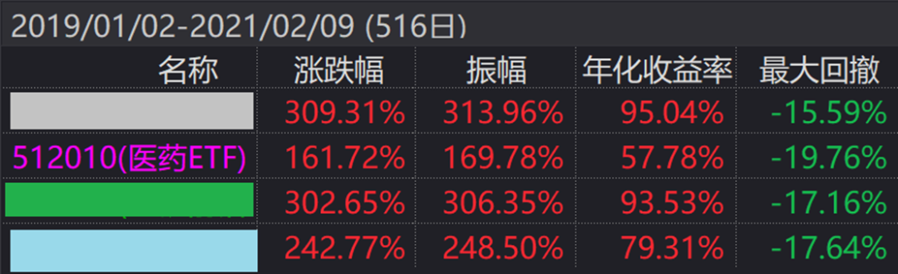
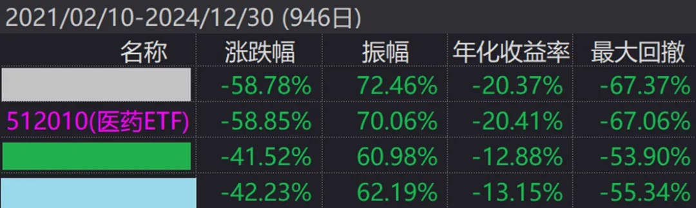

上周老南写了《[长期持有，反而成了亏损之源？](长期持有，反而成了亏损之源？.md)》，评论区也比较热闹。

今天顺着那篇文章，聊下A股至关重要的超额收益。

**1**

**正是因为A股波动率过高，导致对于有优秀交易能力，或者基本面分析水平的管理人而言，是可以获得显著高于基准指数的回报。**

先看个医药指数的行业主动型基金

下图紫色，是医药ETF，另外三个，对应着3个主动管理型医药公募基金。这几个都是最近咨询中，客人拿来问老南的。

数据来源：wind

我们评估产品，至少要看一个牛熊周期，即从19年初，上一轮行情启动开始，到24年底，熊市到底，前后6年。

数据来源：wind

从整个6年看，医药ETF上涨10.31%，年化仅1.65%，考虑到中间还有67%的回撤，可谓是地狱级的投资体验了。

而看另外3个主动型行业基金，会发现各有千秋。灰色基金年化9.42%，6年涨了71%，但最大回撤很巧，和指数一样，67%。

绿色是三个钟最猛的，6年下来还有138%的回报，年化15%，最大回撤53%，可以说非常强了。

蓝色稍逊些，但也年化12%，累计差不多翻翻，99.91%，回撤55%。

**2**

这里，我们做个分段统计，以医药指数最高点，21年2月分开看。

先看上涨周期。

**19年初到21年2月，2年多的上涨周期，医药指数上涨了161%。**

**灰色和绿色，都有300%，超额非常夸张了，2年跑赢指数140%。蓝色稍逊，也有242%。**

**而期间的最大回撤，居然收益最低的医药指数是最大的，有19%。**

数据来源：wind

再看下跌周期。

灰色和医药ETF，涨跌幅基本一致，最大回撤也基本一致，67%。

而绿色和蓝色，涨跌幅倒也一致，回撤也一致，而且最大回撤比指数低了10%多。但客观地说，对持有人而言，-50%和-60%，体感上差距并不大。

数据来源：wind

**可见，灰色基金在牛市有显著超额，熊市没超额；蓝色基金在牛市超额偏小，熊市期间超额不错；绿色基金在牛熊市超额都不错。**

**3**

综上，我们发现：

医药主动型行业基金相对医药行业指数，在牛市期间超额非常明显（2年有100%+），在熊市期间也有超额，但远小于牛市期间（3年10%+）。

**即，如果有明显的行业牛市机会，主动型相对行业ETF，会有大额、显著的超额收益。如行业进入全面熊市，主动型相对行业ETF的超额偏小，跌幅接近。**

**从全周期角度而言，主动型行业基金在牛市期间的大幅超额，是熊市剧烈回撤下的保护垫。**

也因此即使经历了这轮超级医药大熊市，行业β下跌了67%，主动型行业公募基金，不少还有10%左右的年化。

基于上述的总结，我们可以得出个简单的交易策略：

**行业发动初期，主动型行业基金，是最佳选择，毕竟能跑出非常显著的超额。一旦行业进入熊市，无论拿的啥能跑还是要坚决跑。**

**而之前主动型的超额，是你跑晚的安全垫。**

**结**

当然，这篇毕竟不是论文，有兴趣的可以把所有行业主动型产品拿出来研究，会发现很多有意思的情况。

**对于我们而言，如果真看好某个行业，尽量还是在行业估值偏低的时候，从至少经历过一个行业牛熊周期的管理人里，去选择尽量牛熊阶段都有超额都管理人。**

**当然，别仅看业绩，也要看下季报股票持仓，反推下管理人一路下来的逻辑判断。**