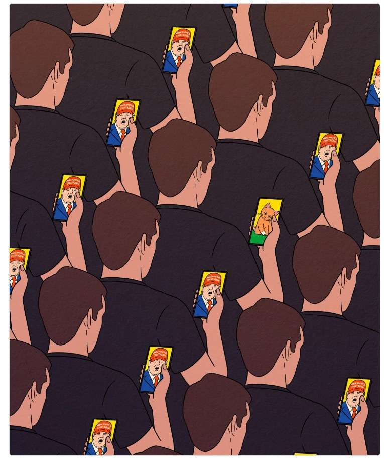
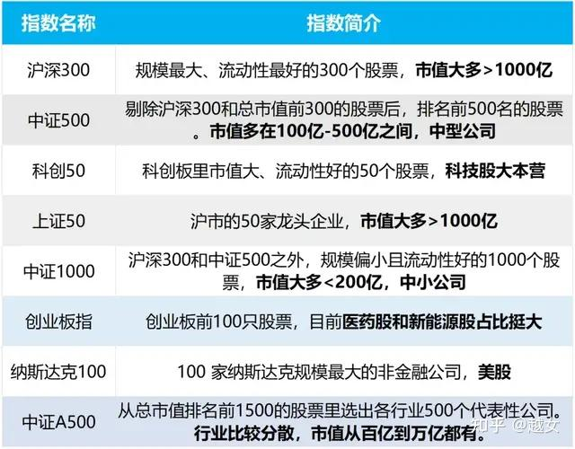
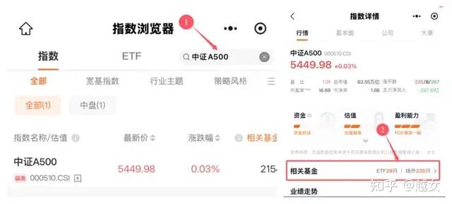
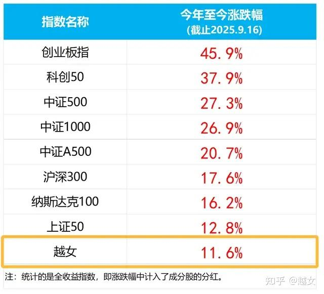
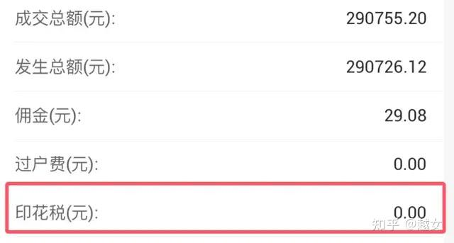

服了服了。

今天自取其辱了

去年年底，我盘点过8个最常见的宽基指数。

就是下面这些。

为啥，它们是最常见的宽基？

因为跟踪它们的指数基金**数量**多，**成交额**也很高。

大伙爱买、常买。

是市场最活跃的指数。

如果你是小白，无从下手。

又很想跟上牛市节奏。

那可以先看这8个，买买它们对应的指数基金。

极简、省事，好上手。

我刚刚又复盘了一下，这8个的规模、活跃度没太大变化，仍然是目前最活跃的宽基指数们

我估计很多人会问：怎么找到这些指数，对应的基金呢？

挺简单，还是用昨天提过的「**红色火箭**」小程序

点击这里：**红色火箭** ，打开小程序。

在右上角搜指数名字，比如中证A500。

点击下方搜出的指数名称，在详情页点击"相关基金"

就能看到跟踪它的所有基金代码、规模、成交量、各种费用...

特别清晰明了。

选自己中意的就行了~~

**二**

好了好了，其实前面都不是重点。

重点是——

我手贱了。

把这8个宽基指数今年涨幅统计了一下。想着：

我总能跑赢几个吧！给自己打打气~~

结果——

**一个都没跑赢...我被群殴了...**

囧，我知道今年我业绩不行，但没想到不行到这种程度了。

热门宽基，一个没跑赢。

连最迟钝稳重的上证50，都跑我前面去了。

这...我有点脸红...我不想说话

我想蹲地上哭一会5555

咳，开玩笑开玩笑。

别安慰我。

我自己是收息风格为主，注重防守，在牛市跑不赢指数倒也正常。

我正在努力的追赶ing

成绩是其次，倒是这句话，又一次证明了它的含金量——

**牛市买宽基，比自己瞎折腾个股强。**

虽然牛市里，宽基表现不是最亮眼的，但不管哪个行业涨了，它们都能跟着一起，吃点肉、喝点汤。

不像你重仓了个股，或者太细分的行业。

风不来，它就是不动

**三**

买宽基ETF呢，还有个额外好处，很少有人注意到。

它手续费很低，如果你经常买啊卖啊的。

**帮你省下不少钱。**

**结结实实地省很多。**

能省多少呢？

比如跟你在支付宝买基金比——

同样是买1万块的中证500ETF（512500），我用券商软件买一笔1万元，佣金是**1块钱**。

买也1块，卖也1块。

（在我这里开户的小伙伴，买卖ETF的收费都是万分之1，最低0.2元）

但如果在支付宝等三方平台买它的联接基金，申购费是0.12%

买1万块要给基金公司**12元**

持有不到一年就卖掉，还要交至少0.5%的赎回费，这又是50块钱没掉了。

是不是很心疼。

当然，很多人会选C类。

买时免费，持有满7天再卖也免费。

但一是C类另有一个"销售服务费"，持有越久，收得越多，它只适合短持；

二是，赎回费马上要改规则嘛，我上周聊过。点击重温

以后C类哪怕短持，也不吃香了...

。。。

以上是ETF跟场外基金相比。

它还有一个巨大的优势，是跟买卖股票比。

**卖ETF时，不用交印花税。**

**而卖股票时，必须交0.05%的印花税。**

这也能省下不少钱。

我直接拿自己举个例子吧——

前段时间，我分别卖掉了29万的ETF，和29万的股票。

对比很鲜明：

ETF卖掉时，收了我29块钱的佣金。没有印花税。

而股票卖掉时，除了佣金，国家还另收了我一笔印花税。

29万的0.05%，是**146元**。

同样是卖29万，ETF成本只需要20多块钱。而股票成本要170多。

这找谁喊冤呢。

我一个女性朋友最近买卖特别频繁，牛市了嘛，兴奋。

忍不住买了又卖、卖了又买。

她说：

打开交割单，有一种深一脚、浅一脚的感觉。

经常几笔很少的佣金后面，突然来一笔很大的支出。

仔细一看，哦，感觉是股票印花税

我上次晒印花税时，有人不以为然：

不就几十块钱、一百来块嘛，这也值得你心疼？

不是这么算的...

我又不是只交易这一笔。

交易的次数多了，成本差距就陡然拉大了。

想想看——

如果一个人有100万的持仓，一年能有1千万的交易额，那光股票的印花税就要交5000块。

如果换成ETF，这5000块就省下了。

它不香嘛~

所以咧，说了半天，总结就一句话——

如果你不太会研究股票，平时交易又频繁。

**买ETF，是要省钱方便许多的。**

买ETF呢，也是建议首选宽基，会比你贸然冲到热门行业基里，更安全。

最重要的是：

宽基它数量少哇。

数量少，研究需要的精力就少。长时间盯住那几个看就行，持续观察。

时间长了，你自然就有感觉了。

什么时候适合买哪一个，哪几种可以搭配在一起...

越熟，就越不容易踩坑。

等宽基你有把握了，再慢慢把能力圈，扩宽到行业。

这比今天研究创新药、明天学习AI芯片人工智能、后天又盯上汽车链...

要好得多
