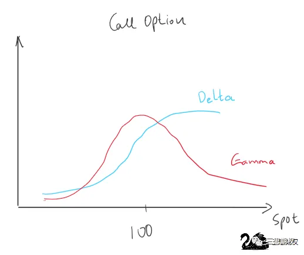
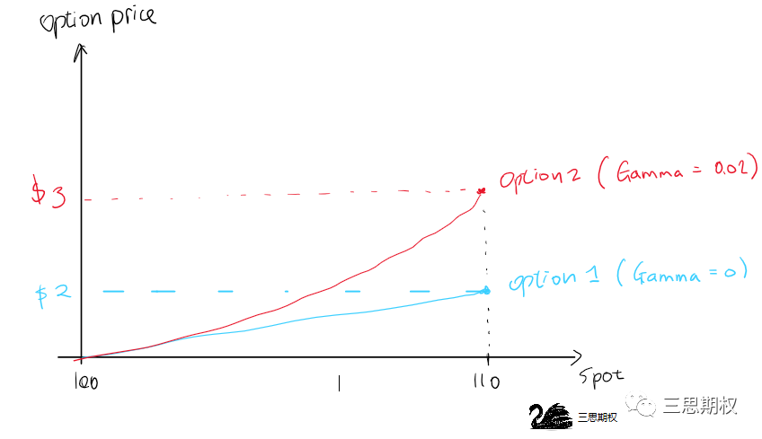
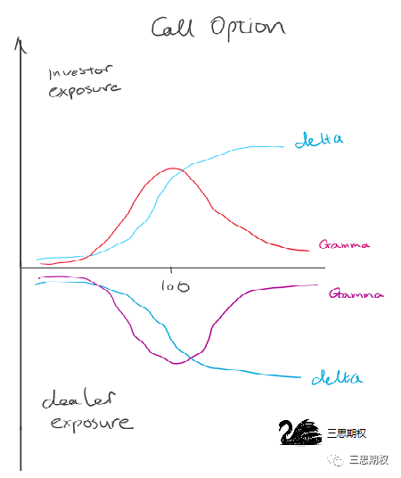
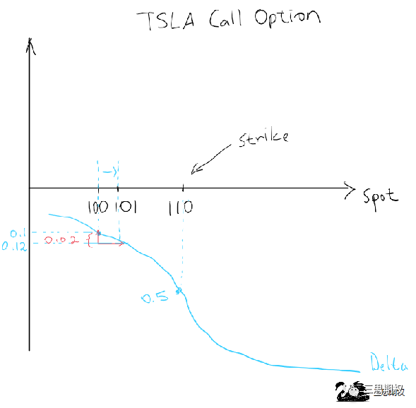

**【白话期权】**

白话期权板块意在用最直白，最简单的语言来解释期权，波动率这些复杂的概念。让只懂加减乘除的朋友也可以理解并将期权运用到交易当中。曾经在期权上吃过亏的朋友，不要气馁，重新通过我们的白话期权认识一下期权的利弊，风控和技巧，相信会让你对期权有新的认识。被期权公式吓退的朋友和完全没接触过的朋友，只要认真的读懂每一篇文章，你们就会可以灵活的运用期权来增加收益和避讳风险。我们坚信不疑期权是每个金融市场参与者必须要了解且会使用的工具，而且随着中国期权品种越来越多，散户要与时俱进的把期权利用起来。_

这篇文章并不是一篇基础科普，但由于软银近期的巨额交易给市场造成了比较大的波动，很多朋友很想知道我们之前文章里提到的Gamma效应是什么。本文我们就用简单的语言，用故事带入的方式给大家详细解释。

想要了解Gamma效应，我们要先熟悉一下看涨期权Call的特性：Delta和gamma两个希腊字母。不懂这些是什么的朋友不用担心，先记住下面这几点特性，就可以看懂这篇的逻辑了。

01 **Delta and Gamma 101**

买入看涨期权，拥有正Delta 和正Gamma。卖空看涨期权，风险暴露就是负Delta，负Gamma。

如果一个期权有正Delta，那么标的物升高的时候，这个期权的价格就会相应的上升， 反之亦然。期权的价格上升多少，取决于Delta 是多少。如果是 0.1 个Delta， 那股价每上升$1，这个期权价格就上涨$0.1。 所以我们也把一股股票看作是1个Delta （这个知识点在下面解释Gamma效应时会用到）。

一个期权的Delta大小不是恒定的，会随着标的物的价格改变而改变，至于改变多少，取决于该期权的Gamma。

Gamma的特性是Gamma的数值决定了期权Delta随标的物的变化而改变多少。随着标的物的波动，Gamma值越大的期权，它的Delta变动的也越大。

一个期权的Gamma大小也不是恒定的，会随着标的物的价格， 以及其他因素的改变而改变。

结合上面解释的特性，先给大家举一个简单的例子。当前股票X价格（spot）为100，执行价位是120的有两个看涨期权的价格同为$1,波动率恒定，没有时间价值损耗。

期权1: Delta= 0.1,Gamma = 0

期权2: Delta= 0.2,Gamma = 0.02

假设股价从$100涨到了$110。

期权1:由于Gamma为0，其他情况也不变的情况下，delta不会变化。由于股价的升高，我们可以推算出期权的价值至$2($1 + ($110-$100)*delta(0.1)= $2)。

期权2:由于Gamma为0.02，其他情况也不变的情况下，delta会随着股价变化而变化。股价每涨$1，Delta就会增多0.02。当股价涨到$110的时候，delta则上涨le0.2 (($110-$100)*0.02)，也就是说这个期权的Delta随着股价的上涨也在上涨,股价涨到110时，期权2的Delta涨到0.3。

在上面的例子里，期权2越来越大的delta会带来什么不同呢？它意味着期权2的价格的变化的幅度也在增大。股价上升至$110，期权2的价格上升的幅度就要远大于期权1。

**Gamma**是期权最重要的概念之一，**也是真正的交易者最喜欢拥有的风险敞口。拥有正的Gamma就意味着当市场朝着有利的方向发展时，仓位的利润就如滚雪球般逐渐增大的；而市场朝相反的方向发展时亏损累计的速度则会越来越小。这也是交易最终奥义所在，但天下没有免费的Gamma，篇幅有限这里就不展开讲了。**

02 **市场中性策略与Gamma效应**

跟普通散户想象的可能不同，期权做市商和大部分机构多数时候并不带有方向性，更多的时候是交易波动率。

但是不管是买入还是卖出期权，不管是看涨还是看跌期权，都会有来自Delta的方向性的风险敞口。因此机构在交易波动率的时候，绝大多数情况下会对冲掉Delta的风险，从而保持市场中性。

而保持市场中性的原则是市场上出现Gamma效应的必要条件之一。下面我们利用软银"gamma鲸"作为例子，利用虚构的数据以及故事给来讲解一下基本原理。

**市场中性策略**

孙正义正准备在期权市场上大干一场，准备大量购入以特斯拉为首的股票的看涨期权。带着强烈日本口音的英文打电话给XX投行的股票期权交易团队，为100万张，3个月到期,行权价为$110的看涨期权询价。特斯拉股票此时价格正在$100.

8月份正是高级交易员们最通常休假的时间，因此这个时候多数都是苦逼的初级交易员值班。原本这个时候市场交易一般都较为清淡，因此这个日本人不小的询价单子过来之后让初级交易员有所警觉。为了不捅娄子，小鲜肉交易员给出了比交易所屏幕上显示的稍差的报价。本想着日本人可能会知难而退转而找其他家问价，没想到电话那头干净利落的一句“done（成交）”就挂了电话，留下了一脸懵逼的交易员。

如下图所示，那这时候作为软银（investor）的对手方，投行（dealer）期权仓位Delta以及Gamma风险正好相反。

这时初级交易员用模型一算，期权的Delta为0.1，Gamma为0.02。为了把这个例子简单化，我们在这里假设Gamma不变。

由于是期权的卖方，交易员的交易账户上Delta风险显示为-100k(1百万张期权*-0.1Delta)的敞口，意思就是现在的Delta敞口等于做空了十万股特斯拉股票。虽然这十万股的做空敞口倒不至于马上接到风控的警告电话，但是为了不给正在度假的老板心里添堵，初级交易员决定先要把他方向性的delta风险对冲掉，因此转手就打算在股票市场买入十万股特斯拉。

如果这单股票买单成交，空100万张特斯拉看涨合约，加上做多十万股特斯拉加在一起后总体delta风险为零，这类仓位也通常被称为**delta neutral(即delta中性)**，也是做市商通常的仓位。而正是做市商为了保证delta neutral的原则导致Gamma效应。

**Gamma效应**

特斯拉的市价仍然为$100,初级交易员马上以$100美金的价格挂了十万股买单。

通常来说特斯拉这类流动性较好的品种，买单很快就会成交。但是今天的市场有点奇怪，就在初级交易员下单不久之后，他发现市场上开始频繁出现类似的大额买单，很快就将股价推升至$101。

单子没有成交让交易员有开始警觉，隐约觉得这些买单很可能是由于日本人也从其他银行手里买入了类似的期权，导致其他银行的交易员开始做类似的对冲交易。

此时已经开始警觉的他，再次刷新了一下模型。如下图所示，由于股票上升了$1,期权的Delta从0.1上升到了0.12（0.1+ 0.02gamma）。意思就是此时此刻，交易员的现在期权最新敞口相当于做空了十二万股特斯拉，比之前的做空敞口多出了两万股**。为了完全对冲掉Delta风险，交易员现在原来十万股的基础上再多买入两万股特斯拉。

这新增的**两万股**便是本文的核心知识点Gamma效应。当股价从$101上升至102，103….以此类推交易员手里期权的delta不断变大（即做空特斯股票的数量越来越多），直到上升至1（一个期权的最大delta为1）。这意味着该交易员特斯拉股票的对冲仓位由最初的10万股，会一路随着股票价格上涨最多加仓到100万股。

当股价上升之后，期权的卖方的Delta敞口永远都是向自己不利的方向变动。Gamma效应用简单的话说，就是当股价上升，投行的交易员此时需要买入更多的股票来对冲期权产生的做空敞口，在这些对冲单的量足够大的时候，大量买单进入市场后又将股价推升，形成一个正反馈。

这也是为什么，我们在上一篇《[巨鳄出现！200亿美金的疯狂赌注！](http://mp.weixin.qq.com/s?__biz=MzIyMzkwMjc4MA==&mid=2247484015&idx=1&sn=a776fc4e4506d2f80c1095f7b5e012e3&chksm=e8166f3cdf61e62aa8640b86f8e4e01087fa0d53992dcd424aeff02f13d35e90f3cc8650ce2d&scene=21#wechat_redirect)》里提到，投行要在股价攀升阶段买入更多股票来对冲软银的对手仓位，而且最终文末的结论是科技股股价波动会增大的原因，市场之后的变动也证明了我们的看法。**Gamma**效应本身并不改变市场的方向，由于有一波追涨杀跌的对冲者存在，只是会把市场已经出现的波动扩大。

今天我们的内容就到这里，希望这篇科普文能够帮大家看明白我们之前两篇“巨鳄”文章里的内容。过两天我们将为大家分享一篇我们三思社社友的非常专业硬核的“脑洞”文章，用另类的方法解释市场上8月底出现隐含波动率与股价同涨的现象，敬请关注。