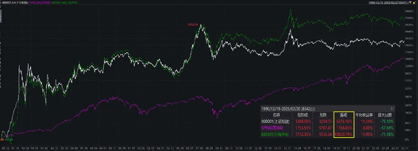
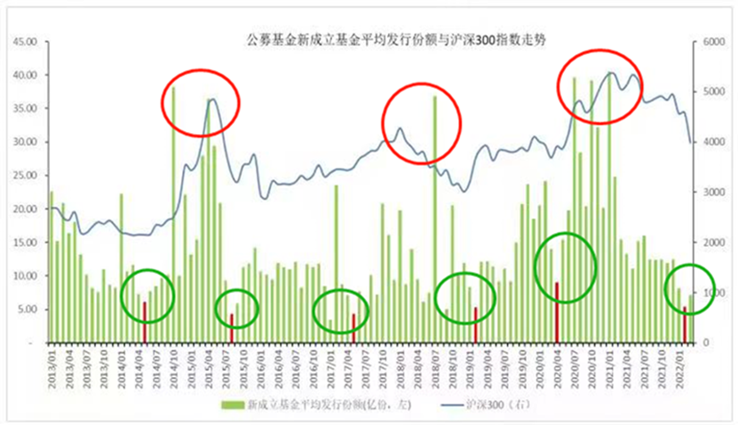
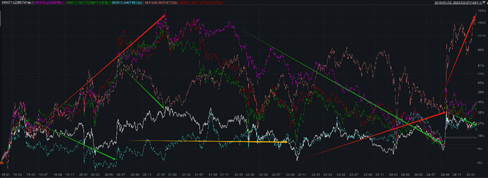

最近在客人咨询过程中，发现即使去年9月的绝地反弹后，不少客人的持仓，依然亏损幅度不小。

**而这里有一个很大的因素，在于大家都简单认为，选一个当时业绩好的产品，长期持有就好。**

实际上，这个逻辑并不一定正确。

**01**

我们先看一张图，白线是上证指数，紫线是标普500，绿线是wind全A，统计从有数据开始，即1990年12月19日到今天，30多年了。

这个图并非让大家关注涨幅，而是请大家关注振幅，即波动率。

你会发现，这30多年，标普500的振幅，是1768%，而蓝筹为主的上证指数，直接是6276%，代表全市场的WIND全A，振幅直接干到了10820%。

**这背后就的典型的新兴市场和成熟市场的区别，之前有过数据统计，A股的波动率，是美股的3倍，这就直接导致了A股的持有体验，比较差。**

大牛市的时候满地市梦率，大熊市的时候跌满地破产一样。

这就意味着，如果并非熊市低位进入这个市场，而是牛市，尤其牛市后半场进入，且高位不止盈，会一套好几年。

而且至少30%-50%的回撤，会让你痛不欲生。

**这里的核心，就是超高的波动率下，止盈非常重要，不然就是多年的关灯吃面。**

细节可参考老南之前写的《[亏钱最多的基金背后，有这些秘密]()》、《[投资百亿基金，就输在了起跑线上](投资百亿基金，就输在了起跑线上.md)》。

而从下图可以看出，基民猛买基金的时候，往往都在牛市后期。

大家有兴趣可以翻翻我们的历史文章，20年底21年初，老南提醒消费这些太贵的文章下，评论区全是骂老南的。

然后去年上半年，我们反复写A股估值严重低估，至少要标配，虽然不知道什么时候涨。然后评论区也是大部分骂老南的。

**但这也不能都怪大家，毕竟这种高波动率下，大牛市和大熊市，都会把人搞疯掉。**

**2**

**此外，A股除了超高波动率之外，风格切换幅度巨大，也是长期投资逻辑的障碍。**

这张图大家可以放大看，我统计了上一个周期，即19年到现在，有国证价值、国证成长、消费、医疗、红利、TMT等指数。

这6年的时间里，你会发现这些指数呈现明显的时序上的差异，

如19年一开始，国证成长、消费、医药、TMT，都很强，而国证价值、红利都躺平，甚至下跌。

到了20年年中，TMT掉头向下，然后到了21年，消费、医药都开始跌，这一跌一直到现在，还没修复的迹象。国证价值也开始向下，但TMT又支棱了起来。

22年基本一起死，这时候，瘟了多年的红利，突然好了起来，一直到去年下半年。

然后去年底开始，科技开始爆拉，一直到现在，火了2年多到红利，不行了。

**可见，A股内部有非常强烈的风格轮动、行业轮动。而无论是股民，还是基金经理，本身就不可能全天候适应所有的风格，然后精准择时，完美高抛低吸，毕竟总有自己擅长的和不擅长的。**

**对于基民而言，如果没在该基金经理的适应风格，演绎到极致的时候止盈，就会死的很惨。**

**3**

**此外，个股也好，行业也好，经常也会发生股价和业绩的长期脱节。**

如前几年，老南在《[“价值投资”在A股能赚钱？](https://mp.weixin.qq.com/s?__biz=MzAwNTc1NzQ5NA==&mid=2649714374&idx=1&sn=99376d6f17d7c111cf50835b9f0e84fa&scene=21#wechat_redirect)》里，举过招行的例子：

如果你是个坚定的价值投资者，且判断对了招行09年到13年，牛逼的业绩增长，结果，一毛钱没赚到。

然后在14年，判断对了招行业绩，未来5年增速下滑，卖出股票。结果，反而错过了5年近4倍的涨幅。

人生最大的痛苦莫过于此。10年啊，人生有几个10年？

至于消费和医药行业就更不用我举例了，相信太多的基民还深套其中。

**结**

  

**在这样的市场中，长期持有，尤其是非专业投资者，在非专业的决策下，长期持有，很容易最后只得到大幅的下跌。**

**前两年，老南和一个前券商管过百亿级FOF，且十年没亏钱，后来奔私的老总聊过，他和我说，他管理的FOF，里面的子基金，从年头到年尾，80%都会调仓。**

**所以，发现区别没？对于高波动率的市场，简单的长期持有很容易亏大钱，更应该关注的，是如何赚波动率的钱，这些我们后面写。**