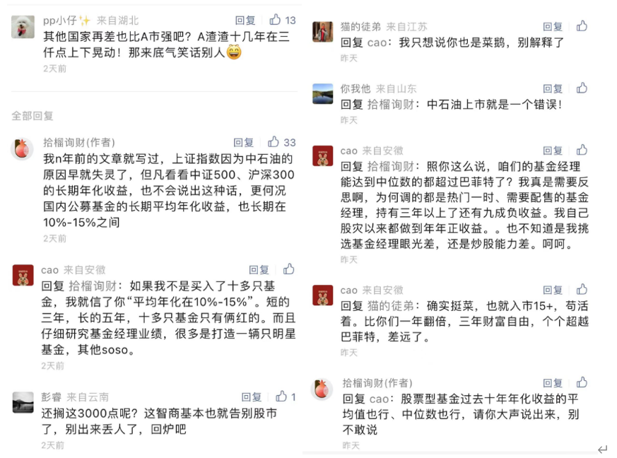
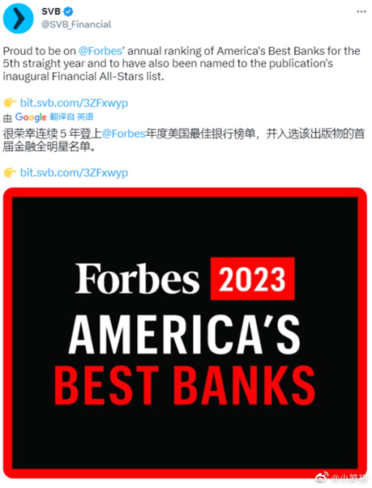
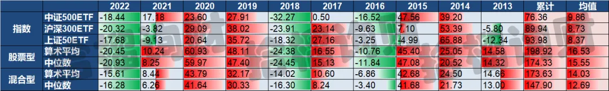
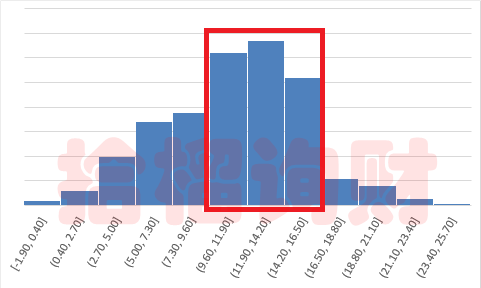
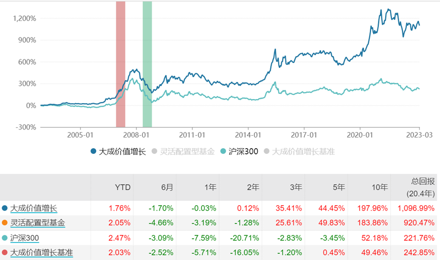
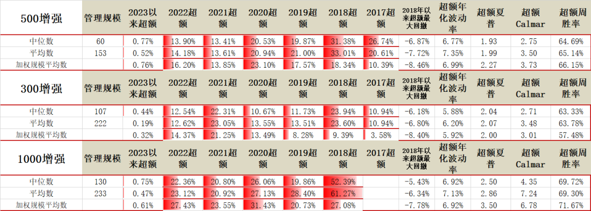

前天，老南写美国硅谷银行挤兑的文章，顺便提了句美股还没跌透，结果莫名其妙的被要求反思，还有自称15年的老股民来说教。

**干脆就用数据来打脸下吧，给你们算算，A股到底拉不拉垮，公募基金的长期平均年化收益，到底有没有10%-15%**

  

**01**

开篇照例说故事。  

这次硅谷银行之后，有两件事特别有意思。

一是这次硅谷银行事发，其实要追溯到2018年。

那年，川建国同志大手一挥，把08 年次贷危机后，实施的多德-弗兰克金融监管方案，取消了部分条款。

降低了部分银行，必须接受美联储压力测试的频率，减少了对银行的监管。

而硅谷银行首席执行官格雷格贝克尔，是取消这个条款的坚定支持者。

然后，好巧不巧，硅谷银行这次就死在了自己给自己挖的坑里。

说到这里，还记得上一个在公开场合，批判“巴塞尔协议无效且有害”的互联网大佬不？亏好国内监管不理这一套。

二是据传这次硅谷银行被挤兑，源于投行高盛想赚佣金，建议公开卖股票融资。

而融资路演，必须要对外披露财务数据，结果被发现客户在大规模取钱，存款快速流失。如果不是路演披露，这事还隐藏得很好，还不至于被挤兑。

毕竟5天前，硅谷银行还被福布斯评为年度美国最佳银行。

**所以啊，金融行业，严监管是必须的，人性是经不起高额利润的考验的。**

**而公募基金，作为国内严监管下的产物，本身就具备非常好的投资价值。**

  

  

**02**

  

回到股市，巴菲特作为顶尖的投资大家，其很多语录流传甚远，国内也粉丝众多。包括多次为标普500带货，被很多人直接照搬到国内。

**但是，很多人忽略了一点，巴菲特的绝大部分投资头寸，是在美股，他的很多方法论，在美股市场的确是有效的，但并不意味在全球市场都有效的。**

以国内为例，老南今天顺手做了个数据，把过去10年，国内的3个主流ETF——上证50、沪深300、中证500，过去十年的业绩做了个统计，年化收益率在8.37%到9.86%之间。

然后，把国内股票型基金、混合型基金，过去10年的算术平均、中位数，分别做了统计。

肉眼可见，国内主动型基金的长期均值，相对指数有非常显著的超额，年化收益，在12.69%—16.53%之间。

**这些数据完全符合老南常说的，国内主动型公募，长期平均年化收益在10%-15%之间。**

**这些客观数据，充分说明A股市场的长期回报率并不差，甚至可以说很优秀。**

  

**03**

  

当然，为防止还有人抬杠，老南也顺手把成立10年以上的混合型基金，过去10年的年化收益率区间统计了下，做了个直方图：

数据来源：wind 拾榴询财

**清晰可见，大部分的基金收益，是落在10%-15%这个收益区间。**

老南特地看了下，排名位于中间的基金，叫“大成价值增长”，这是只完全没有存在感的非网红基金，规模也就12亿多。

**但10年业绩，涨了近2倍，年化11.54%，远远领先沪深300。（反复强调，并非基金推荐，只是举例）**

**这只是排名中间的一只普通公募基金而已。**

**至于私募量化指数增强的平均超额业绩，感受下吧：**

数据来源：中信证券

**这也是为何，老南在给客人配置时，早就放弃了这些指数基金，因为业绩被主动管理的公募和私募（包括量化）碾压，回撤还一点都不小。**  

  

**结**

  

**所以，理财本质上就是算账，就是简单的数学，并简单的归纳，选择胜率、赢率最大的策略。**

**在如此优秀的平均业绩前，如果我们的投资收益并不好，是应该骂A股呢？还是应该骂基金经理呢？还是应该反思自己呢？**

**其实，大部分人只想追逐前10%业绩的产品，最终50%的业绩都跑不赢。**

**而老老实实努力争取50%平均业绩的，才持久，说不定还有惊喜。**